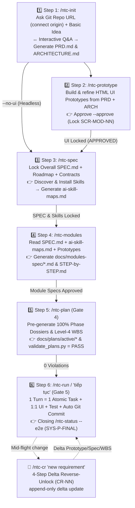

# NTC Micro-Harness: Atomic Engineering Protocol & `/ntc-*` Plugin (v2.1)

<p align="center">
  <strong>🌐 Language / Ngôn ngữ:</strong>
  <strong>🇺🇸 English (Current)</strong> |
  <a href="README.vi.md">🇻🇳 Tiếng Việt</a>
</p>

[](https://github.com/chien5572/ntc-micro-harness/actions)
[](LICENSE)
[](plugin.json)
[](AGENTS.md)

**NTC Micro-Harness v2.1 (Plugin Edition)** is a zero-drift, token-optimized **Atomic Engineering Harness & Slash-Command Plugin (`/ntc-*`)** designed for pair-programming and multi-agent orchestration with modern AI coding assistants (**Google Antigravity**, **Anthropic Claude Code**, **Cursor**, **Windsurf**, and **Roo Code / Cline**).

Instead of forcing you to write massive specifications from scratch or letting AI agents jump prematurely into writing fragmented code, **NTC Micro-Harness v2.1** guides the entire software lifecycle through **6 progressive steps powered by `/ntc-*` slash commands**:
1. **Step 1 (`/ntc-init`) — Git Remote Connection & Interactive Q&A → `PRD.md` + `ARCHITECTURE.md`:** Asks for your **Project Git Repository URL** right up front (to initialize `git init` and connect `git remote add origin <url>` before doing anything else — can be left blank for local-only) along with your basic requirements. The agent asks 3–5 clarifying questions and generates [`PRD.md`](docs/templates/prd-template.md) and [`ARCHITECTURE.md`](docs/templates/architecture-template.md).
2. **Step 2 (`/ntc-prototype`) — Interactive UI Prototyping from `PRD` + `ARCHITECTURE` (if UI):** Generates self-contained clickable HTML/CSS prototypes (`docs/prototypes/<slug>/scr-<nn>-*.html`) covering `default`, `loading`, `empty`, and `error` states with `data-testid` hooks. Iterate (`--revise`) until satisfied and lock (`--approve` → `APPROVED`).
3. **Step 3 (`/ntc-spec`) — Overall `SPEC.md`, Roadmap, Contracts & AI Skill Mapping (`ai-skill-maps.md`):** Synthesizes the approved `PRD.md`, `ARCHITECTURE.md`, and UI prototypes into the supreme [`SPEC.md`](docs/templates/spec-template.md) (plus `system-roadmap.md` and `contract-registry.md`). Once locked, proposes and installs corresponding **AI Skills** for each module/service into `.agents/skills/` and generates the skill usage guide [`ai-skill-maps.md`](docs/templates/ai-skill-maps-template.md).
4. **Step 4 (`/ntc-modules`) — Skill-Guided Detailed Module Specifications & `STEP-by-STEP.md`:** Reads `SPEC.md`, the module's mapped skills in `ai-skill-maps.md`, and approved prototypes to generate detailed specifications [`docs/modules-spec/<slug>.md`](docs/templates/module-spec-template.md) for every module/service. Upon approval (`--approve`), automatically generates the Human-Only Playbook [`STEP-by-STEP.md`](docs/templates/step-by-step-template.md).
5. **Step 5 (`/ntc-plan`) — Project-Wide Phase Dossiers & Level-4 WBS Pre-Generation (Gate 4):** Pre-generates 100% of Phase Dossiers (`docs/plans/active/<slug>/phase-<NN>-*.md`) with Level-4 Atomic Tasks across all modules before a single line of production code is written.
6. **Step 6 (`/ntc-run` / `"tiếp tục"`) — Atomic Execution, Auto Git Commit, `/ntc-cr` & Closing `SYS` E2E (Gate 5):** Executes strictly **1 Turn = 1 Atomic Task** with 1:1 UI Prototype parity, executable verification proof, **End-of-Turn Atomic Git Commit checkpointing (`HEAD`)**, 3-Step Crash Recovery, mid-flight Change Requests via **`/ntc-cr`** (`CR-<NN>`), and Closing Full-Stack E2E verification (**`/ntc-status --e2e`**).

---

## 1. `/ntc-*` Plugin Slash Commands Reference

| Step | Slash Command | Supported Flags / Arguments | When to Use | What the Agent Does |
| :--- | :--- | :--- | :--- | :--- |
| **Step 1** | **`/ntc-init`** | `--repo <git-url>` *(optional)*<br>`--idea "<summary>"`<br>`--no-ui`<br>`--approve` | At the start of a new project or when adopting the Harness in an existing repo. | 1. **Asks for Project Git Repo URL first** (can be left blank) → runs `git init` & connects `git remote add origin <url>` before anything else.<br>2. Asks 3–5 clarifying questions on your basic requirements.<br>3. Generates [`PRD.md`](docs/templates/prd-template.md) and [`ARCHITECTURE.md`](docs/templates/architecture-template.md) for your approval. |
| **Step 2** | **`/ntc-prototype`** | `--screen <SCR-ID>`<br>`--revise "<feedback>"`<br>`--approve` | Immediately after `PRD.md` & `ARCHITECTURE.md` are ready (when `UI Required: YES`). | 1. Locks Design System Tokens in [`docs/prototypes/registry.md`](docs/prototypes/registry.md) and creates interactive HTML/CSS prototypes (`docs/prototypes/<slug>/scr-<nn>-*.html`) with 4 visual states & `data-testid` anchors.<br>2. Refines screens via `--revise`.<br>3. Locks all screens as `APPROVED` via `--approve`. |
| **Step 3** | **`/ntc-spec`** | `--skills-from "<url>"`<br>`--approve` | Once UI prototypes are `APPROVED` (or right after Step 1 if `--no-ui`). | 1. Synthesizes overall [`SPEC.md`](docs/templates/spec-template.md), [`docs/plans/system-roadmap.md`](docs/plans/system-roadmap.md), and [`docs/plans/contract-registry.md`](docs/plans/contract-registry.md) for your review.<br>2. Based on `SPEC.md`, proposes AI Skills for each module/service.<br>3. On `--approve`: installs skills into `.agents/skills/` and generates [`ai-skill-maps.md`](docs/templates/ai-skill-maps-template.md). |
| **Step 4** | **`/ntc-modules`** | `--module <MOD>`<br>`--approve` | Once overall `SPEC.md` and `ai-skill-maps.md` are locked. | 1. Reads each module's mapped skills in `ai-skill-maps.md` + `SPEC.md` + approved UI prototypes.<br>2. Generates detailed [`docs/modules-spec/<slug>.md`](docs/templates/module-spec-template.md) for every module/service.<br>3. On `--approve`: generates the Human Playbook [`STEP-by-STEP.md`](docs/templates/step-by-step-template.md). |
| **Step 5** | **`/ntc-plan`** | `--module <MOD>`<br>`--verify` | Once all `docs/modules-spec/*.md` files are approved (Gate 4). | 1. Pre-generates 100% of Phase Dossiers (`docs/plans/active/<slug>/phase-<NN>-*.md`) across all modules.<br>2. Decomposes work into Level-4 Atomic Tasks (`<MOD>-P<NN>.<M>.<A>`) and verifies `python scripts/validate_plans.py --fix` passes with `0 violations`. |
| **Step 6** | **`/ntc-run`** *(or `"tiếp tục"`)* | `--module <MOD>`<br>`--phase <MOD>-P<NN>` | Throughout Gate 5 implementation until project completion. | 1. Runs 3-Step Crash Recovery against `HEAD`.<br>2. Executes **strictly 1 Atomic Task** (`1 Turn = 1 Task`) with 1:1 UI Prototype parity (`SCR-<MOD>-<NN>`).<br>3. Runs tests → checks `[x]` → updates `🎫 Resume Ticket` → runs `validate_plans.py --fix` → **creates an Atomic Git Commit checkpoint**. |
| **Delta CR** | **`/ntc-cr`** | `"<change description>"`<br>`--approve-delta` | Anytime in Step 5/6 when adding features, modifying APIs (`CT-*`), or adding/changing UI screens (`SCR-*`). | Executes the **4-Step Delta Reverse-Unlock Protocol (`CR-<NN>`)** without touching completed `[x]` history: logs `CR-<NN>`, updates delta prototypes/contracts first, amends specs, and appends delta tasks/phase dossiers. |
| **Verify & E2E** | **`/ntc-status`** | `--fix`<br>`--e2e` | Anytime to validate plans, view progress, or run the closing `SYS-P<FINAL>` phase. | - Default / `--fix`: Runs `python scripts/validate_plans.py --fix` and prints the module/phase progress matrix.<br>- `--e2e`: Triggers the closing `SYS-P<FINAL>` Cross-Module Integration & Full-Stack E2E verification phase. |

---

## 2. 6-Step Plugin Workflow Diagram



---

## 3. One-Line Installation (Workspace & Global Plugin)

Open a terminal inside your target project directory and run the one-liner for your OS:

### Windows PowerShell / PowerShell Core
```powershell
irm https://raw.githubusercontent.com/chien5572/ntc-micro-harness/main/install.ps1 | iex
```
*(Or from a local clone with Git remote connection and Global Plugin installation)*:
```powershell
powershell -ExecutionPolicy Bypass -File .\install.ps1 -TargetPath "D:\my-project" -RepoUrl "https://github.com/org/my-project.git" -InstallPlugin
```

### Linux / macOS / WSL / Git Bash
```bash
curl -fsSL https://raw.githubusercontent.com/chien5572/ntc-micro-harness/main/install.sh | bash
```

### Cross-Platform Python Installer
```bash
# Remote 1-liner:
python -c "import urllib.request as u; exec(u.urlopen('https://raw.githubusercontent.com/chien5572/ntc-micro-harness/main/install.py').read().decode('utf-8'))"

# Local installer with Git remote connection + Global Antigravity Plugin (~/.gemini/config/plugins/ntc-micro-harness):
python install.py --target . --repo https://github.com/org/my-project.git --plugin
```

---

## 4. Validation & Auto-Synchronization

Run the structural validator at any time (or via `/ntc-status --fix`):

```bash
# Validate structure, IDs, contracts, UI prototypes, specs, and dossiers
python scripts/validate_plans.py

# Automatically synchronize Module Phase Sequence tables and Active Work Pointer from disk
python scripts/validate_plans.py --fix
```

---

## License

Released under the **MIT License**. See [`LICENSE`](LICENSE) for details.
