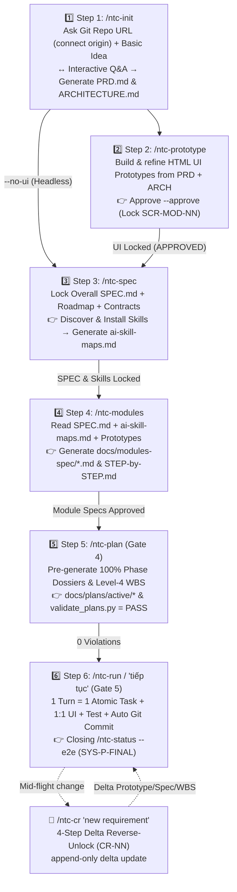

# NTC Micro-Harness: Atomic Engineering Protocol & `/ntc-*` Plugin (v2.1)

<p align="center">
  <strong>🌐 Language / Ngôn ngữ:</strong>
  <strong>🇺🇸 English (Current)</strong> |
  <a href="README.vi.md">🇻🇳 Tiếng Việt</a>
</p>

[](https://github.com/chien5572/ntc-micro-harness/actions)
[](LICENSE)
[](plugin.json)
[-4285F4.svg)](plugin.json)
[](AGENTS.md)

**NTC Micro-Harness v2.1 (Plugin Edition)** is a zero-drift, token-optimized **Atomic Engineering Harness & Slash-Command Plugin (`/ntc-*`)** purpose-built for the **Google Antigravity ecosystem** (**Antigravity 2.0 Desktop App**, **Antigravity IDE**, and **Antigravity CLI `agy`**), as well as **Claude Code**, **Cursor**, and **Windsurf**.

Instead of forcing you to write massive specifications from scratch or letting AI agents jump prematurely into writing fragmented code and improvised UIs, **NTC Micro-Harness v2.1** guides the entire software lifecycle through **6 progressive steps powered by `/ntc-*` slash commands**:
1. **Step 1 (`/ntc-init`) — Git Remote Connection & Interactive Q&A → `PRD.md` + `ARCHITECTURE.md`:** Asks for your **Project Git Repository URL** right up front (to initialize `git init` and connect `git remote add origin <url>` before doing anything else — can be left blank for local-only) along with your basic requirements. The agent asks 3–5 clarifying questions and generates [`PRD.md`](docs/templates/prd-template.md) and [`ARCHITECTURE.md`](docs/templates/architecture-template.md).
2. **Step 2 (`/ntc-prototype`) — Interactive UI Prototyping from `PRD` + `ARCHITECTURE` (if UI):** Generates self-contained clickable HTML/CSS prototypes (`docs/prototypes/<slug>/scr-<nn>-*.html`) covering `default`, `loading`, `empty`, and `error` states with `data-testid` hooks. Iterate (`--revise`) until satisfied and lock (`--approve` → `APPROVED`).
3. **Step 3 (`/ntc-spec`) — Overall `SPEC.md`, Roadmap, Contracts & AI Skill Mapping (`ai-skill-maps.md`):** Synthesizes the approved `PRD.md`, `ARCHITECTURE.md`, and UI prototypes into the supreme [`SPEC.md`](docs/templates/spec-template.md) (plus `system-roadmap.md` and `contract-registry.md`). Once locked, proposes and installs corresponding **AI Skills** for each module/service into `.agents/skills/` and generates the skill usage guide [`ai-skill-maps.md`](docs/templates/ai-skill-maps-template.md).
4. **Step 4 (`/ntc-modules`) — Skill-Guided Detailed Module Specifications & `STEP-by-STEP.md`:** Reads `SPEC.md`, the module's mapped skills in `ai-skill-maps.md`, and approved prototypes to generate detailed specifications [`docs/modules-spec/<slug>.md`](docs/templates/module-spec-template.md) for every module/service. Upon approval (`--approve`), automatically generates the Human-Only Playbook [`STEP-by-STEP.md`](docs/templates/step-by-step-template.md).
5. **Step 5 (`/ntc-plan`) — Project-Wide Phase Dossiers & Level-4 WBS Pre-Generation (Gate 4):** Pre-generates 100% of Phase Dossiers (`docs/plans/active/<slug>/phase-<NN>-*.md`) with Level-4 Atomic Tasks across all modules before a single line of production code is written.
6. **Step 6 (`/ntc-run` / `"tiếp tục"`) — Atomic Execution, Auto Git Commit, `/ntc-cr` & Closing `SYS` E2E (Gate 5):** Executes strictly **1 Turn = 1 Atomic Task** with 1:1 UI Prototype parity, executable verification proof, **End-of-Turn Atomic Git Commit checkpointing (`HEAD`)**, 3-Step Crash Recovery, mid-flight Change Requests via **`/ntc-cr`** (`CR-<NN>`), and Closing Full-Stack E2E verification (**`/ntc-status --e2e`**).

---

## Table of Contents

1. [Installing the Plugin for Google Antigravity (2.0, IDE & CLI `agy`)](#1-installing-the-plugin-for-google-antigravity-20-ide--cli-agy)
   - [1.1 Install via Antigravity CLI (`agy`)](#11-install-via-antigravity-cli-agy)
   - [1.2 One-Line Global Plugin Install for Antigravity 2.0, IDE & CLI](#12-one-line-global-plugin-install-for-antigravity-20-ide--cli)
   - [1.3 Combined Project Workspace + Global Plugin Installer (1-Liner)](#13-combined-project-workspace--global-plugin-installer-1-liner)
   - [1.4 How to Activate & Use in Antigravity 2.0, IDE, and CLI](#14-how-to-activate--use-in-antigravity-20-ide-and-cli)
2. [`/ntc-*` Plugin Slash Commands Reference](#2-ntc--plugin-slash-commands-reference)
3. [6-Step Plugin Workflow Diagram](#3-6-step-plugin-workflow-diagram)
4. [Step-by-Step Usage Walkthrough (`/ntc-init` → `/ntc-run`)](#4-step-by-step-usage-walkthrough-ntc-init--ntc-run)
5. [5-Layer UI Prototype Parity Lock](#5-5-layer-ui-prototype-parity-lock)
6. [Mid-Flight Change Requests (`/ntc-cr`), Auto Git Commit & Crash Recovery](#6-mid-flight-change-requests-ntc-cr-auto-git-commit--crash-recovery)
7. [Closing `SYS` Cross-Module Integration & Full-Stack E2E (`/ntc-status --e2e`)](#7-closing-sys-cross-module-integration--full-stack-e2e-ntc-status---e2e)
8. [Repository Layout & Identifier Conventions](#8-repository-layout--identifier-conventions)

---

## 1. Installing the Plugin for Google Antigravity (2.0, IDE & CLI `agy`)

**Google Antigravity 2.0 (Desktop App)**, **Antigravity IDE**, and **Antigravity CLI (`agy`)** all share the global plugin discovery directory `~/.gemini/config/plugins/ntc-micro-harness` as well as workspace-scoped `.agents/` customizations. Installing once makes all `/ntc-*` slash commands available across all three surfaces.

### 1.1 Install via Antigravity CLI (`agy`)

If you have the **Antigravity CLI (`agy`)** installed, run:

```bash
# Install the plugin directly from GitHub
agy plugin install https://github.com/chien5572/ntc-micro-harness.git

# Ensure the plugin is enabled
agy plugin enable ntc-micro-harness
```

---

### 1.2 One-Line Global Plugin Install for Antigravity 2.0, IDE & CLI

You can install the `ntc-micro-harness` bundle directly into Antigravity's global plugin directory (`~/.gemini/config/plugins/ntc-micro-harness`) via `git clone` or our `--plugin-only` one-liner:

#### 🪟 Windows (PowerShell / CMD)
```powershell
# Option A: Direct Git Clone into Antigravity's Global Plugins folder
git clone https://github.com/chien5572/ntc-micro-harness.git "$HOME\.gemini\config\plugins\ntc-micro-harness"

# Option B: PowerShell 1-Liner (Global Plugin Only)
powershell -NoProfile -ExecutionPolicy Bypass -Command "& ([scriptblock]::Create((irm https://raw.githubusercontent.com/chien5572/ntc-micro-harness/main/install.ps1))) -PluginOnly"
```

#### 🍎 macOS / 🐧 Linux / WSL / Git Bash
```bash
# Option A: Direct Git Clone into Antigravity's Global Plugins folder
git clone https://github.com/chien5572/ntc-micro-harness.git ~/.gemini/config/plugins/ntc-micro-harness

# Option B: Bash 1-Liner (Global Plugin Only)
curl -fsSL https://raw.githubusercontent.com/chien5572/ntc-micro-harness/main/install.sh | bash -s -- --plugin-only
```

> **Note:** After installing a new global plugin directory for the first time, **restart** Antigravity 2.0 / Antigravity IDE / `agy` so the language server discovers [`plugin.json`](plugin.json).

---

### 1.3 Combined Project Workspace + Global Plugin Installer (1-Liner)

Open a terminal inside your target project directory (`cd /path/to/your-project`) and run the one-liner for your OS. This installs **both** the **Global Antigravity Plugin** (`~/.gemini/config/plugins/ntc-micro-harness`) **and** the project workspace files (`AGENTS.md`, `docs/`, `scripts/validate_plans.py`, `.agents/skills/ntc-*/`):

#### 🪟 Windows PowerShell / PowerShell Core
```powershell
irm https://raw.githubusercontent.com/chien5572/ntc-micro-harness/main/install.ps1 | iex
```
*(Or pass your project's Git remote repository URL upfront)*:
```powershell
powershell -ExecutionPolicy Bypass -File .\install.ps1 -TargetPath "." -RepoUrl "https://github.com/org/my-project.git"
```

#### 🪟 Windows Command Prompt (CMD)
```cmd
powershell -NoProfile -ExecutionPolicy Bypass -Command "irm https://raw.githubusercontent.com/chien5572/ntc-micro-harness/main/install.ps1 | iex"
```

#### 🍎 macOS / 🐧 Linux / WSL / Git Bash
```bash
curl -fsSL https://raw.githubusercontent.com/chien5572/ntc-micro-harness/main/install.sh | bash
```

#### 🐍 Cross-Platform Python Installer (Windows / macOS / Linux)
```bash
# Remote 1-liner:
python -c "import urllib.request as u; exec(u.urlopen('https://raw.githubusercontent.com/chien5572/ntc-micro-harness/main/install.py').read().decode('utf-8'))"

# Or from a local clone with Git remote connection:
python install.py --target . --repo https://github.com/org/my-project.git
```

---

### 1.4 How to Activate & Use in Antigravity 2.0, IDE, and CLI

| Antigravity Surface | How to View & Manage the Plugin | How to Invoke `/ntc-*` Commands |
| :--- | :--- | :--- |
| **1. Antigravity 2.0 (Desktop App)** | In the **Left-hand Sidebar**, click **Skills & Customizations** → **Plugins** to view the **NTC Micro-Harness (Atomic Engineering v2.1)** card and its 3 starter prompts (`suggestedPrompts`). Toggle it on/off live without restarting. | In the **Chat Canvas**, type `/` to open the slash command menu and select `/ntc-init`, `/ntc-prototype`, `/ntc-spec`, `/ntc-modules`, `/ntc-plan`, `/ntc-run`, `/ntc-cr`, or `/ntc-status`. |
| **2. Antigravity IDE** | Automatically loads both the Global Plugin (`~/.gemini/config/plugins/ntc-micro-harness`) and Workspace Customizations (`.agents/skills/ntc-*/`). | Open the **Sidebar Chat** (**Agent Mode**) and type `/ntc-init` or `/ntc-run` (or `"tiếp tục"` / `"continue"`). |
| **3. Antigravity CLI (`agy`)** | Launch `agy` in your project terminal. Run `/help` inside the TUI to verify loaded slash commands. | Type `/ntc-init`, `/ntc-prototype`, `/ntc-spec`, `/ntc-modules`, `/ntc-plan`, `/ntc-run`, `/ntc-cr`, or `/ntc-status` directly in the `agy` prompt. |

---

## 2. `/ntc-*` Plugin Slash Commands Reference

| Step | Slash Command | Supported Flags / Arguments | When to Use | What the Agent Does |
| :--- | :--- | :--- | :--- | :--- |
| **Step 1** | **`/ntc-init`** | `--repo <git-url>` *(optional)*<br>`--idea "<summary>"`<br>`--no-ui`<br>`--approve` | At the start of a new project or when adopting the Harness in an existing repo. | 1. **Asks for Project Git Repo URL first** (can be left blank) → runs `git init` & connects `git remote add origin <url>` before anything else.<br>2. Asks 3–5 clarifying questions on your basic requirements.<br>3. Generates [`PRD.md`](docs/templates/prd-template.md) and [`ARCHITECTURE.md`](docs/templates/architecture-template.md) for your approval. |
| **Step 2** | **`/ntc-prototype`** | `--screen <SCR-ID>`<br>`--revise "<feedback>"`<br>`--approve` | Immediately after `PRD.md` & `ARCHITECTURE.md` are ready (when `UI Required: YES`). | 1. Locks Design System Tokens in [`docs/prototypes/registry.md`](docs/prototypes/registry.md) and creates interactive HTML/CSS prototypes (`docs/prototypes/<slug>/scr-<nn>-*.html`) with 4 visual states & `data-testid` anchors.<br>2. Refines screens via `--revise`.<br>3. Locks all screens as `APPROVED` via `--approve`. |
| **Step 3** | **`/ntc-spec`** | `--skills-from "<url>"`<br>`--approve` | Once UI prototypes are `APPROVED` (or right after Step 1 if `--no-ui`). | 1. Synthesizes overall [`SPEC.md`](docs/templates/spec-template.md), [`docs/plans/system-roadmap.md`](docs/plans/system-roadmap.md), and [`docs/plans/contract-registry.md`](docs/plans/contract-registry.md) for your review.<br>2. Based on `SPEC.md`, proposes AI Skills for each module/service.<br>3. On `--approve`: installs skills into `.agents/skills/` and generates [`ai-skill-maps.md`](docs/templates/ai-skill-maps-template.md). |
| **Step 4** | **`/ntc-modules`** | `--module <MOD>`<br>`--approve` | Once overall `SPEC.md` and `ai-skill-maps.md` are locked. | 1. Reads each module's mapped skills in `ai-skill-maps.md` + `SPEC.md` + approved UI prototypes.<br>2. Generates detailed [`docs/modules-spec/<slug>.md`](docs/templates/module-spec-template.md) for every module/service.<br>3. On `--approve`: generates the Human Playbook [`STEP-by-STEP.md`](docs/templates/step-by-step-template.md). |
| **Step 5** | **`/ntc-plan`** | `--module <MOD>`<br>`--verify` | Once all `docs/modules-spec/*.md` files are approved (Gate 4). | 1. Pre-generates 100% of Phase Dossiers (`docs/plans/active/<slug>/phase-<NN>-*.md`) across all modules.<br>2. Decomposes work into Level-4 Atomic Tasks (`<MOD>-P<NN>.<M>.<A>`) and verifies `python scripts/validate_plans.py --fix` passes with `0 violations`. |
| **Step 6** | **`/ntc-run`** *(or `"tiếp tục"`)* | `--module <MOD>`<br>`--phase <MOD>-P<NN>` | Throughout Gate 5 implementation until project completion. | 1. Runs 3-Step Crash Recovery against `HEAD`.<br>2. Executes **strictly 1 Atomic Task** (`1 Turn = 1 Task`) with 1:1 UI Prototype parity (`SCR-<MOD>-<NN>`).<br>3. Runs tests → checks `[x]` → updates `🎫 Resume Ticket` → runs `validate_plans.py --fix` → **creates an Atomic Git Commit checkpoint**. |
| **Delta CR** | **`/ntc-cr`** | `"<change description>"`<br>`--approve-delta` | Anytime in Step 5/6 when adding features, modifying APIs (`CT-*`), or adding/changing UI screens (`SCR-*`). | Executes the **4-Step Delta Reverse-Unlock Protocol (`CR-<NN>`)** without touching completed `[x]` history: logs `CR-<NN>`, updates delta prototypes/contracts first, amends specs, and appends delta tasks/phase dossiers. |
| **Verify & E2E** | **`/ntc-status`** | `--fix`<br>`--e2e` | Anytime to validate plans, view progress, or run the closing `SYS-P<FINAL>` phase. | - Default / `--fix`: Runs `python scripts/validate_plans.py --fix` and prints the module/phase progress matrix.<br>- `--e2e`: Triggers the closing `SYS-P<FINAL>` Cross-Module Integration & Full-Stack E2E verification phase. |

---

## 3. 6-Step Plugin Workflow Diagram



---

## 4. Step-by-Step Usage Walkthrough (`/ntc-init` → `/ntc-run`)

### Step 1: Connect Git Remote & Generate `PRD.md` + `ARCHITECTURE.md` (`/ntc-init`)
```text
/ntc-init
```
*(Or with arguments: `/ntc-init --repo https://github.com/org/order-platform.git --idea "Multi-tenant B2B order management system with web dashboard"`)*
1. The Agent asks for your **Project Git Repository URL** (can be left blank for local-only) and your basic requirements first, initializes `git init`, and connects `git remote add origin <repo-url>` before doing anything else.
2. The Agent asks **3–5 targeted clarifying questions** (roles/RBAC, core workflows, tech stack, database, UI requirements).
3. From your answers, the Agent generates **`PRD.md`** and **`ARCHITECTURE.md`** for your review.

### Step 2: Interactive UI Prototyping (`/ntc-prototype`)
*(Skipped automatically if `--no-ui` or `UI Required: NO`)*
```text
/ntc-prototype
/ntc-prototype --screen SCR-WEB-01 --revise "Add date range filter and dark sidebar"
/ntc-prototype --approve
```
Generates clickable HTML/CSS prototypes in `docs/prototypes/<slug>/scr-<nn>-*.html` covering `default`, `loading`, `empty`, and `error` states with `data-testid="scr-<nn>-..."` attributes until locked (`APPROVED`).

### Step 3: Overall `SPEC.md` & Module AI Skill Mapping (`/ntc-spec`)
```text
/ntc-spec
/ntc-spec --approve
```
Synthesizes `PRD.md`, `ARCHITECTURE.md`, and approved UI prototypes into `SPEC.md`, `docs/plans/system-roadmap.md`, and `docs/plans/contract-registry.md`. Then proposes and installs specialized AI skills per module into `.agents/skills/` and generates **`ai-skill-maps.md`**.

### Step 4: Detailed Module Specifications & Human Playbook (`/ntc-modules`)
```text
/ntc-modules
/ntc-modules --approve
```
Reads `SPEC.md`, each module's installed skills in `ai-skill-maps.md`, and approved UI prototypes to author `docs/modules-spec/<slug>.md` for every module, then generates **`STEP-by-STEP.md`**.

### Step 5: Pre-Generate All Phase Dossiers & Level-4 WBS (`/ntc-plan`)
```text
/ntc-plan
```
Generates 100% of Phase Dossiers (`docs/plans/active/<slug>/phase-<NN>-*.md`) with Level-4 Atomic Tasks (`.1` Contract/Schema → `.2` Logic/UI with `SCR-<MOD>-<NN>` → `.3` Verification Test) and verifies `python scripts/validate_plans.py --fix` passes with `0 violations`.

### Step 6: Atomic Implementation & State Machine (`/ntc-run` / `"tiếp tục"`)
```text
/ntc-run
/ntc-run --phase AUTH-P02
```
Executes strictly **1 Atomic Task per turn**, enforces 1:1 UI Prototype parity, runs the executable test proof, updates the `🎫 Resume Ticket`, synchronizes via `validate_plans.py --fix`, and creates an **Atomic Git Commit checkpoint (`HEAD`)**.

---

## 5. 5-Layer UI Prototype Parity Lock

1. **Layer 1 — Design Token & Screen Registry (`docs/prototypes/registry.md`):** Locks color variables, typography, and `SCR-<MOD>-<NN>` screen inventory in Step 2.
2. **Layer 2 — Mandatory `data-testid` Anchors:** Every HTML prototype file (`docs/prototypes/<slug>/scr-<nn>-*.html`) includes explicit `data-testid="scr-<nn>-<element>"` hooks and 4 visual states (`default`, `loading`, `empty`, `error`).
3. **Layer 3 — Mechanical Validator (`scripts/validate_plans.py`):** Blocks Step 5/6 if any screen is still `DRAFT`, missing on disk, or missing `data-testid=` attributes.
4. **Layer 4 — `AGENTS.md` & `ui-prototype-fidelity` Skill:** Forces the agent to `read_file` the HTML prototype in the same turn and port its DOM, classes, and `data-testid` hooks 1:1.
5. **Layer 5 — Component Tests (Task `.3`) & Closing E2E (`SYS-P<FINAL>`):** Asserts `data-testid` elements across unit and Playwright/Cypress E2E tests.

---

## 6. Mid-Flight Change Requests (`/ntc-cr`), Auto Git Commit & Crash Recovery

- **Mid-Flight Change Requests (`/ntc-cr "<description>"`):** Runs the **4-Step Delta Reverse-Unlock Protocol (`CR-<NN>`)** — logs `CR-<NN>` in `system-roadmap.md`, updates only delta prototypes (`SCR-*`) and contracts (`CT-*`) for approval (`--approve-delta`), appends delta specs and tasks/dossiers without modifying completed `[x]` history, and commits the delta plan.
- **End-of-Turn Atomic Git Commit & 3-Step Crash Recovery:** Every verified `[x]` Atomic Task is immediately committed to `HEAD`. If a session crashes mid-turn, any uncommitted diff in `git status` / `git diff HEAD` belongs exclusively to the interrupted task and is automatically reconciled on the next `/ntc-run`.

---

## 7. Closing `SYS` Cross-Module Integration & Full-Stack E2E (`/ntc-status --e2e`)

Once all domain and UI modules complete their phases and are archived in `docs/plans/completed/`, run:
```text
/ntc-status --e2e
```
This activates the closing `SYS-P<FINAL>` phase to boot the live stack (DB + Backend Services + Gateway + Frontend), verify live cross-module contract (`CT-*`) calls without mocks, and execute Full-Stack E2E browser journeys against the locked `data-testid="scr-..."` anchors.

---

## 8. Repository Layout & Identifier Conventions

```text
your-project/
├── plugin.json                                     # Antigravity (2.0 / IDE / CLI) Plugin Manifest
├── PRD.md                                          # [Step 1: /ntc-init] Product Requirements Document
├── ARCHITECTURE.md                                 # [Step 1: /ntc-init] System Architecture & Topology
├── SPEC.md                                         # [Step 3: /ntc-spec] Supreme System Specification
├── ai-skill-maps.md                                # [Step 3: /ntc-spec] AI Skill Playbook per Module
├── STEP-by-STEP.md                                 # [Step 4: /ntc-modules] Human-Only Playbook (Agents DO NOT read)
├── AGENTS.md                                       # Mandatory 6-Step Agent Operating Contract
├── rules/AGENTS.md                                 # Plugin rule active when plugin is enabled
├── skills/                                         # 8 Plugin Slash Command Skills (/ntc-init .. /ntc-status)
├── .agents/skills/                                 # Workspace-installed AI skills
├── docs/
│   ├── WORKFLOW.md                                 # Detailed 6-step protocol documentation
│   ├── prototypes/                                 # [Step 2: /ntc-prototype]
│   │   ├── registry.md                             # UI Prototype & Design Tokens Registry (SCR-<MOD>-<NN>)
│   │   └── <module-slug>/scr-<nn>-<slug>.html      # Interactive HTML/CSS prototypes with data-testid hooks
│   ├── modules-spec/                               # [Step 4: /ntc-modules]
│   │   ├── system.md                               # Reserved SYS module spec (Opening Infra & Closing E2E)
│   │   └── <module-slug>.md                        # Detailed Module Spec + Module Phase Sequence (<MOD>-P<NN>)
│   ├── plans/
│   │   ├── system-roadmap.md                       # Project Roadmap, Active Work Pointer & CR-<NN> Log
│   │   ├── contract-registry.md                    # Cross-Module Contract Registry (CT-<PROVIDER>-<NN>)
│   │   ├── active/<module-slug>/phase-<NN>-*.md    # [Step 5: /ntc-plan] Pre-generated Phase Dossiers + 🎫 Resume Ticket
│   │   └── completed/<module-slug>/phase-<NN>-*.md # [Step 6: /ntc-run] Verified, archived Phase Dossiers
│   └── templates/                                  # Document templates (PRD, ARCH, SPEC, Prototype, Module, WBS)
└── scripts/
    └── validate_plans.py                           # Cross-platform validator & auto-synchronizer (--fix)
```

---

## License

Released under the **MIT License**. See [`LICENSE`](LICENSE) for details.
