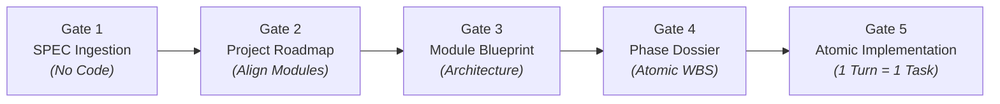

# NTC Micro Harness: Atomic Engineering Protocol (Microservices Edition)

[](https://github.com/chien5572/ntc-micro-harness/actions)
[](LICENSE)
[](AGENTS.md)
[](AGENTS.md)

**NTC Micro Harness** is a battle-tested, zero-drift, token-efficient engineering harness and behavioral governance protocol designed for pair-programming with autonomous AI coding agents (**Google Antigravity**, **Anthropic Claude Code**, **Cursor**, **Windsurf**, and **Roo Code/Cline**).

It forces AI agents to operate like disciplined Principal Software Architects: enforcing strict gated lifecycles, contract-first boundaries, atomic task execution, and automated micro-state checkpointing for seamless zero-context resumption across days or months.

---

## Table of Contents

1. [Why NTC Micro Harness?](#why-ntc-micro-harness)
2. [Core Architecture & Operating Invariants](#core-architecture--operating-invariants)
   - [Hierarchy of Truth](#hierarchy-of-truth)
   - [The 5-Stage Gated Lifecycle](#the-5-stage-gated-lifecycle)
   - [Strict Implementation Invariants](#strict-implementation-invariants)
   - [Micro-State Checkpointing & Resume Engine](#micro-state-checkpointing--resume-engine)
3. [Installation Guide](#installation-guide)
   - [Option 1: Quick Install via Python (Recommended)](#option-1-quick-install-via-python-recommended)
   - [Option 2: Windows PowerShell One-Liner](#option-2-windows-powershell-one-liner)
   - [Option 3: Linux / macOS Bash One-Liner](#option-3-linux--macos-bash-one-liner)
   - [Option 4: Manual Setup](#option-4-manual-setup)
   - [Configuring Your AI Assistant (Antigravity, Claude, Cursor, Windsurf)](#configuring-your-ai-assistant)
4. [Step-by-Step Usage Guide](#step-by-step-usage-guide)
   - [Step 1: Ingest Specification (Gate 1)](#step-1-ingest-specification-gate-1)
   - [Step 2: Align Project Roadmap (Gate 2)](#step-2-align-project-roadmap-gate-2)
   - [Step 3: Define Module Blueprint (Gate 3)](#step-3-define-module-blueprint-gate-3)
   - [Step 4: Instantiate Phase Dossier & Recursive Breakdown (Gate 4)](#step-4-instantiate-phase-dossier--recursive-breakdown-gate-4)
   - [Step 5: Execute Atomic Implementation Turns (Gate 5)](#step-5-execute-atomic-implementation-turns-gate-5)
   - [Step 6: Zero-Context Resumption (Hiatus Engine)](#step-6-zero-context-resumption-hiatus-engine)
   - [Step 7: Phase Verification & Archival](#step-7-phase-verification--archival)
5. [Automated Verification (`validate-plans.ps1`)](#automated-verification-validate-plansps1)
6. [Repository Structure & Templates](#repository-structure--templates)
7. [Contributing & License](#contributing--license)

---

## Why NTC Micro Harness?

Autonomous AI coding assistants are exceptionally capable, but in non-trivial codebases or multi-service architectures they suffer from four fundamental failure modes:

| Failure Mode | Symptom in Unharnessed AI | NTC Micro Harness Remedy |
| :--- | :--- | :--- |
| **Premature Coding** | Agent rushes to generate code before understanding boundaries, creating architectural debt. | **Gate 1 & Gate 2:** Writing production code is strictly forbidden until the Spec and Roadmap are approved. |
| **Context Bloat & Drift** | Agent reads hundreds of files, burns token budget, forgets earlier constraints, and drifts. | **Layered Planning:** Small, modular files (`system-roadmap.md` → `modules/<mod>.md` → `phase-*.md`) protect context limits. |
| **Multi-Task Sprawl** | Agent modifies 10 files in one turn, emitting incomplete stubs (`// TODO: implement later`) and breaking builds. | **Atomic Task Invariant:** 1 Turn = Exactly 1 Micro-Task. Contract-first, fully implemented, verified by tests. |
| **Hiatus Amnesia** | After days or weeks away, the developer must re-explain the entire context and history to the agent. | **`🎫 Resume Ticket`:** 3-line checkpoint capturing file, line, dirty state, test status, and next atomic action. |

---

## Core Architecture & Operating Invariants

```text
SPEC.md (Human Architect Intent)
 └─ docs/plans/system-roadmap.md (Global Phases, Module Registry, Dependency Graph)
     ├─ docs/plans/contract-registry.md (Cross-Module APIs, Events, Schemas)
     └─ docs/plans/modules/<module>.md (Module Blueprint: architecture, flows, phases)
         └─ docs/plans/active/<module>/phase-<NN>-<slug>.md (Module Phase Dossier + Resume Ticket)
             └─ Major Task  ──►  Atomic Task (Level 4 Micro-task)
                 (Verified) ──►  docs/plans/completed/<module>/phase-<NN>-<slug>.md
```

### Hierarchy of Truth

A lower document must never contradict a higher one. In case of ambiguity or conflict, the agent must **STOP and ask the Human Architect**:

1. `SPEC.md` — The supreme specification, functional boundaries, and architectural intent defined by the Human Architect.
2. `AGENTS.md` — The mandatory operating contract, behavioral boundaries, and execution rules.
3. `docs/plans/system-roadmap.md` — Project Roadmap: Module Registry, Global Phases, dependency graph, and Active Work Pointer.
4. `docs/plans/contract-registry.md` — Cross-Module Contract Registry: all shared APIs, events, and schemas with provider, consumers, and versioning.
5. `docs/plans/modules/<module>.md` — Module Blueprint: charter, diagrams, data ownership, flows, and module phase sequence.
6. `docs/plans/active/<module>/phase-<NN>-<slug>.md` — Active Module Phase Dossier: Major Tasks, Atomic Work Breakdown Structure (WBS), and real-time Resume Ticket.
7. `docs/plans/completed/<module>/phase-<NN>-<slug>.md` — Archived dossiers (immutable audit record).

---

### The 5-Stage Gated Lifecycle

The agent and developer advance strictly through five sequential gates:



1. **Gate 1 - Specification Ingestion:** Read `SPEC.md` and `AGENTS.md`. Analyze architecture, identify risks, propose candidate modules. **NO PRODUCTION CODE ALLOWED.**
2. **Gate 2 - Project Roadmap Alignment:** Collaboratively construct `system-roadmap.md` and `contract-registry.md`. Require human approval before proceeding.
3. **Gate 3 - Module Blueprint:** Instantiate `docs/plans/modules/<module>.md`. One module at a time. Define tech stack, internal diagrams, contracts, and module phase sequence.
4. **Gate 4 - Module Phase Dossier & Recursive Breakdown:** Instantiate `docs/plans/active/<module>/phase-<NN>-<slug>.md`. Break Major Tasks recursively into **Atomic Tasks (Level 4 Micro-tasks)**.
5. **Gate 5 - Atomic Implementation:** Only write code when the user explicitly instructs an Atomic Task ID (`<MOD>-P<NN>.<M>.<A>`).

---

### Strict Implementation Invariants

Every coding turn must honor these mechanical rules:

- **Single Atomic Task Turn (1 Turn = 1 Task):** In any single response, execute **ONLY ONE ATOMIC TASK**. Never implement multiple tasks, modules, or services at once.
- **Single-Module Scope:** An atomic task modifies only its declared module Code Root. Cross-module contract modifications require a dedicated task.
- **Contract-First Invariant:** Task 1 of any phase must define Types, Interfaces, Schemas, DTOs, or Protobufs before writing business logic.
- **Contract Change Control:** Cross-module APIs must be registered in `contract-registry.md` as `AVAILABLE` before consumers or providers write integration code.
- **Executable Proof:** Every task must be backed by real executable evidence: unit tests passing, typechecks succeeding, or diagnostic logs.
- **No-Stubbing Rule:** Never output incomplete stubs (`// TODO`, `// implement later`). Code must be fully implemented or bounded strictly to that atomic task.

---

### Micro-State Checkpointing & Resume Engine

Before yielding **any** turn, the AI agent updates the `🎫 Resume Ticket` at the top of the active Phase Dossier:

```markdown
## 🎫 Resume Ticket (Instant State Checkpoint)
- **Lifecycle Status:** `IN_PROGRESS`
- **Active Module & Phase:** `AUTH` / `AUTH-P01`
- **Active Major Task:** `AUTH-P01.2` - Token Generation & Validation
- **Active Atomic Task:** `AUTH-P01.2.3` - Implement Refresh Token Rotation
- **In-flight File & Location:** `services/auth/token_service.py:142`
- **Current Context / State:** Rotation logic implemented; test_token_rotation passing; pending Redis cache eviction integration.
- **Immediate Next Atomic Action:** Implement Redis blacklist lookup in `services/auth/token_store.py:65`.
```

#### Zero-Context Resumption:
When returning after a hiatus (days or months later), simply say:
> *"Continue"* or *"Where were we?"* or *"Tiếp tục"*

The agent reads the `Active Work Pointer` → inspects the `🎫 Resume Ticket` → reports state in 3 lines → immediately executes the **Immediate Next Atomic Action** without hallucination or regression.

---

## Installation Guide

You can install NTC Micro Harness into any existing or new software project in seconds.

### Option 1: Quick Install via Python (Recommended)

Works on Windows, macOS, and Linux without external dependencies:

```bash
# Clone the harness or download install.py
git clone https://github.com/chien5572/ntc-micro-harness.git /tmp/harness

# Install into your target project
python /tmp/harness/install.py --target /path/to/my-project --agent all
```

**Options:**
- `--target PATH` / `-t PATH`: Target project directory (defaults to current directory).
- `--agent [all|claude|cursor|windsurf|none]`: Configures agent rule files (`.cursorrules`, `CLAUDE.md`, `.windsurfrules`).
- `--force` / `-f`: Overwrites existing files if desired.

---

### Option 2: Windows PowerShell One-Liner

Run directly from within your target project directory:

```powershell
powershell -ExecutionPolicy Bypass -Command "Invoke-RestMethod -Uri https://raw.githubusercontent.com/chien5572/ntc-micro-harness/main/install.ps1 | Invoke-Expression"
```

Or clone and execute:
```powershell
git clone https://github.com/chien5572/ntc-micro-harness.git C:\Temp\harness
& C:\Temp\harness\install.ps1 -TargetPath "C:\Projects\MyAwesomeProject" -AgentRules all
```

---

### Option 3: Linux / macOS Bash One-Liner

Run directly from within your target project directory:

```bash
curl -fsSL https://raw.githubusercontent.com/chien5572/ntc-micro-harness/main/install.sh | bash
```

Or execute against a specified target:
```bash
git clone https://github.com/chien5572/ntc-micro-harness.git /tmp/harness
bash /tmp/harness/install.sh /path/to/my-project
```

---

### Option 4: Manual Setup

If you prefer setting up manually without running scripts:

1. Copy `AGENTS.md` to your repository root.
2. Copy the entire `docs/` folder to your repository root:
   - `docs/WORKFLOW.md`
   - `docs/patterns/encoding-invariants.md`
   - `docs/plans/system-roadmap.md`
   - `docs/plans/contract-registry.md`
   - `docs/templates/*`
3. Copy `scripts/validate-plans.ps1` to `scripts/validate-plans.ps1`.
4. (Optional) Create rules files (`.cursorrules`, `CLAUDE.md`, `.windsurfrules`) pointing to `AGENTS.md`.

---

### Configuring Your AI Assistant

| Tool | Configuration |
| :--- | :--- |
| **Google Antigravity** | Automatically reads `AGENTS.md` in repository root. Also supported in custom user rules. |
| **Claude Code** | Reads `CLAUDE.md` and `AGENTS.md` automatically in the project workspace. |
| **Cursor IDE** | Uses `.cursorrules` or `.cursor/rules/` configured by the installer. |
| **Windsurf IDE** | Uses `.windsurfrules` configured by the installer. |
| **Roo Code / Cline** | Uses `.clinerules` configured to refer to `AGENTS.md`. |

---

## Step-by-Step Usage Guide

### Step 1: Ingest Specification (Gate 1)

1. Create `SPEC.md` in your project root using `docs/templates/spec-template.md`. Detail product goals, functional scope, tech stack, and non-functional requirements.
2. Prompt your AI Agent:

```text
Read SPEC.md and AGENTS.md. Perform Gate 1 Specification Ingestion:
- Analyze architecture and technical risks.
- Propose candidate modules (services) with clear data ownership.
- Do NOT write any code at this stage.
```

---

### Step 2: Align Project Roadmap (Gate 2)

Collaboratively populate `docs/plans/system-roadmap.md` and `docs/plans/contract-registry.md`.

Prompt your AI Agent:

```text
Proceed to Gate 2 Project Roadmap Alignment.
Collaboratively fill docs/plans/system-roadmap.md with:
1. System Architecture Blueprint & Diagram
2. Module Registry (Code, Slug, Responsibility, Code Root, Status)
3. Global Phase Sequence (GP-01, GP-02...)
4. Module Dependency Graph
5. Register initial shared APIs in docs/plans/contract-registry.md
Do not write production code yet.
```

*Review and approve the roadmap before continuing.*

---

### Step 3: Define Module Blueprint (Gate 3)

When ready to plan a specific module (e.g. `AUTH`):

```text
Proceed to Gate 3 Module Blueprint for module 'AUTH' (slug: auth).
Instantiate docs/plans/modules/auth.md from docs/templates/module-roadmap-template.md:
- Define charter, tech stack, and data ownership.
- Document provided and consumed contracts.
- Define internal component diagrams and Module Phases (AUTH-P01, AUTH-P02).
```

*Review and approve the blueprint.*

---

### Step 4: Instantiate Phase Dossier & Recursive Breakdown (Gate 4)

When starting a phase (e.g. `AUTH-P01`):

```text
Open Gate 4 for module AUTH, Phase 01.
Instantiate docs/plans/active/auth/phase-01-foundation.md.
Decompose Major Tasks into Level 4 Atomic Micro-tasks:
- .1 Contract/Interface/Schema definition
- .2 Core logic implementation
- .3 Unit testing and executable proof
Verify dependencies in docs/plans/contract-registry.md are AVAILABLE.
```

If not granular enough, instruct:
> *"Break down Major Task AUTH-P01.2 into finer micro-tasks."*

---

### Step 5: Execute Atomic Implementation Turns (Gate 5)

When you are satisfied with the breakdown, authorize code implementation:

```text
Proceed with Gate 5.
Implement ONLY Atomic Task AUTH-P01.1.1 (Contract-First: Define Auth Schemas and DTOs).
Provide executable proof (tests or diagnostics). Update the Resume Ticket before concluding.
```

**The Agent's Single Turn Cycle:**
1. Implements strictly the requested micro-task.
2. Runs unit tests / validation commands to provide executable proof.
3. Updates `🎫 Resume Ticket` at the top of the active dossier.
4. Awaits your next prompt.

---

### Step 6: Zero-Context Resumption (Hiatus Engine)

When you return to the project after any hiatus:

```text
Continue
```
*(Or: "Tiếp tục", "Where were we?", "Continue AUTH")*

The Agent automatically:
1. Inspects `Active Work Pointer` in `system-roadmap.md`.
2. Reads the `🎫 Resume Ticket` in `docs/plans/active/<module>/phase-*.md`.
3. Reports the exact state in 3 lines.
4. Executes the **Immediate Next Atomic Action**.

---

### Step 7: Phase Verification & Archival

Once all atomic tasks in a phase are complete:
1. Run the module's full test suite:
   ```bash
   pytest tests/
   # or: npm test / cargo test / go test ./...
   ```
2. Move the dossier from active to completed:
   ```bash
   mv docs/plans/active/auth/phase-01-foundation.md docs/plans/completed/auth/phase-01-foundation.md
   ```
3. Update module status in `docs/plans/modules/auth.md` and `docs/plans/system-roadmap.md` to `COMPLETED`.
4. Proceed to the next phase!

---

## Automated Verification (`validate-plans.ps1`)

NTC Micro Harness includes a deterministic plan validator script that checks the structural integrity of your entire planning tree:

```powershell
# Run from repository root
powershell -ExecutionPolicy Bypass -File scripts/validate-plans.ps1
```

**What it verifies:**
- ✓ Every registered module has a valid blueprint file.
- ✓ All contract IDs match convention `CT-<PROVIDER>-<NN>`.
- ✓ Contract references exist and statuses are valid (`DRAFT`, `AVAILABLE`, `DEPRECATED`).
- ✓ At most one active phase dossier per module.
- ✓ Every active dossier contains a properly formatted `🎫 Resume Ticket`.
- ✓ Task ID naming conventions strictly followed (`<MOD>-P<NN>.<M>.<A>`).

Run this script locally or add it to your CI/CD pipeline (`.github/workflows/validate.yml`) to guarantee zero documentation drift.

---

## Repository Structure & Templates

```text
.
├── AGENTS.md                                # Root harness operating instructions
├── docs/
│   ├── WORKFLOW.md                          # Detailed 5-stage protocol specification
│   ├── README.md                            # Documentation map & consumption rules
│   ├── patterns/
│   │   └── encoding-invariants.md           # Engineering invariants & safety patterns
│   ├── plans/
│   │   ├── system-roadmap.md                # System Roadmap & Module Registry
│   │   ├── contract-registry.md             # Cross-module contract registry
│   │   ├── modules/                         # Service blueprints
│   │   ├── active/                          # Active phase dossiers (in-progress)
│   │   └── completed/                       # Archived phase dossiers (audit trail)
│   └── templates/
│       ├── spec-template.md                 # SPEC.md starter template
│       ├── system-roadmap-template.md       # Master roadmap template
│       ├── contract-registry-template.md    # Cross-module contract template
│       ├── module-roadmap-template.md       # Module blueprint template
│       ├── phase-dossier-template.md        # Active phase dossier template
│       ├── decision.md                      # Architecture Decision Record (ADR)
│       ├── exec-plan.md                     # Single-session execution plan
│       └── application-runbook.md           # Operations & incident runbook
├── scripts/
│   └── validate-plans.ps1                   # Structural plan validator
├── install.py                               # Cross-platform Python installer
├── install.ps1                              # Windows PowerShell installer
├── install.sh                               # Linux / macOS Bash installer
└── LICENSE                                  # MIT License
```

---

## Identifier Convention Cheat Sheet

| Level | Format | Example | Description |
| :--- | :--- | :--- | :--- |
| **Global Phase** | `GP-<NN>` | `GP-01` | High-level project milestone |
| **Module Code** | `<MOD>` | `AUTH`, `ORD`, `PAY` | 2-5 uppercase letters identifying service |
| **Module Phase** | `<MOD>-P<NN>` | `AUTH-P01` | Phase of a specific module |
| **Major Task** | `<MOD>-P<NN>.<M>` | `AUTH-P01.2` | Key feature or sub-system |
| **Atomic Task** | `<MOD>-P<NN>.<M>.<A>` | `AUTH-P01.2.3` | **1 turn = 1 micro-task** |
| **Contract** | `CT-<PROVIDER>-<NN>` | `CT-AUTH-01` | Inter-module API / schema / event |

---

## Contributing & License

Contributions, feedback, and issue reports are warmly welcomed! Feel free to open an issue or submit a pull request on GitHub at [chien5572/ntc-micro-harness](https://github.com/chien5572/ntc-micro-harness).

Licensed under the [MIT License](LICENSE). Copyright (c) 2026 chien5572.
