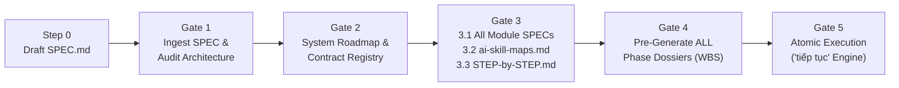

# NTC Micro Harness: Atomic Engineering Protocol (Microservices Edition v2.0)

<p align="center">
  <strong>🌐 Language / Ngôn ngữ:</strong>
  <strong>🇺🇸 English (Current)</strong> |
  <a href="README.vi.md">🇻🇳 Tiếng Việt</a>
</p>

[](https://github.com/chien5572/ntc-micro-harness/actions)
[](LICENSE)
[](AGENTS.md)
[](AGENTS.md)

**NTC Micro Harness v2.0** is an enterprise-grade, zero-drift, token-efficient engineering harness and behavioral governance framework designed for pair-programming and multi-agent orchestration with autonomous AI coding assistants (**Google Antigravity**, **Anthropic Claude Code**, **Cursor**, **Windsurf**, and **Roo Code / Cline**).

Instead of allowing AI agents to jump prematurely into writing fragmented, unverified code, **NTC Micro Harness v2.0** enforces a deterministic **5-Stage Gated Lifecycle**. It compels AI agents to behave like disciplined Principal Software Architects: authoring complete domain specifications (`docs/modules-spec/`), discovering and mapping project AI skills (`ai-skill-maps.md`), generating a human operator playbook (`STEP-by-STEP.md`), pre-generating all Phase Dossiers across every module before touching code, and executing strictly **one Atomic Task per turn** via the **`"tiếp tục"` / `"tiếp tục phase ..."` state machine** with **3-Step Crash Recovery**.

---

## Table of Contents

1. [Introduction & Why NTC Micro Harness v2.0?](#1-introduction--why-ntc-micro-harness-v20)
2. [Core Architecture & Hierarchy of Truth](#2-core-architecture--hierarchy-of-truth)
3. [One-Liner Installation Guide (All Environments)](#3-one-liner-installation-guide-all-environments)
   - [3.1 Windows PowerShell / PowerShell Core](#31-windows-powershell--powershell-core)
   - [3.2 Windows Command Prompt (CMD)](#32-windows-command-prompt-cmd)
   - [3.3 Linux / macOS / WSL / Git Bash](#33-linux--macos--wsl--git-bash)
   - [3.4 Universal Python One-Liner (Any OS)](#34-universal-python-one-liner-any-os)
   - [3.5 Advanced Installer Flags & What Gets Installed](#35-advanced-installer-flags--what-gets-installed)
4. [Complete Execution Workflow (Step-by-Step Guide)](#4-complete-execution-workflow-step-by-step-guide)
   - [Step 0: Initialize `SPEC.md`](#step-0-initialize-specmd)
   - [Gate 1: Root Specification Ingestion & Architecture Audit](#gate-1-root-specification-ingestion--architecture-audit)
   - [Gate 2: System Roadmap & Cross-Module Contract Registry](#gate-2-system-roadmap--cross-module-contract-registry)
   - [Gate 3: All Detailed Module SPECs, `ai-skill-maps.md`, and `STEP-by-STEP.md`](#gate-3-all-detailed-module-specs-ai-skill-mapsmd-and-step-by-stepmd)
   - [Gate 4: Project-Wide Phase Dossiers & Atomic WBS Pre-Generation](#gate-4-project-wide-phase-dossiers--atomic-wbs-pre-generation)
   - [Gate 5: Atomic Implementation & The `"Tiếp tục"` State Machine](#gate-5-atomic-implementation--the-tiếp-tục-state-machine)
5. [Crash Recovery & Multi-Agent Parallel Execution](#5-crash-recovery--multi-agent-parallel-execution)
   - [5.1 3-Step Mid-Turn Crash & Dirty-State Recovery](#51-3-step-mid-turn-crash--dirty-state-recovery)
   - [5.2 Multi-Agent Parallel Execution (Shared Tabs vs. Git Worktrees)](#52-multi-agent-parallel-execution-shared-tabs-vs-git-worktrees)
6. [Automated Validation & Auto-Synchronization (`validate_plans.py`)](#6-automated-validation--auto-synchronization-validate_planspy)
7. [Repository Structure & Identifier Convention Reference](#7-repository-structure--identifier-convention-reference)

---

## 1. Introduction & Why NTC Micro Harness v2.0?

When building complex microservices, modular monoliths, or full-stack systems, unharnessed AI coding agents consistently fail in five predictable ways. **NTC Micro Harness v2.0** eliminates each failure mode mechanically:

| Failure Mode | Symptom in Unharnessed AI | NTC Micro Harness v2.0 Remedy |
| :--- | :--- | :--- |
| **1. Premature Coding & Shallow Specs** | Agent rushes to write code before database schemas, state machines, edge cases, and cross-service contracts exist. | **Gate 1 → Gate 3 Lock:** Production code is strictly forbidden until `SPEC.md`, `system-roadmap.md`, `contract-registry.md`, and **all** `docs/modules-spec/<slug>.md` are completed. |
| **2. Ignored or Unmapped AI Skills** | Agent forgets to consult domain/framework skills (`.agents/skills/`) and invents inconsistent patterns across modules. | **Gate 3.2 (`ai-skill-maps.md`):** Agent stops to ask for skill repository URLs, proposes skills for human approval, installs them into `.agents/skills/`, and binds every module/phase to mandatory skills. |
| **3. Planning / Coding Context Thrashing** | Constantly switching back and forth between high-level planning and coding breaks developer flow and bloats context. | **Gate 4 Project-Wide WBS Pre-Generation:** **Every Phase Dossier across all modules** is decomposed into Level-4 Atomic Tasks upfront before Gate 5 unlocks. |
| **4. Multi-Task Sprawl & High Prompt Friction** | Agent edits 15 files in one turn leaving `// TODO` stubs, or forces the developer to copy-paste long task IDs every turn. | **`"Tiếp tục"` State Machine:** Enforces `1 Turn = 1 Atomic Task` with executable test proof. Simply type `"tiếp tục"` to run the next task; hard-stops at phase boundaries until `"tiếp tục phase <MOD>-P<NN+1>"` is entered. |
| **5. Mid-Turn Crash / Session Amnesia** | IDE crashes mid-turn or a new session starts days later, causing the agent to overwrite or duplicate half-written files. | **Write-Ahead `🎫 Resume Ticket` + 3-Step Crash Recovery:** Inspects `git status` and `git diff` against the active task's target files to seamlessly resume or complete interrupted work. |

---

## 2. Core Architecture & Hierarchy of Truth

All planning and specification artifacts are layered so that an AI agent only loads the slice of context required for its current turn:

```text
SPEC.md (Supreme System Specification)
 ├─ AGENTS.md                                     Mandatory AI Behavioral Contract & Operating Rules
 ├─ docs/plans/system-roadmap.md                  Project Roadmap (Global Phases, Module Registry, Active Work Pointer)
 ├─ docs/plans/contract-registry.md               Cross-Module APIs, Events, Schemas (CT-<PROVIDER>-<NN>)
 ├─ docs/modules-spec/<module-slug>.md            Detailed Module SPEC (7 sections) + Module Phase Sequence (<MOD>-P<NN>)
 ├─ ai-skill-maps.md                              Project AI Skill Playbook (.agents/skills/<skill>/SKILL.md)
 ├─ STEP-by-STEP.md                               Human-Only Playbook (Copy-paste prompts; AI Agents DO NOT read this)
 └─ docs/plans/active/<module-slug>/
     ├─ phase-01-<slug>.md                        Active Phase Dossier (IN_PROGRESS + real-time 🎫 Resume Ticket)
     └─ phase-02-<slug>.md                        Pre-generated Next Phase Dossier (PENDING)
         └─ Major Task (<MOD>-P<NN>.<M>)
             └─ Atomic Task (<MOD>-P<NN>.<M>.<A>) ──► 1 Turn = 1 Task + Executable Proof
                 ("tiếp tục phase ...")           ──► Archived to docs/plans/completed/<module-slug>/
```

### Hierarchy of Truth

A lower document must **never** contradict a higher one. If a discrepancy is detected, the AI agent must **STOP immediately and ask the Human Architect**:

1. **`SPEC.md`** — Supreme system specification, functional boundaries, and architectural intent defined by the Human Architect.
2. **`AGENTS.md`** — Mandatory operating contract, behavioral boundaries, and execution invariants.
3. **`docs/plans/system-roadmap.md`** — Master Project Roadmap: Module Registry, Global Phases (`GP-<NN>`), inter-module dependency graph, and the real-time **Active Work Pointer**.
4. **`docs/plans/contract-registry.md`** — Cross-Module Contract Registry: every shared REST/gRPC endpoint, async event, and schema (`CT-<MOD>-<NN>`).
5. **`docs/modules-spec/<module-slug>.md`** — Detailed Module Specification: scope, user stories, exact DB/storage schemas, contracts, sequence diagrams/state machines, Given/When/Then acceptance criteria, error codes, and the **Module Phase Sequence** (`<MOD>-P<NN>`).
6. **`ai-skill-maps.md`** — Project AI Skill Playbook mapping each module and phase to mandatory local skills (`.agents/skills/<skill-name>/SKILL.md`).
7. **`docs/plans/active/<module-slug>/phase-<NN>-<slug>.md`** — Pre-generated Module Phase Dossiers containing Major Tasks, Level-4 Atomic WBS, and the real-time `🎫 Resume Ticket`.
8. **`docs/plans/completed/<module-slug>/phase-<NN>-<slug>.md`** — Verified, archived phase dossiers (immutable audit history).

> [!IMPORTANT]
> **Human-Only Boundary (`STEP-by-STEP.md`):** `STEP-by-STEP.md` is generated at the end of Gate 3 strictly for the **Human Architect** to read and copy prompts from. **AI Agents are strictly forbidden from reading `STEP-by-STEP.md` during execution.**

---

## 3. One-Liner Installation Guide (All Environments)

Open your terminal **directly inside your target project directory** (existing or newly created):

```bash
cd /path/to/your-project
```

Then copy and paste the **single one-liner command** for your operating system / shell below. The command will automatically fetch **NTC Micro Harness v2.0** from GitHub, install the harness into your current project folder (`.`), configure AI agent rules (`AGENTS.md`, `CLAUDE.md`, `.cursorrules`, `.windsurfrules`), and clean up all temporary files.

---

### 3.1 Windows PowerShell / PowerShell Core

Open **PowerShell** inside your project directory and paste:

```powershell
irm https://raw.githubusercontent.com/chien5572/ntc-micro-harness/main/install.ps1 | iex
```

*(Alternative using `git clone` in PowerShell if you prefer explicit git cloning)*:
```powershell
git clone --depth 1 https://github.com/chien5572/ntc-micro-harness.git .ntc-tmp; & .\.ntc-tmp\install.ps1 -TargetPath .; Remove-Item -Recurse -Force .ntc-tmp
```

---

### 3.2 Windows Command Prompt (CMD)

Open **Command Prompt (`cmd.exe`)** inside your project directory and paste:

```cmd
git clone --depth 1 https://github.com/chien5572/ntc-micro-harness.git .ntc-tmp && python .ntc-tmp\install.py --target . --agent all && rmdir /s /q .ntc-tmp
```

*(Or using PowerShell bridge from CMD without requiring Python)*:
```cmd
powershell -NoProfile -ExecutionPolicy Bypass -Command "irm https://raw.githubusercontent.com/chien5572/ntc-micro-harness/main/install.ps1 | iex"
```

---

### 3.3 Linux / macOS / WSL / Git Bash

Open **Bash** or **Zsh** inside your project directory and paste:

```bash
curl -fsSL https://raw.githubusercontent.com/chien5572/ntc-micro-harness/main/install.sh | bash
```

*(Alternative using `git clone` in Bash/Zsh)*:
```bash
git clone --depth 1 https://github.com/chien5572/ntc-micro-harness.git .ntc-tmp && bash .ntc-tmp/install.sh . && rm -rf .ntc-tmp
```

---

### 3.4 Universal Python One-Liner (Any OS)

If **Python 3.8+** is installed on any OS (Windows, macOS, Linux), open a terminal inside your project folder and paste:

```bash
python -c "import urllib.request; exec(urllib.request.urlopen('https://raw.githubusercontent.com/chien5572/ntc-micro-harness/main/install.py').read())"
```
*(Use `python3` instead of `python` on macOS/Linux if `python` is not aliased).*

---

### 3.5 Advanced Installer Flags & What Gets Installed

When running `install.py` or `install.ps1` with custom options:

| Option (`install.py`) | Option (`install.ps1`) | Description |
| :--- | :--- | :--- |
| `--target .` | `-TargetPath "."` | Target project directory (defaults to current working directory `.`). |
| `--agent all` | `-AgentRules all` | Generate rule hooks for `all` (`CLAUDE.md`, `.cursorrules`, `.windsurfrules`), or specify `claude`, `cursor`, `windsurf`, `none`. |
| `--force` | `-Force` | Overwrite existing harness files if upgrading from an older version. |

**Safe Non-Destructive Behavior on Existing Projects:**
- If your project already has an `AGENTS.md`, `CLAUDE.md`, `.cursorrules`, or `.windsurfrules`, the installer **safely appends** the `<!-- HARNESS:BEGIN -->` block without deleting your existing instructions.
- Copies `docs/WORKFLOW.md`, `docs/modules-spec/README.md`, `docs/plans/system-roadmap.md`, `docs/plans/contract-registry.md`, all templates in `docs/templates/`, and `scripts/validate_plans.py`.

Verify your installation immediately by running:
```bash
python scripts/validate_plans.py
```

---

## 4. Complete Execution Workflow (Step-by-Step Guide)



Follow the steps below in order to take any project from idea to production-verified code.

---

### Step 0: Initialize `SPEC.md`

Copy the starter specification template to the root of your project and fill in your business requirements, target stack, and core workflows:

```bash
# Linux / macOS / Git Bash
cp docs/templates/spec-template.md SPEC.md

# Windows PowerShell
Copy-Item docs/templates/spec-template.md SPEC.md
```

Edit `SPEC.md` with your system overview, user roles, functional requirements, and non-functional constraints.

---

### Gate 1: Root Specification Ingestion & Architecture Audit

Open your AI coding agent (Antigravity, Claude Code, Cursor, or Windsurf) and paste this prompt:

```text
Read SPEC.md and AGENTS.md.
Execute Gate 1 (Root Specification Ingestion):
1. Analyze the system architecture, domain boundaries, and technical risks.
2. Propose the list of modules/microservices (with 2-5 uppercase letter Module Codes, slugs, data ownership, and responsibilities — reserving SYS / system for cross-cutting foundation work).
3. List any clarifying architectural questions before we proceed to Gate 2.
STRICT RULE: Do NOT write any production code.
```

**What happens at Gate 1:**
- The agent audits `SPEC.md`, proposes the decomposition into modules (e.g., `SYS`, `AUTH`, `ORD`, `PAY`), highlights ambiguities, and waits for your confirmation.

---

### Gate 2: System Roadmap & Cross-Module Contract Registry

Once you answer the agent's questions and approve the module breakdown, prompt:

```text
Approved. Proceed to Gate 2:
1. Populate `docs/plans/system-roadmap.md` (using `docs/templates/system-roadmap-template.md`) with the Architecture Blueprint, Module Registry (pointing to `docs/modules-spec/<slug>.md`), Global Phases (`GP-01`, `GP-02`, ...), Module Dependency Graph, and Active Work Pointer.
2. Populate `docs/plans/contract-registry.md` (using `docs/templates/contract-registry-template.md`) with all cross-module APIs, events, and shared schemas (`CT-<PROVIDER>-<NN>`), initialized as `DRAFT`.
3. Run `python scripts/validate_plans.py` and stop for my Gate 2 approval.
```

**What happens at Gate 2:**
- The agent creates `docs/plans/system-roadmap.md` and `docs/plans/contract-registry.md`.
- Review both files to ensure module dependencies and contracts are accurate.

---

### Gate 3: All Detailed Module SPECs, `ai-skill-maps.md`, and `STEP-by-STEP.md`

Gate 3 consists of **three mandatory sub-steps** (`3.1` → `3.2` → `3.3`).

#### Step 3.1: Generate Detailed Module Specifications (`docs/modules-spec/<slug>.md`) for ALL Modules

Prompt the agent:

```text
Gate 2 is approved. Proceed to Gate 3 - Step 3.1:
Using `docs/templates/module-spec-template.md`, generate the Detailed Module Specification `docs/modules-spec/<module-slug>.md` for EVERY registered module in `docs/plans/system-roadmap.md` (starting with `system.md`, then each domain module).
Each module spec must be 100% complete (Scope, User Stories, Tech Stack, Exact DB/Storage DDL & Indexes, Contracts & Events, Sequence Diagrams & State Machines, Given/When/Then Acceptance Criteria, NFRs/Error Codes, and Module Phase Sequence `<MOD>-P<NN>`).
If there are many modules, generate them thoroughly (1–2 modules per turn) until all modules have their `docs/modules-spec/<slug>.md` file.
When all `docs/modules-spec/*.md` files are complete, STOP and ask me for AI Skill catalog URLs to begin Step 3.2.
```

*(If the project has multiple modules and the agent pauses after generating a batch to protect output token limits, simply reply `"tiếp tục"` until all `docs/modules-spec/*.md` files are created).*

#### Step 3.2: Interactive AI Skill Discovery & `ai-skill-maps.md`

As soon as all `docs/modules-spec/*.md` files exist, the agent will **STOP and ask you** for website URLs or skill repositories to search for AI skills. Reply with your preferred skill catalogs (for example):

```text
Search for relevant AI skills for our tech stack and domain modules from these sources:
- https://skillsmp.com/search
- https://felo.ai/vi/skills
- Local `.agents/skills/` or official framework skill repositories
Also propose custom project-specific skills (such as `atomic-harness-gatekeeper` and `<project>-domain-invariants`).
Present the candidate skill table mapped to our modules for my approval before installing them or creating `ai-skill-maps.md`.
```

After reviewing the agent's proposed skill table, approve it:

```text
I approve the skill list. Please:
1. Create/install the approved `.agents/skills/<skill-name>/SKILL.md` files.
2. Generate `ai-skill-maps.md` at the repository root (from `docs/templates/ai-skill-maps-template.md`).
3. Immediately proceed to Gate 3 - Step 3.3: generate `STEP-by-STEP.md` (from `docs/templates/step-by-step-template.md`) for the Human Architect, and run `python scripts/validate_plans.py --fix`.
```

#### Step 3.3: Human Execution Playbook (`STEP-by-STEP.md`)

- The agent generates `STEP-by-STEP.md` at the project root containing the exact module dependency order and ready-to-copy prompts customized for your project's actual module codes (`SYS`, `AUTH`, etc.).
- **Remember:** `STEP-by-STEP.md` is strictly for **you (the Human Architect)** to read and copy prompts from. AI agents never read `STEP-by-STEP.md`.

---

### Gate 4: Project-Wide Phase Dossiers & Atomic WBS Pre-Generation

Before writing a single line of production code, **all Phase Dossiers (`docs/plans/active/<module-slug>/phase-<NN>-<slug>.md`) for every module in the project** must be pre-generated and decomposed into Level-4 Atomic Tasks.

Copy the Gate 4 prompt from your `STEP-by-STEP.md` (or use the prompt below):

```text
Proceed to Gate 4 (Project-Wide Phase Dossiers & Atomic WBS Pre-Generation):
1. Read `AGENTS.md`, `ai-skill-maps.md` (and activate the mandatory `.agents/skills/*/SKILL.md` files), `docs/plans/system-roadmap.md`, `docs/plans/contract-registry.md`, and all `docs/modules-spec/*.md` files. (Do NOT read `STEP-by-STEP.md`).
2. Using `docs/templates/phase-dossier-template.md`, generate ALL Phase Dossiers `docs/plans/active/<module-slug>/phase-<NN>-<slug>.md` for EVERY planned phase of EVERY module in the project.
3. Decompose every phase into Major Tasks (`<MOD>-P<NN>.<M>`) and Level-4 Atomic Micro-Tasks (`<MOD>-P<NN>.<M>.<A>`):
   - `.1`: Contract / Interface / Schema / Type definition (Contract-First)
   - `.2`: Core business logic implementation (Zero stubs / no TODOs)
   - `.3`: Unit / Contract verification tests with Executable Proof Command
4. Set `phase-01` of the starting module(s) to `READY_TO_EXECUTE` and subsequent phases (`phase-02`, `phase-03`...) to `PENDING`.
5. Run `python scripts/validate_plans.py --fix` and report the full list of generated Phase Dossiers for Gate 4 approval.
STRICT RULE: Do NOT write production code in Gate 4.
```

*(If your project has many modules/phases, reply `"tiếp tục"` until 100% of Phase Dossiers across all modules are generated in `docs/plans/active/` and `python scripts/validate_plans.py --fix` passes with 0 errors).*

---

### Gate 5: Atomic Implementation & The `"Tiếp tục"` State Machine

Once all Phase Dossiers are in `docs/plans/active/` and validated, you unlock **Gate 5**.

#### 1. Starting Phase 01 of a Module (e.g., `SYS-P01`)

```text
Gate 4 is approved. Enter Gate 5 and start Phase `SYS-P01`:
1. Read `ai-skill-maps.md` and activate the required skills for `SYS` (`system`).
2. Read `docs/modules-spec/system.md` and `docs/plans/active/system/phase-01-foundation.md`.
3. Execute ONLY the first Atomic Task `SYS-P01.1.1` (`1 Turn = 1 Atomic Task`).
4. Run the Executable Proof Command, check off `[x]`, update the `🎫 Resume Ticket`, and run `python scripts/validate_plans.py --fix`.
```

#### 2. Sequential Execution via `"tiếp tục"`

From this point forward, you do **not** need to type long prompts or task IDs. Simply type:

```text
tiếp tục
```
*(Or `"tiếp tục <MOD>"`, e.g., `"tiếp tục AUTH"`, or `"continue"`).*

On each `"tiếp tục"`, the agent automatically:
1. Checks the `🎫 Resume Ticket` and runs **3-Step Crash / Dirty-State Recovery**.
2. Marks the target Atomic Task `IN_PROGRESS` (Write-Ahead).
3. Implements **only that single Atomic Task** within the module's `Code Root`.
4. Executes the unit test / verification command (`Executable Proof`).
5. Marks `- [x]` on the task, updates the `🎫 Resume Ticket` with the next Atomic Task ID, and stops cleanly.

#### 3. Completing the Final Task of a Phase & The Hard Stop Guardrail

When the agent finishes the **last unchecked Atomic Task** of `<MOD>-P<NN>` (e.g., `AUTH-P01`):
- It marks `- [x]` on the final task and sets `Lifecycle Status: PHASE_COMPLETED` in the `🎫 Resume Ticket`.
- It outputs the mandatory completion announcement:
  > *"Đã hoàn thành toàn bộ Atomic Tasks của Phase `AUTH-P01`. Vui lòng nhập `tiếp tục phase AUTH-P02` để lưu trữ phase hiện tại và chuyển sang phase kế tiếp."*
- **Hard Stop Protection:** If you accidentally type plain `"tiếp tục"` when `AUTH-P01` is already `PHASE_COMPLETED`, the agent **will NOT start `AUTH-P02`**. It will stop and remind you to enter the explicit phase transition command.

#### 4. Transitioning to the Next Phase via `"tiếp tục phase <MOD>-P<NN+1>"`

To archive the completed phase and immediately begin the next phase, type:

```text
tiếp tục phase AUTH-P02
```
*(Or `"tiếp tục phase 02"`).*

In that **single turn**, the agent automatically:
1. Moves `docs/plans/active/auth/phase-01-*.md` → `docs/plans/completed/auth/phase-01-*.md`.
2. Activates `docs/plans/active/auth/phase-02-*.md` (`Lifecycle Status: IN_PROGRESS`).
3. Runs `python scripts/validate_plans.py --fix` to synchronize the Module Phase Sequence table in `docs/modules-spec/auth.md` and the `Active Work Pointer` in `docs/plans/system-roadmap.md`.
4. Immediately executes the **first Atomic Task (`AUTH-P02.1.1`)** of the new phase!

---

## 5. Crash Recovery & Multi-Agent Parallel Execution

### 5.1 3-Step Mid-Turn Crash & Dirty-State Recovery

What happens if your IDE crashes, your laptop loses power, or the network drops **in the middle of an Atomic Task**?

Simply reopen your editor and type:
```text
tiếp tục
```

Before writing a single line of code, the agent executes the **3-Step Crash Recovery Protocol**:
1. **Inspects the Active Dossier:** Locates the first unchecked `- [ ]` Atomic Task and its declared `Target Files` and `Executable Proof Command`.
2. **Inspects Git Working Tree:** Runs `git status --short` and `git diff` scoped to the module's `Code Root`.
3. **Deterministic Reconciliation:**
   - **Case A — Clean Working Tree:** The crash occurred before any file was written. The agent executes the Atomic Task cleanly from scratch.
   - **Case B — Code Completed Before Crash & Tests Pass:** The agent runs the `Executable Proof Command`. If all tests already pass, it checks off `- [x]`, logs the recovery in the dossier's Execution Log, and immediately executes the **next** unchecked Atomic Task in the same turn.
   - **Case C — Partially Written / Failing Tests:** The agent outputs a concise 3-line recovery report identifying the exact interrupted file/line and completes the remaining code of that exact Atomic Task without duplicating work.

---

### 5.2 Multi-Agent Parallel Execution (Shared Tabs vs. Git Worktrees)

Once foundational contracts in `GP-01` (`SYS-P01`) are codified and marked `AVAILABLE` in `docs/plans/contract-registry.md`, you can run **multiple AI agents in parallel** across independent modules (e.g., Agent 1 on `AUTH`, Agent 2 on `CAT`, Agent 3 on `ORD`):

#### Mode A: Parallel Agent Tabs in the Same Workspace
Open separate chat tabs in Antigravity / Claude Code / Cursor and scope each tab by module code:
- **Tab 1:** `"tiếp tục AUTH"`
- **Tab 2:** `"tiếp tục CAT"`

Because `AUTH` only touches `services/auth/` + `docs/plans/active/auth/` and `CAT` only touches `services/catalog/` + `docs/plans/active/catalog/`, they never overwrite each other's files.

#### Mode B: Isolated Git Worktrees (Recommended for Heavy Builds & Port Isolation)
From your project root, create an isolated Git Worktree per module:

```bash
git worktree add ../myproject-auth -b feat/auth main
git worktree add ../myproject-catalog -b feat/catalog main
```

Open an AI agent inside each worktree folder and run `"tiếp tục AUTH"` / `"tiếp tục CAT"`. When a module finishes all of its phases:

```bash
python scripts/validate_plans.py --fix
git add . && git commit -m "feat(auth): complete all AUTH module phases"
# From the main repository root:
git checkout main
git merge --no-ff feat/auth
git worktree remove ../myproject-auth
```

---

## 6. Automated Validation & Auto-Synchronization (`validate_plans.py`)

NTC Micro Harness v2.0 ships with a zero-dependency, cross-platform Python structural validator (`scripts/validate_plans.py`).

```bash
# 1. Validate all structural invariants across the repository
python scripts/validate_plans.py

# 2. Automatically synchronize Module Phase Sequence tables and the Active Work Pointer from disk
python scripts/validate_plans.py --fix
```

**What `scripts/validate_plans.py` verifies:**
- `AGENTS.md` contains the intact `<!-- HARNESS:BEGIN -->` ... `<!-- HARNESS:END -->` contract block.
- Every module registered in `docs/plans/system-roadmap.md` has a valid `docs/modules-spec/<slug>.md` with all 7 required specification sections and a valid Module Phase Sequence table.
- Every contract in `docs/plans/contract-registry.md` (`CT-<MOD>-<NN>`) references a registered provider module, valid consumer modules, and an existing spec file when status is `AVAILABLE`.
- If `ai-skill-maps.md` exists, every mapped `.agents/skills/<skill-name>/SKILL.md` file is present on disk.
- Every Phase Dossier in `docs/plans/active/<slug>/` and `docs/plans/completed/<slug>/` has a valid `🎫 Resume Ticket`, `Lifecycle Status`, and properly formatted Atomic Task checkboxes.
- When `--fix` is passed, it automatically updates the `Module Phase Sequence` status column in `docs/modules-spec/<slug>.md` and the `Active Work Pointer` table in `docs/plans/system-roadmap.md` to match the live dossiers on disk.

---

## 7. Repository Structure & Identifier Convention Reference

### Repository Structure

```text
.
├── AGENTS.md                                      # Root AI operating contract & behavioral rules (v2.0)
├── docs/
│   ├── WORKFLOW.md                                # Complete 5-stage protocol & crash recovery specification
│   ├── README.md                                  # Documentation directory map
│   ├── modules-spec/                              # Detailed Module Specifications (docs/modules-spec/<slug>.md)
│   │   └── README.md
│   ├── patterns/
│   │   └── encoding-invariants.md                 # Engineering invariants & mechanical validation patterns
│   ├── plans/
│   │   ├── system-roadmap.md                      # Master Project Roadmap, Module Registry & Active Work Pointer
│   │   ├── contract-registry.md                   # Cross-module API/Event/Schema contract registry
│   │   ├── active/                                # Pre-generated & active phase dossiers (<slug>/phase-<NN>-*.md)
│   │   └── completed/                             # Archived phase dossiers (immutable audit trail)
│   └── templates/
│       ├── spec-template.md                       # Root SPEC.md starter template
│       ├── system-roadmap-template.md             # Master roadmap template
│       ├── contract-registry-template.md          # Cross-module contract registry template
│       ├── module-spec-template.md                # Detailed Module Spec template (docs/modules-spec/<slug>.md)
│       ├── ai-skill-maps-template.md              # Project AI Skill Playbook template (ai-skill-maps.md)
│       ├── step-by-step-template.md               # Human-Only Operator Playbook template (STEP-by-STEP.md)
│       ├── phase-dossier-template.md              # Phase Dossier + Resume Ticket + WBS template
│       ├── decision.md                            # Architecture Decision Record (ADR) template
│       ├── exec-plan.md                           # Single-session execution plan template
│       └── application-runbook.md                 # Service operations & incident runbook template
├── scripts/
│   └── validate_plans.py                          # Cross-platform Python validator & auto-synchronizer (--fix)
├── install.py                                     # Universal Python installer (local & remote one-liner)
├── install.ps1                                    # Windows PowerShell installer (local & remote one-liner)
├── install.sh                                     # Linux / macOS / WSL Bash installer (local & remote one-liner)
└── LICENSE                                        # MIT License
```

### Identifier Convention Cheat Sheet

| Level | Format | Example | Authoritative File |
| :--- | :--- | :--- | :--- |
| **Global Phase** | `GP-<NN>` | `GP-01` | `docs/plans/system-roadmap.md` |
| **Module Code / Slug** | `<MOD>` / `<slug>` | `AUTH` / `auth` | `docs/plans/system-roadmap.md` & `docs/modules-spec/auth.md` |
| **Module Phase** | `<MOD>-P<NN>` | `AUTH-P01` | `docs/plans/active/auth/phase-01-*.md` |
| **Major Task** | `<MOD>-P<NN>.<M>` | `AUTH-P01.2` | `docs/plans/active/auth/phase-01-*.md` |
| **Atomic Task** | `<MOD>-P<NN>.<M>.<A>` | `AUTH-P01.2.3` | `docs/plans/active/auth/phase-01-*.md` (**1 Turn = 1 Task**) |
| **Dynamic Hotfix Task** | `<MOD>-P<NN>.<M>.<A>[a-z]` | `AUTH-P01.2.3a` | `docs/plans/active/auth/phase-01-*.md` |
| **Cross-Module Contract** | `CT-<PROVIDER>-<NN>` | `CT-AUTH-01` | `docs/plans/contract-registry.md` |

---

## License

Licensed under the [MIT License](LICENSE). Copyright (c) 2026 [chien5572](https://github.com/chien5572).
