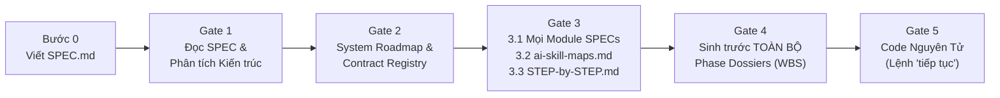

# NTC Micro Harness: Giao Thức Kỹ Thuật Nguyên Tử (Phiên Bản Microservices v2.0)

<p align="center">
  <strong>🌐 Ngôn ngữ / Language:</strong>
  <a href="README.md">🇺🇸 English</a> |
  <strong>🇻🇳 Tiếng Việt (Hiện tại)</strong>
</p>

[](https://github.com/chien5572/ntc-micro-harness/actions)
[](LICENSE)
[](AGENTS.md)
[](AGENTS.md)

**NTC Micro Harness v2.0** là bộ khung kỷ luật kỹ thuật (Engineering Harness) chống trượt ngữ cảnh (zero-drift), tối ưu hóa token, được thiết kế chuyên biệt để lập trình cặp (pair-programming) và điều phối đa tác tử (multi-agent orchestration) với các AI Coding Agent hiện đại (**Google Antigravity**, **Anthropic Claude Code**, **Cursor**, **Windsurf**, và **Roo Code / Cline**).

Thay vì để AI tự ý nhảy vào viết code chắp vá khi chưa rõ thiết kế, **NTC Micro Harness v2.0** ép AI hoạt động như một **Kiến trúc sư Phần mềm Chính (Principal Software Architect)** thông qua quy trình **5 Cổng Kiểm Soát (5-Stage Gated Lifecycle)**: bắt buộc hoàn thiện đặc tả chi tiết từng module (`docs/modules-spec/`), hỏi ý kiến người dùng để tìm kiếm và ánh xạ kỹ năng AI (`ai-skill-maps.md`), sinh sổ tay hướng dẫn cho người dùng (`STEP-by-STEP.md`), tạo trước toàn bộ hồ sơ pha (Phase Dossiers) cho mọi module trước khi code, và thực thi **1 Lượt = 1 Tác vụ Nguyên tử (Atomic Task)** bằng cơ chế **`"tiếp tục"` / `"tiếp tục phase ..."`** kèm **Khôi phục sự cố 3 bước (3-Step Crash Recovery)**.

---

## Mục Lục

1. [Giới thiệu & Tại sao cần NTC Micro Harness v2.0?](#1-giới-thiệu--tại-sao-cần-ntc-micro-harness-v20)
2. [Kiến trúc Cốt lõi & Hệ thống Phân cấp Sự thật (Hierarchy of Truth)](#2-kiến-trúc-cốt-lõi--hệ-thống-phân-cấp-sự-thật-hierarchy-of-truth)
3. [Hướng dẫn Cài đặt 1 Lệnh Duy Nhất (Tất cả Môi trường)](#3-hướng-dẫn-cài-đặt-1-lệnh-duy-nhất-tất-cả-môi-trường)
   - [3.1 Windows PowerShell / PowerShell Core](#31-windows-powershell--powershell-core)
   - [3.2 Windows Command Prompt (CMD)](#32-windows-command-prompt-cmd)
   - [3.3 Linux / macOS / WSL / Git Bash](#33-linux--macos--wsl--git-bash)
   - [3.4 Lệnh Python Đa Nền Tảng (Mọi Hệ Điều Hành)](#34-lệnh-python-đa-nền-tảng-mọi-hệ-điều-hành)
   - [3.5 Tùy chọn Nâng cao & Các File Được Cài Đặt](#35-tùy-chọn-nâng-cao--các-file-được-cài-đặt)
4. [Quy trình Thực thi Từng Bước (Gate 1 → Gate 5)](#4-quy-trình-thực-thi-từng-bước-gate-1--gate-5)
   - [Bước 0: Khởi tạo `SPEC.md`](#bước-0-khởi-tạo-specmd)
   - [Gate 1: Tiếp nhận Đặc tả Gốc & Kiểm toán Kiến trúc](#gate-1-tiếp-nhận-đặc-tả-gốc--kiểm-toán-kiến-trúc)
   - [Gate 2: Lộ trình Hệ thống (`system-roadmap.md`) & Sổ đăng ký Hợp đồng (`contract-registry.md`)](#gate-2-lộ-trình-hệ-thống-system-roadmapmd--sổ-đăng-ký-hợp-đồng-contract-registrymd)
   - [Gate 3: Đặc tả Chi tiết Từng Module (`docs/modules-spec/`), `ai-skill-maps.md`, và `STEP-by-STEP.md`](#gate-3-đặc-tả-chi-tiết-từng-module-docsmodules-spec-ai-skill-mapsmd-và-step-by-stepmd)
   - [Gate 4: Sinh trước Toàn bộ Hồ sơ Pha & WBS Nguyên tử cho Mọi Module](#gate-4-sinh-trước-toàn-bộ-hồ-sơ-pha--wbs-nguyên-tử-cho-mọi-module)
   - [Gate 5: Thực thi Nguyên tử & Máy Trạng Thái `"Tiếp tục"`](#gate-5-thực-thi-nguyên-tử--máy-trạng-thái-tiếp-tục)
5. [Khôi phục Sự cố Giữa Chừng & Chạy Song Song Đa Agent (Git Worktree)](#5-khôi-phục-sự-cố-giữa-chừng--chạy-song-song-đa-agent-git-worktree)
   - [5.1 Khôi phục Sự cố Tắt Máy / Đóng App Giữa Chừng (3-Step Crash Recovery)](#51-khôi-phục-sự-cố-tắt-máy--đóng-app-giữa-chừng-3-step-crash-recovery)
   - [5.2 Chạy Song Song Nhiều AI Agent (Nhiều Tab hoặc Git Worktree)](#52-chạy-song-song-nhiều-ai-agent-nhiều-tab-hoặc-git-worktree)
6. [Kiểm tra Tự động & Đồng bộ Hóa (`validate_plans.py`)](#6-kiểm-tra-tự-động--đồng-bộ-hóa-validate_planspy)
7. [Cấu trúc Thư mục & Bảng Quy ước Định danh](#7-cấu-trúc-thư-mục--bảng-quy-ước-định-danh)

---

## 1. Giới thiệu & Tại sao cần NTC Micro Harness v2.0?

Khi xây dựng các dự án phức tạp hoặc hệ thống Microservices, các AI Coding Agent thông thường rất dễ mắc 5 lỗi nghiêm trọng. **NTC Micro Harness v2.0** khắc phục triệt để cả 5 vấn đề này:

| Điểm yếu của AI thông thường | Triệu chứng thực tế | Giải pháp của NTC Micro Harness v2.0 |
| :--- | :--- | :--- |
| **1. Vội vàng viết code khi chưa rõ thiết kế** | AI lao vào viết code ngay khi chưa có schema DB, state machine, edge cases và hợp đồng API giữa các module. | **Khóa Gate 1 → Gate 3:** Nghiêm cấm viết code sản phẩm cho đến khi hoàn tất `SPEC.md`, `system-roadmap.md`, `contract-registry.md`, và **toàn bộ** `docs/modules-spec/<slug>.md`. |
| **2. Bỏ quên hoặc không dùng AI Skills** | AI không đọc các bộ kỹ năng (`.agents/skills/`) nên tự bịa ra các mẫu code thiếu nhất quán giữa các module. | **Gate 3.2 (`ai-skill-maps.md`):** AI dừng lại hỏi người dùng các trang web tìm skill, đề xuất danh sách skill để người dùng duyệt, cài đặt vào `.agents/skills/` và lập bảng ánh xạ bắt buộc trong `ai-skill-maps.md`. |
| **3. Xáo trộn ngữ cảnh giữa Lập kế hoạch & Code** | Vừa code vừa nghĩ kế hoạch làm loãng context window và đứt mạch làm việc của lập trình viên. | **Gate 4 Sinh trước toàn bộ Phase Dossiers:** Mọi phase của **tất cả các module** đều được bóc tách sẵn thành các Atomic Tasks trước khi bước vào Gate 5. |
| **4. Ôm đồm nhiều việc hoặc bắt gõ lệnh dài** | AI sửa 15 file cùng lúc đầy `// TODO`, hoặc bắt người dùng phải nhớ và gõ mã task dài dòng ở mỗi lượt. | **Máy trạng thái `"Tiếp tục"`:** Thực thi đúng `1 Lượt = 1 Atomic Task` kèm kiểm thử thực tế. Chỉ cần gõ `"tiếp tục"` để làm task kế tiếp; tự động dừng cứng khi hết phase và yêu cầu gõ `"tiếp tục phase <MOD>-P<NN+1>"` để chuyển phase. |
| **5. Mất trạng thái khi sập IDE / mất điện** | Đang chạy dở task thì tắt máy hoặc hôm sau mở lại, AI viết đè hoặc làm hỏng phần code đang viết dở. | **Write-Ahead `🎫 Resume Ticket` + Khôi phục 3 bước:** Tự động đối chiếu `git status` / `git diff` trên các file mục tiêu để viết tiếp phần còn thiếu hoặc tự đánh dấu `[x]` nếu code đã pass test. |

---

## 2. Kiến trúc Cốt lõi & Hệ thống Phân cấp Sự thật (Hierarchy of Truth)

Tài liệu trong dự án được phân tầng rõ ràng để AI chỉ cần nạp đúng phần ngữ cảnh cần thiết cho lượt chạy hiện tại:

```text
SPEC.md (Đặc tả Hệ thống Tối cao)
 ├─ AGENTS.md                                     Hợp đồng vận hành & Quy tắc kỷ luật bắt buộc cho AI
 ├─ docs/plans/system-roadmap.md                  Lộ trình Dự án (Global Phases, Module Registry, Active Work Pointer)
 ├─ docs/plans/contract-registry.md               Sổ đăng ký Hợp đồng Liên Module (CT-<PROVIDER>-<NN>)
 ├─ docs/modules-spec/<module-slug>.md            Đặc tả Chi tiết Module (7 phần) + Bảng Chuỗi Pha (<MOD>-P<NN>)
 ├─ ai-skill-maps.md                              Bản đồ Kỹ năng AI của Dự án (.agents/skills/<skill>/SKILL.md)
 ├─ STEP-by-STEP.md                               Sổ tay Hướng dẫn dành riêng cho Người dùng (AI KHÔNG ĐƯỢC ĐỌC)
 └─ docs/plans/active/<module-slug>/
     ├─ phase-01-<slug>.md                        Hồ sơ Pha Đang Chạy (IN_PROGRESS + 🎫 Resume Ticket thời gian thực)
     └─ phase-02-<slug>.md                        Hồ sơ Pha Kế Tiếp đã sinh sẵn (PENDING)
         └─ Major Task (<MOD>-P<NN>.<M>)
             └─ Atomic Task (<MOD>-P<NN>.<M>.<A>) ──► 1 Lượt = 1 Task + Bằng chứng chạy test thực tế
                 ("tiếp tục phase ...")           ──► Tự động lưu trữ sang docs/plans/completed/<module-slug>/
```

### Hệ thống Phân cấp Sự thật (Hierarchy of Truth)

Tài liệu cấp dưới **tuyệt đối không được mâu thuẫn** với tài liệu cấp trên. Nếu phát hiện xung đột, AI phải **DỪNG LẠI NGAY và hỏi Kiến trúc sư Con người**:

1. **`SPEC.md`** — Đặc tả hệ thống tối cao, phạm vi nghiệp vụ và mục tiêu kiến trúc do con người định nghĩa.
2. **`AGENTS.md`** — Hợp đồng vận hành, ranh giới hành vi và quy tắc thực thi bắt buộc đối với AI.
3. **`docs/plans/system-roadmap.md`** — Lộ trình tổng thể của dự án: Danh mục Module, các Pha Toàn cục (`GP-<NN>`), đồ thị phụ thuộc, và **Con trỏ Công việc Hiện hành (Active Work Pointer)**.
4. **`docs/plans/contract-registry.md`** — Sổ đăng ký toàn bộ API, sự kiện (Event) và Schema dùng chung giữa các module (`CT-<MOD>-<NN>`).
5. **`docs/modules-spec/<module-slug>.md`** — Đặc tả chi tiết từng module: phạm vi, user stories, schema DB/lưu trữ chi tiết, hợp đồng cung cấp/tiêu thụ, biểu đồ tuần tự/state machine, tiêu chí nghiệm thu Given/When/Then, mã lỗi, và **Chuỗi Pha của Module** (`<MOD>-P<NN>`).
6. **`ai-skill-maps.md`** — Bản đồ ánh xạ từng module và từng pha với các kỹ năng AI bắt buộc (`.agents/skills/<skill-name>/SKILL.md`).
7. **`docs/plans/active/<module-slug>/phase-<NN>-<slug>.md`** — Hồ sơ Pha được sinh sẵn chứa các Major Tasks, Atomic Tasks (WBS cấp 4), và `🎫 Resume Ticket`.
8. **`docs/plans/completed/<module-slug>/phase-<NN>-<slug>.md`** — Hồ sơ Pha đã hoàn thành và được lưu trữ (lịch sử kiểm toán bất biến).

> [!IMPORTANT]
> **Ranh giới Dành riêng cho Con người (`STEP-by-STEP.md`):** File `STEP-by-STEP.md` được sinh ra ở cuối Gate 3 **chỉ dành riêng cho bạn (Kiến trúc sư Con người)** đọc và copy câu lệnh. **AI Agent bị nghiêm cấm đọc file `STEP-by-STEP.md` trong suốt quá trình thực thi.**

---

## 3. Hướng dẫn Cài đặt 1 Lệnh Duy Nhất (Tất cả Môi trường)

Bạn chỉ cần **mở Terminal ngay tại thư mục dự án hiện tại của bạn** (dự án mới hoặc dự án đang có sẵn):

```bash
cd /duong-dan/toi/du-an-cua-ban
```

Sau đó **dán đúng 1 dòng lệnh** tương ứng với môi trường của bạn dưới đây. Lệnh sẽ tự động tải **NTC Micro Harness v2.0** từ GitHub về thư mục tạm, áp dụng bộ khung vào ngay thư mục dự án hiện tại (`.`), cấu hình quy tắc cho AI (`AGENTS.md`, `CLAUDE.md`, `.cursorrules`, `.windsurfrules`) và tự động dọn sạch file tạm!

---

### 3.1 Windows PowerShell / PowerShell Core

Mở **PowerShell** ngay tại thư mục dự án và dán lệnh:

```powershell
irm https://raw.githubusercontent.com/chien5572/ntc-micro-harness/main/install.ps1 | iex
```

*(Hoặc nếu muốn dùng `git clone` trực tiếp trong PowerShell)*:
```powershell
git clone --depth 1 https://github.com/chien5572/ntc-micro-harness.git .ntc-tmp; & .\.ntc-tmp\install.ps1 -TargetPath .; Remove-Item -Recurse -Force .ntc-tmp
```

---

### 3.2 Windows Command Prompt (CMD)

Mở **CMD (`cmd.exe`)** ngay tại thư mục dự án và dán lệnh:

```cmd
powershell -NoProfile -ExecutionPolicy Bypass -Command "irm https://raw.githubusercontent.com/chien5572/ntc-micro-harness/main/install.ps1 | iex"
```

*(Hoặc dùng `git` + `python` trong CMD)*:
```cmd
git clone --depth 1 https://github.com/chien5572/ntc-micro-harness.git .ntc-tmp && python .ntc-tmp\install.py --target . --agent all && rmdir /s /q .ntc-tmp
```

---

### 3.3 Linux / macOS / WSL / Git Bash

Mở terminal **Bash** hoặc **Zsh** ngay tại thư mục dự án và dán lệnh:

```bash
curl -fsSL https://raw.githubusercontent.com/chien5572/ntc-micro-harness/main/install.sh | bash
```

*(Hoặc nếu muốn dùng `git clone` trong Bash/Zsh)*:
```bash
git clone --depth 1 https://github.com/chien5572/ntc-micro-harness.git .ntc-tmp && bash .ntc-tmp/install.sh . && rm -rf .ntc-tmp
```

---

### 3.4 Lệnh Python Đa Nền Tảng (Mọi Hệ Điều Hành)

Nếu máy đã cài **Python 3.8+** (trên Windows, macOS, hoặc Linux), mở terminal tại thư mục dự án và dán:

```bash
python -c "import urllib.request; exec(urllib.request.urlopen('https://raw.githubusercontent.com/chien5572/ntc-micro-harness/main/install.py').read())"
```
*(Thay `python` bằng `python3` trên macOS/Linux nếu máy dùng lệnh `python3`).*

---

### 3.5 Tùy chọn Nâng cao & Các File Được Cài Đặt

**Cơ chế an toàn cho dự án đang có sẵn:**
- Nếu dự án của bạn đã có sẵn `AGENTS.md`, `CLAUDE.md`, `.cursorrules`, hoặc `.windsurfrules`, bộ cài sẽ **nối thêm (append)** khối `<!-- HARNESS:BEGIN -->` vào cuối file mà không làm mất nội dung cũ của bạn.
- Tạo đầy đủ cấu trúc `docs/WORKFLOW.md`, `docs/modules-spec/README.md`, `docs/plans/system-roadmap.md`, `docs/plans/contract-registry.md`, toàn bộ mẫu trong `docs/templates/`, và công cụ kiểm tra `scripts/validate_plans.py`.

Kiểm tra ngay sau khi cài đặt bằng lệnh:
```bash
python scripts/validate_plans.py
```

---

## 4. Quy trình Thực thi Từng Bước (Gate 1 → Gate 5)



Thực hiện lần lượt từ Bước 0 đến Gate 5 như sau:

---

### Bước 0: Khởi tạo `SPEC.md`

Copy file mẫu đặc tả ra thư mục gốc của dự án và điền yêu cầu bài toán, công nghệ sử dụng, và các luồng nghiệp vụ chính:

```bash
# Trên Linux / macOS / Git Bash
cp docs/templates/spec-template.md SPEC.md

# Trên Windows PowerShell
Copy-Item docs/templates/spec-template.md SPEC.md
```

---

### Gate 1: Tiếp nhận Đặc tả Gốc & Kiểm toán Kiến trúc

Mở AI Coding Agent (Antigravity, Claude Code, Cursor, Windsurf) và dán câu lệnh sau:

```text
Hãy đọc file `SPEC.md` và `AGENTS.md`.
Thực hiện Gate 1 (Root Specification Ingestion):
1. Phân tích kiến trúc hệ thống, ranh giới nghiệp vụ và các rủi ro kỹ thuật.
2. Đề xuất danh sách các Module / Microservices (kèm Mã Module 2-5 chữ in hoa, slug, quyền sở hữu dữ liệu và trách nhiệm — giữ mã `SYS` / `system` cho phần nền tảng dùng chung).
3. Nêu các câu hỏi cần làm rõ trước khi chuyển sang Gate 2.
QUY TẮC TUYỆT ĐỐI: KHÔNG viết bất kỳ dòng code sản phẩm nào ở bước này.
```

---

### Gate 2: Lộ trình Hệ thống (`system-roadmap.md`) & Sổ đăng ký Hợp đồng (`contract-registry.md`)

Sau khi trả lời các câu hỏi của AI và chốt danh sách module, bạn dán câu lệnh:

```text
Tôi đồng ý với đề xuất kiến trúc. Hãy chuyển sang Gate 2:
1. Điền đầy đủ `docs/plans/system-roadmap.md` (theo mẫu `docs/templates/system-roadmap-template.md`) gồm Architecture Blueprint, Module Registry (trỏ tới `docs/modules-spec/<slug>.md`), Global Phases (`GP-01`, `GP-02`...), Module Dependency Graph và Active Work Pointer.
2. Điền đầy đủ `docs/plans/contract-registry.md` (theo mẫu `docs/templates/contract-registry-template.md`) với toàn bộ các hợp đồng API/Event/Schema liên module (`CT-<PROVIDER>-<NN>`) ở trạng thái `DRAFT`.
3. Chạy `python scripts/validate_plans.py` để kiểm tra tính hợp lệ và dừng lại chờ tôi duyệt Gate 2.
```

---

### Gate 3: Đặc tả Chi tiết Từng Module (`docs/modules-spec/`), `ai-skill-maps.md`, và `STEP-by-STEP.md`

Gate 3 gồm **3 bước con bắt buộc** (`3.1` → `3.2` → `3.3`):

#### Bước 3.1: Sinh Đặc tả Chi tiết (`docs/modules-spec/<slug>.md`) cho TẤT CẢ các Module

Dán câu lệnh:

```text
Tôi duyệt Gate 2. Hãy chuyển sang Gate 3 - Bước 3.1:
Dựa trên `docs/templates/module-spec-template.md`, hãy khởi tạo file Đặc tả Chi tiết Module `docs/modules-spec/<module-slug>.md` cho TẤT CẢ các module đã đăng ký trong `docs/plans/system-roadmap.md` (bắt đầu từ `system.md`, sau đó đến từng module nghiệp vụ).
Mỗi file phải đầy đủ 7 phần: Scope, User Stories, Tech Stack, Schema DB/DDL & Indexes chi tiết, Contracts & Events, Sequence Diagrams & State Machine, Given/When/Then Acceptance Criteria, NFRs/Error Codes, và bảng Module Phase Sequence (`<MOD>-P<NN>`).
Nếu dự án có nhiều module, hãy viết kỹ từng module (1–2 module mỗi lượt) cho đến khi 100% module có file trong `docs/modules-spec/`.
Ngay khi viết xong toàn bộ `docs/modules-spec/*.md`, hãy DỪNG LẠI và hỏi tôi danh sách trang web/nguồn tìm kiếm AI Skills để bắt đầu Bước 3.2.
```

*(Nếu dự án lớn và AI tạm dừng sau mỗi 1–2 module để tránh tràn độ dài phản hồi, bạn chỉ cần gõ `"tiếp tục"` cho đến khi AI tạo xong toàn bộ các file trong `docs/modules-spec/`).*

#### Bước 3.2: Tương tác Tìm kiếm Kỹ năng AI & Tạo `ai-skill-maps.md`

Ngay khi tạo xong toàn bộ `docs/modules-spec/*.md`, AI sẽ **dừng lại và hỏi bạn** các địa chỉ website hoặc kho lưu trữ để tìm kiếm AI Skills. Bạn trả lời kèm các nguồn bạn muốn (ví dụ):

```text
Hãy tìm kiếm các AI Skills phù hợp với tech stack và nghiệp vụ của từng module từ các nguồn sau:
- https://skillsmp.com/search
- https://felo.ai/vi/skills
- Thư mục `.agents/skills/` hoặc kho skill chính thức của framework
Đồng thời đề xuất thêm các skill đặc thù cho dự án (như `atomic-harness-gatekeeper` và `<project>-domain-invariants`).
Hãy lập bảng đề xuất danh sách Skill ánh xạ với từng module để tôi duyệt trước khi cài đặt và tạo file `ai-skill-maps.md`.
```

Sau khi xem bảng đề xuất skill của AI, bạn có thể thêm/bớt rồi xác nhận duyệt:

```text
Tôi duyệt danh sách AI Skills này. Hãy thực hiện:
1. Cài đặt / khởi tạo các file `.agents/skills/<skill-name>/SKILL.md` đã được duyệt.
2. Tạo file `ai-skill-maps.md` ở thư mục gốc (theo mẫu `docs/templates/ai-skill-maps-template.md`).
3. Chuyển ngay sang Gate 3 - Bước 3.3: Tạo file `STEP-by-STEP.md` ở thư mục gốc (theo mẫu `docs/templates/step-by-step-template.md`) dành cho Kiến trúc sư Con người, rồi chạy `python scripts/validate_plans.py --fix`.
```

#### Bước 3.3: Sổ tay Hướng dẫn Thực thi (`STEP-by-STEP.md`)

- AI sẽ sinh ra file `STEP-by-STEP.md` ở thư mục gốc chứa sơ đồ thứ tự thực thi các module và các mẫu câu lệnh copy-paste đã được điền sẵn đúng tên module của dự án bạn.
- **Lưu ý quan trọng:** File `STEP-by-STEP.md` chỉ dành cho **bạn (người dùng)** đọc và copy lệnh. AI Agent sẽ không bao giờ đọc file này.

---

### Gate 4: Sinh trước Toàn bộ Hồ sơ Pha & WBS Nguyên tử cho Mọi Module

Trước khi được phép viết bất kỳ dòng code nào ở Gate 5, AI phải sinh trước **toàn bộ các file Phase Dossiers (`docs/plans/active/<module-slug>/phase-<NN>-<slug>.md`) cho tất cả các phase của tất cả các module trong dự án**.

Bạn có thể copy câu lệnh Gate 4 từ file `STEP-by-STEP.md` vừa được tạo (hoặc dùng lệnh dưới đây):

```text
Hãy chuyển sang Gate 4 (Sinh trước toàn bộ Phase Dossiers & WBS Nguyên tử cho toàn dự án):
1. Đọc `AGENTS.md`, `ai-skill-maps.md` (kèm các file `.agents/skills/*/SKILL.md` tương ứng), `docs/plans/system-roadmap.md`, `docs/plans/contract-registry.md`, và toàn bộ `docs/modules-spec/*.md`. (Tuyệt đối KHÔNG đọc `STEP-by-STEP.md`).
2. Dựa trên `docs/templates/phase-dossier-template.md`, hãy khởi tạo TẤT CẢ các Phase Dossiers `docs/plans/active/<module-slug>/phase-<NN>-<slug>.md` cho MỌI phase của MỌI module trong dự án.
3. Trong mỗi Phase Dossier, phân rã chi tiết thành các Major Tasks (`<MOD>-P<NN>.<M>`) và Atomic Micro-Tasks cấp 4 (`<MOD>-P<NN>.<M>.<A>`):
   - `.1`: Định nghĩa Contract / Interface / Schema / Type (Contract-First)
   - `.2`: Triển khai logic nghiệp vụ cốt lõi (Không viết TODO / stub)
   - `.3`: Viết Unit Test / Contract Test kèm lệnh kiểm chứng thực thi (Executable Proof Command)
4. Đặt `phase-01` của module khởi đầu ở trạng thái `READY_TO_EXECUTE` và các phase kế tiếp (`phase-02`, `phase-03`...) ở trạng thái `PENDING`.
5. Chạy `python scripts/validate_plans.py --fix` và báo cáo danh sách toàn bộ các Phase Dossiers đã tạo để tôi duyệt Gate 4.
QUY TẮC TUYỆT ĐỐI: KHÔNG viết code sản phẩm ở Gate 4.
```

*(Nếu dự án có nhiều module/phase, bạn chỉ cần gõ `"tiếp tục"` cho đến khi AI sinh đủ 100% Phase Dossiers của mọi module trong `docs/plans/active/` và chạy `python scripts/validate_plans.py --fix` báo PASSED).*

---

### Gate 5: Thực thi Nguyên tử & Máy Trạng Thái `"Tiếp tục"`

Khi toàn bộ Phase Dossiers đã sẵn sàng trong `docs/plans/active/`, dự án chính thức mở khóa **Gate 5**.

#### 1. Bắt đầu Pha đầu tiên của một Module (ví dụ `SYS-P01`)

```text
Gate 4 đã hoàn tất. Hãy bước vào Gate 5 và bắt đầu thực thi Phase `SYS-P01`:
1. Đọc `ai-skill-maps.md` và kích hoạt các kỹ năng bắt buộc cho module `SYS` (`system`).
2. Đọc `docs/modules-spec/system.md` và `docs/plans/active/system/phase-01-foundation.md`.
3. Thực thi ĐÚNG 1 Atomic Task đầu tiên là `SYS-P01.1.1` (1 Lượt = 1 Atomic Task).
4. Chạy lệnh kiểm thử thực tế (Executable Proof), đánh dấu `[x]`, cập nhật `🎫 Resume Ticket`, và chạy `python scripts/validate_plans.py --fix`.
```

#### 2. Thực thi tuần tự cực nhanh chỉ với lệnh `"tiếp tục"`

Từ lúc này trở đi, bạn **không cần** phải gõ lại mã task dài dòng nữa. Ở mỗi lượt tiếp theo, bạn chỉ cần gõ:

```text
tiếp tục
```
*(Hoặc `"tiếp tục <MOD>"`, ví dụ `"tiếp tục AUTH"`, hoặc `"continue"`).*

Mỗi lần bạn gõ `"tiếp tục"`, AI sẽ tự động:
1. Kiểm tra `🎫 Resume Ticket` và chạy **Quy trình Đối soát Khôi phục Sự cố 3 Bước**.
2. Cập nhật `🎫 Resume Ticket` sang `IN_PROGRESS` với mã Atomic Task đang làm (Write-Ahead).
3. Viết code hoàn chỉnh cho **đúng 1 Atomic Task đó** trong phạm vi `Code Root` của module.
4. Chạy lệnh Unit Test / Build để chứng minh code chạy đúng (`Executable Proof`).
5. Đánh dấu `- [x]`, cập nhật `🎫 Resume Ticket` trỏ sang Atomic Task kế tiếp, và dừng lại chờ bạn.

#### 3. Hoàn thành Task Cuối cùng của một Phase & Chốt Chặn An Toàn (Hard Stop)

Ở lượt chạy hoàn thành **Atomic Task cuối cùng** của một phase (ví dụ `AUTH-P01`):
- AI đánh dấu `- [x]` cho task cuối cùng đó và chuyển `Lifecycle Status` trong `🎫 Resume Ticket` sang **`PHASE_COMPLETED`**.
- AI thông báo rõ ràng:
  > *"Đã hoàn thành toàn bộ Atomic Tasks của Phase `AUTH-P01`. Vui lòng nhập `tiếp tục phase AUTH-P02` để lưu trữ phase hiện tại và chuyển sang phase kế tiếp."*
- **Chốt chặn an toàn:** Khi một phase đã ở trạng thái `PHASE_COMPLETED` (không còn task `- [ ]` nào), nếu bạn vô tình gõ `"tiếp tục"` thông thường, AI **sẽ KHÔNG tự ý nhảy sang phase mới** mà dừng lại nhắc bạn nhập đúng lệnh chuyển phase.

#### 4. Chuyển sang Phase Kế tiếp với lệnh `"tiếp tục phase <MOD>-P<NN+1>"`

Để lưu trữ phase vừa xong và bắt đầu ngay phase tiếp theo, bạn gõ:

```text
tiếp tục phase AUTH-P02
```
*(Hoặc `"tiếp tục phase 02"`).*

Chỉ trong **1 lượt duy nhất đó**, AI sẽ tự động thực hiện trọn gói:
1. Di chuyển file hồ sơ `docs/plans/active/auth/phase-01-*.md` sang thư mục lưu trữ `docs/plans/completed/auth/phase-01-*.md`.
2. Kích hoạt file hồ sơ `docs/plans/active/auth/phase-02-*.md` (`Lifecycle Status: IN_PROGRESS`).
3. Chạy `python scripts/validate_plans.py --fix` để tự động đồng bộ bảng tiến độ trong `docs/modules-spec/auth.md` và `Active Work Pointer` trong `docs/plans/system-roadmap.md`.
4. Thực thi ngay **Atomic Task đầu tiên (`AUTH-P02.1.1`)** của phase mới!

---

## 5. Khôi phục Sự cố Giữa Chừng & Chạy Song Song Đa Agent (Git Worktree)

### 5.1 Khôi phục Sự cố Tắt Máy / Đóng App Giữa Chừng (3-Step Crash Recovery)

Nếu đang chạy dở một Atomic Task mà IDE bị treo, mất điện hoặc mất mạng giữa chừng, khi mở lại dự án bạn chỉ cần gõ:

```text
tiếp tục
```

Trước khi sửa bất kỳ file nào, AI bắt buộc thực hiện **3 bước đối soát thực tế trên ổ đĩa**:
1. **Đọc Hồ sơ Pha đang mở:** Xác định Atomic Task `- [ ]` đầu tiên chưa tích chọn và danh sách `Target Files` của task đó.
2. **Kiểm tra Cây thư mục Git (`git status` & `git diff`):** Kiểm tra xem các file mục tiêu trong `Code Root` của module đã bị sửa đổi gì trước khi sập máy chưa.
3. **Tự động xử lý thông minh:**
   - **Trường hợp 1 (Chưa có file nào bị sửa):** Thực thi Atomic Task đó từ đầu như bình thường.
   - **Trường hợp 2 (Code đã được viết xong trước khi sập máy và chạy Test PASS):** Tự động tích chọn `- [x]` cho task đó, ghi nhận khôi phục vào nhật ký, và chuyển sang làm luôn Atomic Task kế tiếp ngay trong lượt đó.
   - **Trường hợp 3 (Code đang viết dở dang hoặc Test đang FAIL):** Báo cáo ngắn gọn 3 dòng (*Module/Phase/Task đang dở, file/dòng bị ngắt quãng, và hướng xử lý*), sau đó **viết nốt phần logic còn thiếu** của đúng Atomic Task đó mà không làm mất hay nhân đôi code đã viết.

---

### 5.2 Chạy Song Song Nhiều AI Agent (Nhiều Tab hoặc Git Worktree)

Ngay khi các hợp đồng nền tảng ở `GP-01` (`SYS-P01`) đã được định nghĩa xong và chuyển sang trạng thái `AVAILABLE` trong `docs/plans/contract-registry.md`, bạn có thể mở **nhiều AI Agent chạy song song** cho các module độc lập (ví dụ: Agent 1 làm `AUTH`, Agent 2 làm `CAT`, Agent 3 làm `ORD`):

#### Cách A: Mở nhiều Tab Chat AI trong cùng Workspace
Ở mỗi tab chat, chỉ định rõ mã module khi gõ lệnh:
- **Tab 1:** `"tiếp tục AUTH"`
- **Tab 2:** `"tiếp tục CAT"`

Vì mỗi module chỉ được phép sửa code trong `Code Root` riêng của nó (ví dụ `services/auth/` và `services/catalog/`) và hồ sơ pha riêng (`docs/plans/active/auth/` và `docs/plans/active/catalog/`), các Agent hoàn toàn không bao giờ đụng độ file của nhau.

#### Cách B: Cô lập hoàn toàn bằng Git Worktree (Khuyên dùng khi chạy build/test nặng)
Tại thư mục gốc của dự án, tách nhánh Worktree riêng cho từng module:

```bash
git worktree add ../du-an-auth -b feat/auth main
git worktree add ../du-an-catalog -b feat/catalog main
```

Mở cửa sổ IDE / AI Agent riêng trong từng thư mục Worktree và gõ `"tiếp tục AUTH"` / `"tiếp tục CAT"`. Khi một module hoàn thành toàn bộ các phase:

```bash
python scripts/validate_plans.py --fix
git add . && git commit -m "feat(auth): hoan thanh toan bo cac phase cua module AUTH"
# Quay về thư mục dự án chính để gộp nhánh:
git checkout main
git merge --no-ff feat/auth
git worktree remove ../du-an-auth
```

---

## 6. Kiểm tra Tự động & Đồng bộ Hóa (`validate_plans.py`)

Bộ khung đi kèm công cụ kiểm tra cấu trúc và tự động đồng bộ trạng thái viết bằng Python thuần (không cần cài thêm thư viện ngoài):

```bash
# 1. Kiểm tra toàn bộ cấu trúc kế hoạch, module specs, hợp đồng và hồ sơ pha
python scripts/validate_plans.py

# 2. Tự động đồng bộ bảng tiến độ trong docs/modules-spec/*.md và Active Work Pointer trong system-roadmap.md
python scripts/validate_plans.py --fix
```

---

## 7. Cấu trúc Thư mục & Bảng Quy ước Định danh

### Cấu trúc Thư mục

```text
.
├── AGENTS.md                                      # Hợp đồng vận hành & Quy tắc kỷ luật cho AI (v2.0)
├── README.md                                      # Tài liệu hướng dẫn tiếng Anh (English)
├── README.vi.md                                   # Tài liệu hướng dẫn tiếng Việt (Vietnamese)
├── docs/
│   ├── WORKFLOW.md                                # Đặc tả chi tiết giao thức 5 cổng & khôi phục sự cố
│   ├── README.md                                  # Bản đồ thư mục tài liệu
│   ├── modules-spec/                              # Đặc tả chi tiết từng Module (docs/modules-spec/<slug>.md)
│   │   └── README.md
│   ├── patterns/
│   │   └── encoding-invariants.md                 # Các mẫu bất biến kỹ thuật & kiểm chứng cơ học
│   ├── plans/
│   │   ├── system-roadmap.md                      # Lộ trình Hệ thống, Module Registry & Active Work Pointer
│   │   ├── contract-registry.md                   # Sổ đăng ký hợp đồng API/Event/Schema liên module
│   │   ├── active/                                # Hồ sơ các phase đang chạy hoặc chờ chạy (<slug>/phase-<NN>-*.md)
│   │   └── completed/                             # Hồ sơ các phase đã hoàn thành & lưu trữ
│   └── templates/
│       ├── spec-template.md                       # Mẫu SPEC.md gốc
│       ├── system-roadmap-template.md             # Mẫu lộ trình hệ thống
│       ├── contract-registry-template.md          # Mẫu sổ đăng ký hợp đồng liên module
│       ├── module-spec-template.md                # Mẫu đặc tả chi tiết module (docs/modules-spec/<slug>.md)
│       ├── ai-skill-maps-template.md              # Mẫu bản đồ kỹ năng AI (ai-skill-maps.md)
│       ├── step-by-step-template.md               # Mẫu sổ tay hướng dẫn cho người dùng (STEP-by-STEP.md)
│       ├── phase-dossier-template.md              # Mẫu hồ sơ pha + Resume Ticket + WBS
│       ├── decision.md                            # Mẫu ghi nhận quyết định kiến trúc (ADR)
│       ├── exec-plan.md                           # Mẫu kế hoạch thực thi nhanh
│       └── application-runbook.md                 # Mẫu sổ tay vận hành & xử lý sự cố
├── scripts/
│   └── validate_plans.py                          # Công cụ kiểm tra cấu trúc & tự động đồng bộ (--fix)
├── install.py                                     # Trình cài đặt Python đa nền tảng (hỗ trợ chạy 1 lệnh từ xa)
├── install.ps1                                    # Trình cài đặt Windows PowerShell (hỗ trợ chạy 1 lệnh từ xa)
├── install.sh                                     # Trình cài đặt Linux / macOS / WSL Bash (hỗ trợ chạy 1 lệnh từ xa)
└── LICENSE                                        # Giấy phép MIT
```

### Bảng Quy ước Định danh (Identifier Convention)

| Cấp độ | Định dạng | Ví dụ | File Quản lý Chính thức |
| :--- | :--- | :--- | :--- |
| **Pha Toàn cục (Global Phase)** | `GP-<NN>` | `GP-01` | `docs/plans/system-roadmap.md` |
| **Mã Module / Slug** | `<MOD>` / `<slug>` | `AUTH` / `auth` | `docs/plans/system-roadmap.md` & `docs/modules-spec/auth.md` |
| **Pha của Module (Module Phase)** | `<MOD>-P<NN>` | `AUTH-P01` | `docs/plans/active/auth/phase-01-*.md` |
| **Tác vụ Lớn (Major Task)** | `<MOD>-P<NN>.<M>` | `AUTH-P01.2` | `docs/plans/active/auth/phase-01-*.md` |
| **Tác vụ Nguyên tử (Atomic Task)** | `<MOD>-P<NN>.<M>.<A>` | `AUTH-P01.2.3` | `docs/plans/active/auth/phase-01-*.md` (**1 Lượt = 1 Task**) |
| **Tác vụ Bổ sung Động (Hotfix)** | `<MOD>-P<NN>.<M>.<A>[a-z]` | `AUTH-P01.2.3a` | `docs/plans/active/auth/phase-01-*.md` |
| **Hợp đồng Liên Module (Contract)** | `CT-<PROVIDER>-<NN>` | `CT-AUTH-01` | `docs/plans/contract-registry.md` |

---

## Giấy phép (License)

Phát hành theo giấy phép [MIT License](LICENSE). Bản quyền (c) 2026 [chien5572](https://github.com/chien5572).
