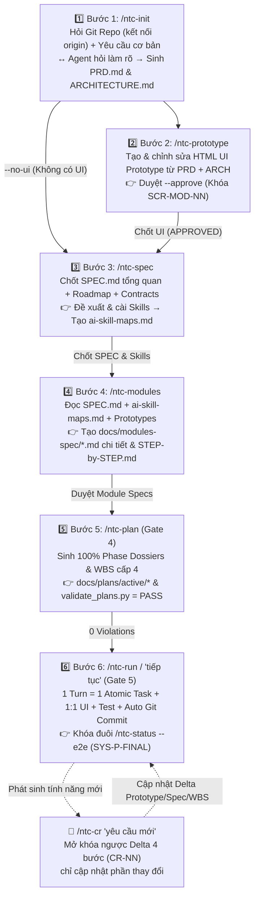

# NTC Micro-Harness: Giao Thức Kỹ Thuật Nguyên Tử & Plugin `/ntc-*` (v2.1)

<p align="center">
  <strong>🌐 Ngôn ngữ / Language:</strong>
  <a href="README.md">🇺🇸 English</a> |
  <strong>🇻🇳 Tiếng Việt (Hiện tại)</strong>
</p>

[](https://github.com/chien5572/ntc-micro-harness/actions)
[](LICENSE)
[](plugin.json)
[](AGENTS.md)

**NTC Micro-Harness v2.1 (Plugin Edition)** là bộ khung kỷ luật kỹ thuật (Engineering Harness) kiêm **Plugin Slash Commands (`/ntc-*`)** chống trượt ngữ cảnh (zero-drift), tối ưu hóa token, được thiết kế chuyên biệt để lập trình cặp (pair-programming) và điều phối đa tác tử (multi-agent orchestration) với các AI Coding Agent hiện đại (**Google Antigravity**, **Anthropic Claude Code**, **Cursor**, **Windsurf**, và **Roo Code / Cline**).

Thay vì bắt bạn phải tự tay viết hàng chục trang tài liệu từ đầu hoặc để AI tự ý nhảy vào viết code chắp vá, **NTC Micro-Harness v2.1** dẫn dắt toàn bộ vòng đời dự án qua **6 Bước điều khiển bằng lệnh `/ntc-*` trực quan**:
1. **Bước 1 (`/ntc-init`) — Kết nối Git Repo & Hỏi-Đáp tạo `PRD.md` + `ARCHITECTURE.md`:** Ngay khi khởi chạy, Agent hỏi link **Git Repo của dự án** (để kết nối `git remote origin` trước khi làm bất cứ việc gì — có thể để trống nếu làm local) và **ý tưởng cơ bản**. Sau đó Agent đặt 3–5 câu hỏi làm rõ để cùng bạn hoàn thiện và tự động sinh ra [`PRD.md`](docs/templates/prd-template.md) & [`ARCHITECTURE.md`](docs/templates/architecture-template.md).
2. **Bước 2 (`/ntc-prototype`) — Tạo & Chốt UI Prototype từ `PRD` + `ARCHITECTURE` (nếu có UI):** Tạo các file HTML/CSS tương tác (`docs/prototypes/<slug>/scr-<nn>-*.html`) có đủ 4 trạng thái (`default`, `loading`, `empty`, `error`) và neo `data-testid`, chỉnh sửa (`--revise`) cho đến khi bạn hài lòng và chốt (`--approve` → `APPROVED`).
3. **Bước 3 (`/ntc-spec`) — Chốt `SPEC.md` Tổng Quan & Gán AI Skills (`ai-skill-maps.md`):** Tổng hợp thành [`SPEC.md`](docs/templates/spec-template.md) tổng quan (kèm `system-roadmap.md` và `contract-registry.md`) để bạn duyệt. Ngay sau đó, dựa trên `SPEC.md`, Agent đề xuất và cài đặt các **AI Skills** tương ứng cho từng chức năng (module/service) vào `.agents/skills/` và lập file hướng dẫn sử dụng skills [`ai-skill-maps.md`](docs/templates/ai-skill-maps-template.md).
4. **Bước 4 (`/ntc-modules`) — Tạo SPEC Chi Tiết Từng Module & `STEP-by-STEP.md`:** Dựa theo `SPEC.md` tổng quan, các **Skills** trong `ai-skill-maps.md` và `UI Prototypes` đã chốt, Agent viết bản đặc tả chi tiết [`docs/modules-spec/<slug>.md`](docs/templates/module-spec-template.md) cho từng chức năng (module/service). Khi bạn duyệt (`--approve`), hệ thống tự động sinh sổ tay [`STEP-by-STEP.md`](docs/templates/step-by-step-template.md).
5. **Bước 5 (`/ntc-plan`) — Chia nhỏ WBS Cấp 4 Toàn Dự Án (Gate 4):** Sinh sẵn 100% Hồ sơ Pha (`docs/plans/active/<slug>/phase-<NN>-*.md`) với các Atomic Tasks cấp 4 cho mọi module trước khi viết bất kỳ dòng code nào.
6. **Bước 6 (`/ntc-run` / `"tiếp tục"`) — Thực thi Nguyên tử, Auto Git Commit, `/ntc-cr` & Khóa Đuôi `SYS` E2E (Gate 5):** Thực thi đúng **1 Lượt = 1 Atomic Task**, ép khớp **1:1 UI Prototype (`data-testid`)**, chạy test thực tế, **tự động `git commit` tạo điểm lui (rollback point) sau mỗi task**, hỗ trợ yêu cầu thay đổi giữa chừng qua **`/ntc-cr`** (`CR-<NN>`), và khóa đuôi bằng kiểm thử tích hợp Full-Stack E2E (**`/ntc-status --e2e`**).

---

## Mục Lục

1. [Bảng Tổng Hợp Các Lệnh `/ntc-*` (Slash Commands) & Khi Nào Sử Dụng](#1-bảng-tổng-hợp-các-lệnh-ntc--slash-commands--khi-nào-sử-dụng)
2. [Sơ Đồ Quy Trình 6 Bước Của Plugin NTC Micro-Harness v2.1](#2-sơ-đồ-quy-trình-6-bước-của-plugin-ntc-micro-harness-v21)
3. [Hướng Dẫn Cài Đặt 1 Lệnh Duy Nhất (Dự Án & Global Plugin)](#3-hướng-dẫn-cài-đặt-1-lệnh-duy-nhất-dự-án--global-plugin)
4. [Chi Tiết Cách Sử Dụng Từng Bước (`/ntc-init` → `/ntc-run`)](#4-chi-tiết-cách-sử-dụng-từng-bước-ntc-init--ntc-run)
5. [Cơ Chế Khóa 5 Lớp Ép AI Tuân Thủ 100% UI Prototype](#5-cơ-chế-khóa-5-lớp-ép-ai-tuân-thủ-100-ui-prototype)
6. [Quản Lý Thay Đổi Giữa Chừng (`/ntc-cr`), Auto Git Commit & Khôi Phục Sự Cố](#6-quản-lý-thay-đổi-giữa-chừng-ntc-cr-auto-git-commit--khôi-phục-sự-cố)
7. [Kiểm Thử Tích Hợp Liên Module & Full-Stack E2E (`/ntc-status --e2e`)](#7-kiểm-thử-tích-hợp-liên-module--full-stack-e2e-ntc-status---e2e)
8. [Cấu Trúc Thư Mục & Bảng Quy Ước Định Danh](#8-cấu-trúc-thư-mục--bảng-quy-ước-định-danh)

---

## 1. Bảng Tổng Hợp Các Lệnh `/ntc-*` (Slash Commands) & Khi Nào Sử Dụng

Khi cài đặt **NTC Micro-Harness v2.1**, 8 lệnh `/ntc-*` dưới đây sẽ sẵn sàng trong IDE của bạn (thông qua `.agents/skills/ntc-*/SKILL.md` và Global Plugin `~/.gemini/config/plugins/ntc-micro-harness`):

| Bước | Lệnh `/ntc-*` | Các Cờ (`--flags`) Hỗ Trợ | Khi Nào Sử Dụng? | Cách Sử Dụng & Hành Động Của Agent |
| :--- | :--- | :--- | :--- | :--- |
| **Bước 1** | **`/ntc-init`** | `--repo <git-url>` *(tùy chọn)*<br>`--idea "<mô tả>"`<br>`--no-ui`<br>`--approve` | Ngay khi bắt đầu dự án mới hoặc áp dụng Harness vào repo hiện có. | 1. **Hỏi link Git Repo dự án trước tiên** (có thể để trống) → Khởi tạo `git init` & kết nối `git remote add origin <url>` trước khi làm bất cứ việc gì.<br>2. Đọc yêu cầu cơ bản → Đặt 3–5 câu hỏi ngắn để làm rõ nghiệp vụ & kiến trúc.<br>3. Sinh [`PRD.md`](docs/templates/prd-template.md) và [`ARCHITECTURE.md`](docs/templates/architecture-template.md) để bạn duyệt. |
| **Bước 2** | **`/ntc-prototype`** | `--screen <SCR-ID>`<br>`--revise "<góp ý>"`<br>`--approve` | Sau khi có `PRD.md` & `ARCHITECTURE.md` (nếu dự án có giao diện `UI Required: YES`). | 1. Dựa vào `PRD.md` & `ARCHITECTURE.md`, khóa Design Tokens trong [`docs/prototypes/registry.md`](docs/prototypes/registry.md) và tạo các bản HTML tương tác tại `docs/prototypes/<slug>/scr-<nn>-*.html` (đủ 4 trạng thái + `data-testid`).<br>2. Dùng `--revise "..."` để tinh chỉnh giao diện.<br>3. Dùng `--approve` để chốt (`APPROVED`) toàn bộ màn hình. |
| **Bước 3** | **`/ntc-spec`** | `--skills-from "<url>"`<br>`--approve` | Sau khi đã chốt UI Prototype (`APPROVED`) (hoặc ngay sau Bước 1 nếu `--no-ui`). | 1. Tạo [`SPEC.md`](docs/templates/spec-template.md) tổng quan, kèm danh sách module trong [`docs/plans/system-roadmap.md`](docs/plans/system-roadmap.md) và hợp đồng [`docs/plans/contract-registry.md`](docs/plans/contract-registry.md) để bạn chốt.<br>2. Dựa trên `SPEC.md`, đề xuất các **AI Skills** tương ứng cho từng chức năng (module/service).<br>3. Khi bạn duyệt (`--approve`): Cài đặt skills vào `.agents/skills/` và tạo file hướng dẫn sử dụng skills [`ai-skill-maps.md`](docs/templates/ai-skill-maps-template.md). |
| **Bước 4** | **`/ntc-modules`** | `--module <MOD>`<br>`--approve` | Sau khi đã chốt `SPEC.md` tổng quan và `ai-skill-maps.md`. | 1. Agent **đọc các Skills trong `ai-skill-maps.md`** của từng module, kết hợp với `SPEC.md` tổng quan và `UI Prototypes` đã chốt.<br>2. Viết đặc tả chi tiết [`docs/modules-spec/<slug>.md`](docs/templates/module-spec-template.md) cho từng chức năng (DDL Schema, API `CT-*`, màn hình `SCR-*`, State Machine, Given/When/Then, Chuỗi Pha `<MOD>-P<NN>`).<br>3. Khi bạn duyệt (`--approve`): Tự động sinh [`STEP-by-STEP.md`](docs/templates/step-by-step-template.md). |
| **Bước 5** | **`/ntc-plan`** | `--module <MOD>`<br>`--verify` | Sau khi đã duyệt toàn bộ `docs/modules-spec/*.md` (Gate 4). | 1. Sinh 100% Hồ sơ Pha (`docs/plans/active/<slug>/phase-<NN>-*.md`) cho tất cả các module.<br>2. Bóc tách tới **Atomic Task cấp 4 (`<MOD>-P<NN>.<M>.<A>`)**, gắn link `SCR-<MOD>-<NN>` và lệnh kiểm thử.<br>3. Chạy `python scripts/validate_plans.py --fix` đảm bảo `0 violations`. |
| **Bước 6** | **`/ntc-run`** *(hoặc gõ `"tiếp tục"`)* | `--module <MOD>`<br>`--phase <MOD>-P<NN>` | Trong suốt quá trình code dự án (Gate 5) cho đến khi hoàn thành. | 1. Đối soát 3-Step Crash Recovery từ `git status` / `HEAD`.<br>2. Thực thi **đúng 1 Atomic Task** (`1 Turn = 1 Task`), kích hoạt Skill trong `ai-skill-maps.md`, port **1:1 UI Prototype (`data-testid`)**.<br>3. Chạy test thực tế → tích `[x]` → cập nhật `🎫 Resume Ticket` → chạy `validate_plans.py --fix` → **Tự động `git commit` tạo điểm lui an toàn**. |
| **Thay đổi (CR)** | **`/ntc-cr`** | `"<mô tả thay đổi>"`<br>`--approve-delta` | Bất cứ lúc nào ở Bước 5/6 khi muốn thêm tính năng mới, sửa API hoặc thêm màn hình mới. | Kích hoạt **Giao thức Mở khóa ngược Delta 4 bước (`CR-<NN>`)**:<br>1. Ghi log `CR-<NN>` vào `system-roadmap.md` & khoanh vùng ảnh hưởng.<br>2. Cập nhật chỉ phần Prototype (`SCR-*`) / Hợp đồng (`CT-*`) thay đổi.<br>3. Bổ sung Delta vào `SPEC.md` & `docs/modules-spec/<slug>.md`.<br>4. Nối thêm Delta Tasks/Phase Dossier mới (không sửa lịch sử đã `[x]`) và quay lại `/ntc-run`. |
| **Kiểm tra & E2E** | **`/ntc-status`** | `--fix`<br>`--e2e` | Khi muốn xem tiến độ, đồng bộ bảng trạng thái, hoặc chạy pha khóa đuôi `SYS-P<FINAL>`. | - Mặc định / `--fix`: Chạy `python scripts/validate_plans.py --fix` và in bảng tiến độ toàn dự án.<br>- `--e2e`: Kích hoạt Pha đóng dự án (`SYS-P<FINAL>`) chạy tích hợp thật liên module (`CT-*`) và Full-Stack UI E2E (`SCR-*`). |

---

## 2. Sơ Đồ Quy Trình 6 Bước Của Plugin NTC Micro-Harness v2.1



### Tại sao thứ tự `PRD & ARCH` → `Prototype` → `SPEC & Skills` → `Module Specs` lại tối ưu nhất?
1. **Kết nối Git ngay từ giây đầu tiên (`/ntc-init`):** Đảm bảo mọi tài liệu kiến trúc và mọi Atomic Git Commit ở các bước sau đều gắn sẵn với kho lưu trữ Git (`origin`) của dự án.
2. **Nhìn thấy giao diện trước khi khóa `SPEC.md` (`/ntc-prototype`):** Từ `PRD.md` và `ARCHITECTURE.md`, bạn được bấm thử trên HTML Prototype thật (`docs/prototypes/<slug>/scr-*.html`). Chỉnh sửa giao diện xong xuôi rồi mới đúc kết thành `SPEC.md` tổng quan sẽ giúp `SPEC.md` chính xác tuyệt đối, không phải sửa đi sửa lại.
3. **Chọn Vũ khí (AI Skills) trước khi viết Thiết kế Chi tiết (`/ntc-spec` → `/ntc-modules`):** Khi chốt `SPEC.md` ở Bước 3, Agent biết rõ dự án gồm những chức năng (modules/services) nào để tìm và gán bộ Skills chuyên sâu vào `ai-skill-maps.md`. Nhờ đó, sang Bước 4 (`/ntc-modules`), Agent **đọc chính các Skills đó** để viết Schema DB, API Contract và kiến trúc chi tiết trong `docs/modules-spec/<slug>.md` chuẩn mực hơn gấp nhiều lần!

---

## 3. Hướng Dẫn Cài Đặt 1 Lệnh Duy Nhất (Dự Án & Global Plugin)

Mở Terminal tại thư mục dự án của bạn và chạy **1 dòng lệnh** tương ứng với hệ điều hành:

### 3.1 Windows PowerShell / PowerShell Core
```powershell
# Cài đặt vào dự án hiện tại + Cài đặt Global Plugin cho Antigravity/Claude
irm https://raw.githubusercontent.com/chien5572/ntc-micro-harness/main/install.ps1 | iex
```
*(Nếu đã clone repo về máy, chạy thêm `-InstallPlugin` và `-RepoUrl`)*:
```powershell
powershell -ExecutionPolicy Bypass -File .\install.ps1 -TargetPath "D:\du-an-moi" -RepoUrl "https://github.com/user/du-an-moi.git" -InstallPlugin
```

### 3.2 Linux / macOS / WSL / Git Bash
```bash
curl -fsSL https://raw.githubusercontent.com/chien5572/ntc-micro-harness/main/install.sh | bash
```

### 3.3 Lệnh Python Đa Nền Tảng (Hỗ trợ cờ `--plugin` và `--repo`)
```bash
# Cài đặt từ xa bằng 1 dòng lệnh Python:
python -c "import urllib.request as u; exec(u.urlopen('https://raw.githubusercontent.com/chien5572/ntc-micro-harness/main/install.py').read().decode('utf-8'))"

# Hoặc chạy trực tiếp từ file install.py kèm kết nối Git Repo và cài Global Plugin:
python install.py --target . --repo https://github.com/user/my-project.git --plugin
```

---

## 4. Chi Tiết Cách Sử Dụng Từng Bước (`/ntc-init` → `/ntc-run`)

### Bước 1: Khởi tạo Git, Điền yêu cầu cơ bản & Hỏi-Đáp tạo `PRD.md` + `ARCHITECTURE.md` (`/ntc-init`)
Trong khung chat của AI Agent, nhập:
```text
/ntc-init
```
*(Hoặc truyền trực tiếp: `/ntc-init --repo https://github.com/user/shop.git --idea "Hệ thống quản lý đơn hàng đa chi nhánh có Web Portal"`)*

* **Việc Agent sẽ làm:**
  1. Nếu bạn chưa nhập link Git repo, Agent sẽ hỏi bạn: **"Link Git Repo của dự án (có thể để trống nếu chỉ làm local)"** và **"Yêu cầu cơ bản của dự án"**.
  2. Ngay khi bạn nhập, Agent chạy `git init` và kết nối `git remote add origin <repo-url>` **trước khi làm bất cứ việc gì khác**.
  3. Agent đưa ra **3–5 câu hỏi ngắn gọn** để bạn làm rõ các điểm khuyết (phân quyền người dùng, luồng nghiệp vụ chính, công nghệ/DB muốn dùng, có giao diện UI hay không).
  4. Từ câu trả lời của bạn, Agent tạo ra 2 file nền tảng tại gốc dự án: **`PRD.md`** và **`ARCHITECTURE.md`**.

---

### Bước 2: Tạo & Tinh chỉnh UI Prototype từ `PRD.md` và `ARCHITECTURE.md` (`/ntc-prototype`)
*(Bỏ qua nếu dự án không có giao diện `--no-ui`)*
```text
/ntc-prototype
```
* **Việc Agent sẽ làm:**
  1. Dựa vào `PRD.md` và `ARCHITECTURE.md`, khởi tạo bảng Design Tokens và danh mục màn hình `SCR-<MOD>-<NN>` trong `docs/prototypes/registry.md`.
  2. Sinh các file HTML/CSS tương tác tự chứa tại `docs/prototypes/<module-slug>/scr-<nn>-<slug>.html` có thanh chuyển đổi 4 trạng thái (`default`, `loading`, `empty`, `error`) và gắn đầy đủ neo `data-testid="scr-<nn>-..."`.
* **Chỉnh sửa cho đến khi hài lòng:**
  ```text
  /ntc-prototype --screen SCR-WEB-01 --revise "Đổi sidebar sang màu tối và thêm bộ lọc theo ngày"
  ```
* **Chốt giao diện:**
  ```text
  /ntc-prototype --approve
  ```

---

### Bước 3: Tạo `SPEC.md` Tổng Quan & Ánh Xạ AI Skills cho Từng Module (`/ntc-spec`)
```text
/ntc-spec
```
* **Việc Agent sẽ làm:**
  1. Kết hợp `PRD.md` + `ARCHITECTURE.md` + `UI Prototypes` đã chốt để tạo **`SPEC.md`** tổng quan, kèm bảng **Module Registry** trong `docs/plans/system-roadmap.md` và danh mục hợp đồng **`CT-*`** trong `docs/plans/contract-registry.md`.
  2. Dựa vào các chức năng (modules/services) trong `SPEC.md`, Agent đề xuất **danh sách các AI Skills** tương ứng cho từng module (bạn có thể truyền thêm nguồn tìm kiếm qua `/ntc-spec --skills-from "https://skillsmp.com/search"`).
* **Khi bạn xem và chốt:**
  ```text
  /ntc-spec --approve
  ```
  Agent cài đặt bộ skills vào `.agents/skills/<skill-name>/SKILL.md` và tạo file hướng dẫn sử dụng skills cho từng chức năng: **`ai-skill-maps.md`**.

---

### Bước 4: Tạo SPEC Chi Tiết cho Từng Chức Năng (Module/Service) (`/ntc-modules`)
```text
/ntc-modules
```
* **Việc Agent sẽ làm:**
  1. Đọc `SPEC.md` tổng quan + **đọc các Skills đã gán cho từng module trong `ai-skill-maps.md`** + `docs/prototypes/registry.md`.
  2. Tạo bản đặc tả chi tiết **`docs/modules-spec/<module-slug>.md`** cho từng chức năng (`system.md`, `auth.md`, `order.md`, `web.md`...) gồm đầy đủ DDL Database, API/Event Contracts `CT-*`, ánh xạ màn hình `SCR-*`, State Machine, Given/When/Then và chuỗi Phase `<MOD>-P<NN>`.
* **Khi bạn duyệt:**
  ```text
  /ntc-modules --approve
  ```
  Agent tự động sinh sổ tay điều hành **`STEP-by-STEP.md`** cho các bước tiếp theo.

---

### Bước 5: Sinh Toàn Bộ Hồ Sơ Pha & Bóc Tách WBS Cấp 4 (`/ntc-plan` — Gate 4)
```text
/ntc-plan
```
* **Việc Agent sẽ làm:**
  1. Khởi tạo 100% file Phase Dossiers tại `docs/plans/active/<module-slug>/phase-<NN>-<slug>.md` cho toàn bộ các module trong dự án.
  2. Chia nhỏ từng Major Task thành các **Atomic Tasks cấp 4 (`<MOD>-P<NN>.<M>.<A>`)**:
     - `.1`: Định nghĩa Contract / Schema / DTO / Interface.
     - `.2`: Triển khai Logic nghiệp vụ hoặc UI Component (gắn rõ `UI Prototype Reference: SCR-<MOD>-<NN>`).
     - `.3`: Viết Unit / Component Test kiểm chứng thực tế.
  3. Chạy `python scripts/validate_plans.py --fix` đảm bảo `PASSED: 0 violations`.

---

### Bước 6: Thực Thi Nguyên Tử & Máy Trạng Thái `/ntc-run` / `"Tiếp tục"` (Gate 5)
Khi bắt đầu code hoặc tiếp tục công việc, bạn chỉ cần gõ:
```text
/ntc-run
```
*(Hoặc gõ tự nhiên bằng tiếng Việt: **`tiếp tục`**, **`tiếp tục <MOD>`**)*

* **Trong mỗi lượt chạy (`1 Turn = 1 Atomic Task`), Agent tự động:**
  1. Kiểm tra **3-Step Crash Recovery** từ `git status` / `HEAD`.
  2. Đọc Skill bắt buộc trong `ai-skill-maps.md` và (nếu là task UI) đọc file HTML Prototype `SCR-<MOD>-<NN>` để port **1:1 DOM + CSS + `data-testid`**.
  3. Viết code hoàn chỉnh (cấm viết `// TODO`) và chạy lệnh kiểm thử thực tế (`Executable Proof Command`).
  4. Đánh dấu `[x]`, cập nhật `🎫 Resume Ticket`, chạy `python scripts/validate_plans.py --fix`.
  5. **Tự động tạo Atomic Git Commit (`git commit -m "feat(<slug>): complete <MOD>-P<NN>.<M>.<A> - ..."`):** Biến `HEAD` thành điểm lui an toàn tuyệt đối!
* **Khi hoàn thành task cuối cùng của một Phase:** Agent tự động dừng cứng và nhắc bạn gõ:
  ```text
  /ntc-run --phase <MOD>-P02
  ```
  *(Hoặc `tiếp tục phase <MOD>-P02`)* để tự động chuyển `phase-01` sang `docs/plans/completed/`, kích hoạt `phase-02` và làm luôn task đầu tiên của `phase-02`.

---

## 5. Cơ Chế Khóa 5 Lớp Ép AI Tuân Thủ 100% UI Prototype

1. **Lớp 1 — Khóa Sổ đăng ký & Design Tokens (`docs/prototypes/registry.md`):** Mọi màn hình đều có mã `SCR-<MOD>-<NN>` và bảng màu/typography cố định ngay từ Bước 2 (`/ntc-prototype`).
2. **Lớp 2 — Khóa Neo Kiểm thử `data-testid`:** Mọi phần tử quan trọng trong file `.html` prototype bắt buộc gắn `data-testid="scr-<nn>-<element>"`.
3. **Lớp 3 — Khóa Kiểm tra Tự động (`scripts/validate_plans.py`):** Chặn cứng nếu màn hình còn ở trạng thái `DRAFT`, thiếu file `.html` trên ổ đĩa, hoặc trong file `.html` không có `data-testid=`.
4. **Lớp 4 — Khóa Quy tắc 1:1 trong `AGENTS.md` & Skill `ui-prototype-fidelity`:** Bắt buộc Agent `read_file` bản HTML prototype ngay trong lượt code để chuyển đổi 1:1 vào React/Vue/Next.js/ Blade/Flutter.
5. **Lớp 5 — Khóa Kiểm thử Component (Task `.3`) & Full-Stack E2E (`SYS-P<FINAL>`):** Bài test bắt buộc truy vấn đúng các neo `getByTestId('scr-...')` đã khóa.

---

## 6. Quản Lý Thay Đổi Giữa Chừng (`/ntc-cr`), Auto Git Commit & Khôi Phục Sự Cố

### 6.1 Khi muốn thêm tính năng / thêm màn hình mới ở giữa Bước 5 hoặc Bước 6 (`/ntc-cr`)
Chỉ cần gõ:
```text
/ntc-cr "Thêm màn hình Xuất báo cáo PDF và API thống kê doanh thu theo tháng"
```
*(Hoặc gõ: `yêu cầu thay đổi: Thêm màn hình Xuất báo cáo PDF...`)*

Agent sẽ chạy **Giao thức Mở khóa ngược Delta 4 bước (`CR-<NN>`)** mà **không bao giờ xóa hay làm hỏng các task `[x]` đã hoàn thành**:
1. **Bước 1:** Đăng ký mã `CR-01` vào `docs/plans/system-roadmap.md` (`## 6. Change Request (CR) Log`) và khoanh vùng ảnh hưởng.
2. **Bước 2:** Chỉ tạo/cập nhật file HTML Prototype (`SCR-*`) và Hợp đồng (`CT-*`) của phần thay đổi để bạn duyệt (`/ntc-cr --approve-delta`).
3. **Bước 3:** Nối thêm đặc tả Delta vào `SPEC.md`, `docs/modules-spec/<slug>.md`, và nối thêm Tasks vào hồ sơ pha đang mở (hoặc tạo hồ sơ Delta Phase mới `phase-<NN+1>-cr-01-*.md` nếu các pha cũ đã đóng).
4. **Bước 4:** Chạy `validate_plans.py --fix`, commit kế hoạch Delta và tiếp tục `/ntc-run`.

### 6.2 Auto Git Commit & Khôi phục sự cố 3 bước (3-Step Crash Recovery)
Nhờ việc mỗi Atomic Task `[x]` đều được `git commit` ngay cuối lượt chạy, mọi thay đổi chưa commit trong `git diff HEAD` đều thuộc 100% về đúng task đang chạy dở khi mất điện/tắt IDE. Khi bạn gõ `/ntc-run` hoặc `"tiếp tục"`, Agent tự động đối chiếu `HEAD` để viết nốt phần dở dang hoặc commit bù nếu code đã pass test.

---

## 7. Kiểm Thử Tích Hợp Liên Module & Full-Stack E2E (`/ntc-status --e2e`)

Khi tất cả các module thành phần (`AUTH`, `ORD`, `WEB`...) đã hoàn thành các phase riêng và chuyển vào `docs/plans/completed/`, bạn chạy lệnh:
```text
/ntc-status --e2e
```
Agent sẽ kích hoạt Pha đóng dự án **`SYS-P<FINAL>`** của module `SYS` (`system`) để:
1. Khởi chạy toàn bộ hệ thống thật (Database + Migrations + Backend Services + API Gateway + Frontend).
2. Kiểm thử tích hợp thật các hợp đồng liên module (`CT-*`) không dùng mock.
3. Chạy kịch bản E2E tự động (Playwright/Cypress) bấm trực tiếp vào các neo `data-testid="scr-<nn>-..."` từ Giao diện → gọi API → lưu Database → kiểm tra giao diện cập nhật đúng 4 trạng thái đã duyệt.

---

## 8. Cấu Trúc Thư Mục & Bảng Quy Ước Định Danh

```text
your-project/
├── plugin.json                                     # Manifest của Plugin NTC Micro-Harness v2.1
├── PRD.md                                          # [Bước 1: /ntc-init] Tài liệu Yêu cầu Sản phẩm
├── ARCHITECTURE.md                                 # [Bước 1: /ntc-init] Bản thiết kế Kiến trúc & Topology
├── SPEC.md                                         # [Bước 3: /ntc-spec] Đặc tả Hệ thống Tổng quan Tối cao
├── ai-skill-maps.md                                # [Bước 3: /ntc-spec] Bản đồ Kỹ năng AI cho từng Module/Service
├── STEP-by-STEP.md                                 # [Bước 4: /ntc-modules] Sổ tay Hướng dẫn cho Người dùng (AI cấm đọc)
├── AGENTS.md                                       # Hợp đồng vận hành 6 bước bắt buộc cho AI Agent
├── skills/                                         # Bộ 8 Slash Command Skills (/ntc-init .. /ntc-status)
├── .agents/skills/                                 # Các kỹ năng AI đã cài đặt cho dự án
├── docs/
│   ├── WORKFLOW.md                                 # Quy trình vận hành chi tiết 6 bước
│   ├── prototypes/                                 # [Bước 2: /ntc-prototype]
│   │   ├── registry.md                             # Sổ đăng ký UI Prototype & Design Tokens (SCR-<MOD>-<NN>)
│   │   └── <module-slug>/scr-<nn>-<slug>.html      # Các bản HTML/CSS Prototype tương tác có data-testid
│   ├── modules-spec/                               # [Bước 4: /ntc-modules]
│   │   ├── system.md                               # Đặc tả module SYS (Mở đầu hạ tầng & Khóa đuôi E2E)
│   │   └── <module-slug>.md                        # Đặc tả chi tiết từng Module + Bảng Chuỗi Pha (<MOD>-P<NN>)
│   ├── plans/
│   │   ├── system-roadmap.md                       # Lộ trình Dự án, Active Work Pointer & Nhật ký CR-<NN>
│   │   ├── contract-registry.md                    # Sổ đăng ký Hợp đồng Liên Module (CT-<PROVIDER>-<NN>)
│   │   ├── active/<module-slug>/phase-<NN>-*.md    # [Bước 5: /ntc-plan] Hồ sơ Pha & WBS cấp 4 + 🎫 Resume Ticket
│   │   └── completed/<module-slug>/phase-<NN>-*.md # [Bước 6: /ntc-run] Hồ sơ Pha đã nghiệm thu & lưu trữ
│   └── templates/                                  # Bộ mẫu tài liệu chuẩn (PRD, ARCH, SPEC, Prototype, Module, WBS)
└── scripts/
    └── validate_plans.py                           # Công cụ kiểm tra & tự động đồng bộ trạng thái (--fix)
```

---

## Giấy phép (License)

Phát hành theo giấy phép **MIT License**. Xem chi tiết tại file [`LICENSE`](LICENSE).
