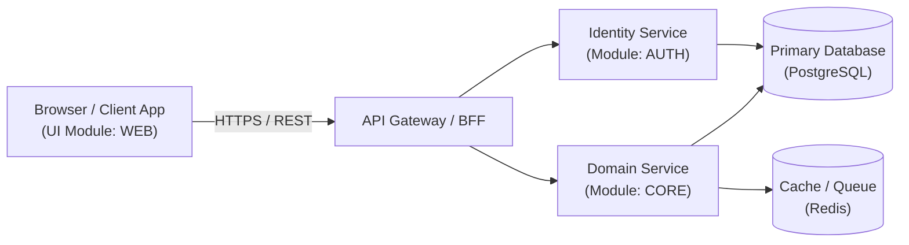

# System Architecture Blueprint (`ARCHITECTURE.md`): <Project Name>

> **Generated via `/ntc-init` (Step 1 — Interactive Discovery & Requirements Refinement)**  
> This document defines the technical topology, tech stack, service/module boundaries, data ownership, and infrastructure constraints aligned with `PRD.md`.  
> Together with `PRD.md`, it guides **Step 2 (`/ntc-prototype`)** and **Step 3 (`/ntc-spec`)**.

- **Architecture Style:** `Modular Monolith | Microservices | Event-Driven | Clean/Hexagonal`
- **Repository Strategy:** `Monorepo | Polyrepo`
- **Repository Remote (`origin`):** `<https://github.com/org/repo.git | Local-Only>`
- **Document Status:** `DRAFT | APPROVED`

---

## 1. High-Level System Topology

## 2. Technology Stack Matrix

| Layer | Selected Technology | Version / Runtime | Rationale & Constraints |
| :--- | :--- | :--- | :--- |
| **Frontend / UI** | (e.g., Next.js / React / Vue / Tailwind CSS / None) | | Must support 1:1 porting from `docs/prototypes/` with `data-testid` |
| **Backend Runtime** | (e.g., Node.js TypeScript / Python FastAPI / Go / Rust) | | |
| **Primary Database** | (e.g., PostgreSQL / MySQL / SQLite) | | Strict per-module table/schema ownership |
| **Cache / Messaging** | (e.g., Redis / RabbitMQ / Kafka / In-Memory) | | |
| **Testing & E2E** | (e.g., Vitest / Pytest + Playwright for Full-Stack E2E) | | Required for Task `.3` proofs and `SYS-P<FINAL>` E2E gate |
| **Local Dev & Infra** | (e.g., Docker Compose / Turborepo / Makefile) | | Managed by reserved `SYS` (`system`) module |

## 3. Candidate Service / Module Decomposition

> **Rule:** The pseudo-module `SYS` (`system`) is strictly reserved for shared contracts, local infrastructure orchestration (`docker-compose`), opening foundation (`SYS-P01`), and closing Full-Stack E2E verification (`SYS-P<FINAL>`). No module may query another module's database tables directly.

| Module Code | Module Slug | Code Root | Core Responsibility | Owned Data / Tables | Exposed Interfaces |
| :--- | :--- | :--- | :--- | :--- | :--- |
| `SYS` | `system` | `packages/contracts/` | Shared schemas, infra, gateway, E2E test suite | — | Shared Contract Packages |
| `AUTH` | `auth` | `services/auth/` | Authentication, JWT issuance, RBAC verification | `users`, `sessions` | `CT-AUTH-01` (REST/gRPC) |
| `WEB` | `web` | `apps/web/` | User-facing web application | Browser state only | `SCR-WEB-01..NN` |

## 4. Data Ownership, Security & Non-Functional Constraints
- **Data Isolation:** Each backend module owns its dedicated schema/tables. Cross-module data exchange occurs exclusively via registered contracts (`CT-<PROVIDER>-<NN>`).
- **Authentication & Authorization:** (e.g., Bearer JWT with short-lived access tokens and HTTP-only refresh cookies).
- **Performance Targets:** (e.g., API p95 < 200ms, UI initial load < 1.5s).
- **Observability & Error Handling:** Structured JSON logs, correlation IDs (`X-Request-ID`), standardized error envelopes.

## 5. Technical Risks & Architectural Decisions
| Risk / Decision Area | Chosen Approach | Mitigation / Fallback |
| :--- | :--- | :--- |
| Cross-module contract drift | Contract-First (`CT-*` codified in `SYS-P01` before domain logic) | Validated via `python scripts/validate_plans.py` |
| UI implementation drift | Interactive HTML prototypes (`SCR-*`) locked in Step 2 with `data-testid` | Enforced 1:1 in Gate 5 + Playwright E2E in `SYS-P<FINAL>` |
