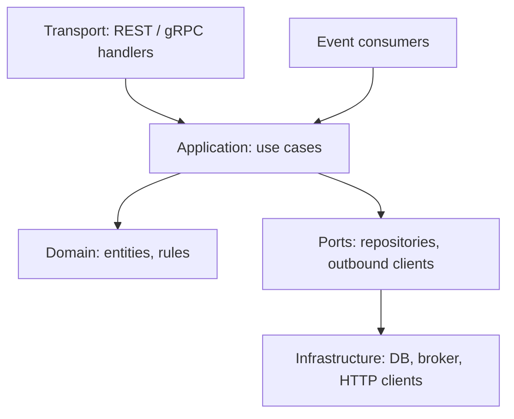
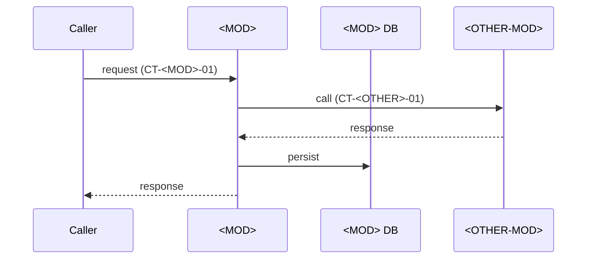

# Module Blueprint: <MOD> - <Module Name>

> **Module Code:** `<MOD>`  
> **Slug:** `<module-slug>` (this file: `docs/plans/modules/<module-slug>.md`)  
> **Code Root:** `services/<module-slug>/`  
> **Project Roadmap:** `docs/plans/system-roadmap.md#2-module-registry`  
> **Contract Registry:** `docs/plans/contract-registry.md`  
> **Status:** PLANNED | BLUEPRINT_REVIEW | READY | IN_PROGRESS | COMPLETED  
> **Last Updated:** YYYY-MM-DD HH:MM  

<!--
STRUCTURE INVARIANTS (checked by scripts/validate-plans.ps1):
- Keep the heading "## 7. Module Phase Sequence" and its table header names.
- Phase IDs: <MOD>-P<NN> using this module's code. Dossier files: phase-<NN>-<slug>.md
- Phase status: PENDING | ACTIVE | BLOCKED | COMPLETED
  ACTIVE    -> dossier must exist in docs/plans/active/<module-slug>/
  COMPLETED -> dossier must exist in docs/plans/completed/<module-slug>/
- This blueprint must not contradict the Project Roadmap or the Contract Registry.
-->

---

## 1. Module Charter
- **Responsibility (one sentence):**
- **Bounded Context / Ubiquitous Language:**
- **In-Scope:**
  - [ ] Capability A
- **Out-of-Scope (owned elsewhere):**
  - Capability X → `<OTHER-MOD>`

## 2. Tech Stack & Runtime
- **Language / Runtime:**
- **Frameworks & Libraries:**
- **Storage:**
- **Build / Test Commands:** `...` *(used as Executable Proof in dossiers)*

## 3. Internal Architecture

## 4. Data Ownership
| Entity / Table | Key Attributes | Storage | Notes |
| :--- | :--- | :--- | :--- |
| `Entity` | id, ... | PostgreSQL | Other modules never access this directly. |

## 5. Interfaces
### 5.1 Provided Contracts
| Contract ID | Type | Purpose | Consumers |
| :--- | :--- | :--- | :--- |
| `CT-<MOD>-01` | REST | ... | `SYS` |

### 5.2 Consumed Contracts
| Contract ID | Provider | Purpose | Required By Phase |
| :--- | :--- | :--- | :--- |
| `CT-<OTHER>-01` | `<OTHER>` | ... | `<MOD>-P02` |

### 5.3 Events
- **Published:** `...` (`CT-<MOD>-NN`)
- **Subscribed:** `...` (`CT-<OTHER>-NN`)

## 6. Core Flows
### Flow 1: <Flow Name>

- **Business invariants:**
- **Failure handling:** (timeouts, retries, idempotency, compensation)

## 7. Module Phase Sequence

| Phase | Title | Objective | Aligns to GP | Depends On | Dossier | Status |
| :--- | :--- | :--- | :--- | :--- | :--- | :--- |
| `<MOD>-P01` | Contracts & Schema | Codify provided contracts, storage schema, config | `GP-01` | — | `docs/plans/active/<module-slug>/phase-01-contracts-and-schema.md` | `ACTIVE` |
| `<MOD>-P02` | Core Domain Logic | Use cases and domain rules | `GP-02` | `<MOD>-P01`, `CT-<OTHER>-01` | — | `PENDING` |
| `<MOD>-P03` | Integrations | Outbound clients, events | `GP-03` | `<MOD>-P02` | — | `PENDING` |

## 8. Module Invariants & Non-Functional Requirements
- **Performance:**
- **Security:**
- **Resilience:**
- **Observability:**

## 9. Risks & Open Questions
- 
