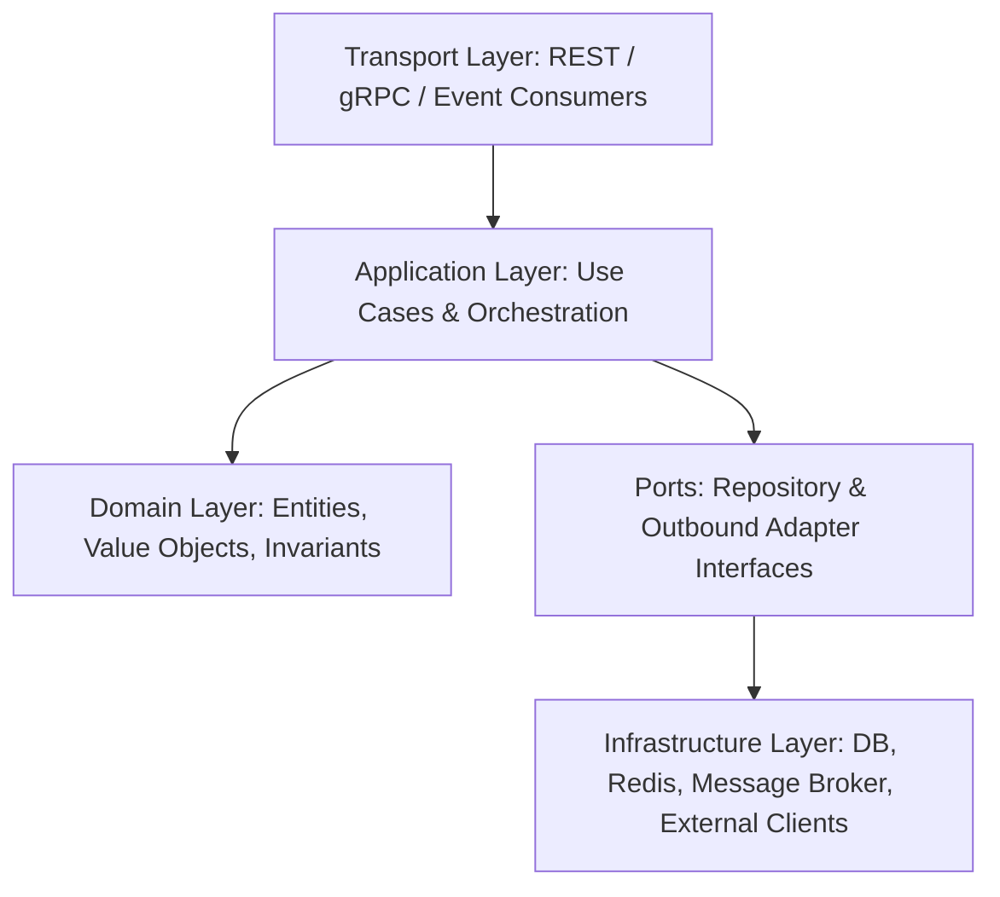
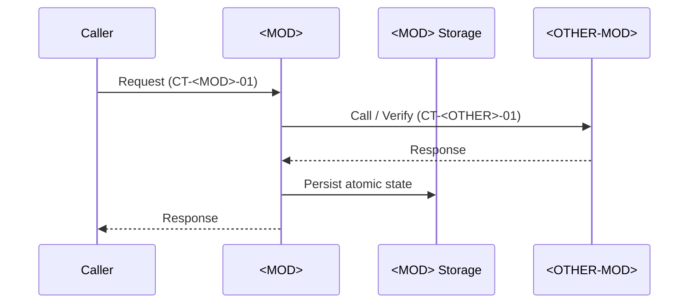

# Detailed Module Specification: <MOD> - <Module Name>

> **Module Code:** `<MOD>`  
> **Slug:** `<module-slug>` (this file: `docs/modules-spec/<module-slug>.md`)  
> **Code Root:** `services/<module-slug>/`  
> **Root SPEC Authority:** `SPEC.md` (§...)  
> **Project Roadmap:** `docs/plans/system-roadmap.md#2-module-registry`  
> **Contract Registry:** `docs/plans/contract-registry.md`  
> **UI Prototype Registry:** `docs/prototypes/registry.md` (`UI Module: YES | NO`)  
> **Skill Map Reference:** `ai-skill-maps.md`  
> **Status:** PLANNED | SPEC_REVIEW | READY | IN_PROGRESS | COMPLETED  
> **Last Updated:** YYYY-MM-DD HH:MM  

<!--
STRUCTURE INVARIANTS (checked by scripts/validate_plans.py):
- Keep the heading "## 9. Module Phase Sequence" and its table header names: Phase | Title | Objective | Aligns to GP | Depends On | Dossier | Status
- Phase IDs: <MOD>-P<NN> using this module's code. Dossier files: phase-<NN>-<slug>.md
- Phase status: PENDING | ACTIVE | BLOCKED | COMPLETED
  ACTIVE / PENDING (with dossier) -> dossier exists in docs/plans/active/<module-slug>/
  COMPLETED                       -> dossier exists in docs/plans/completed/<module-slug>/
- This module specification must never contradict SPEC.md, the Project Roadmap, or the Contract Registry.
-->

---

## 1. Traceability & Scope Boundaries
- **Root `SPEC.md` Traceability:** Implements `SPEC.md` sections `§...`
- **Single-Sentence Responsibility:**
- **Bounded Context / Ubiquitous Language:**
- **In-Scope (Owned by `<MOD>`):**
  - [ ] Core capability A
  - [ ] Core capability B
- **Out-of-Scope (Strictly Owned Elsewhere):**
  - Capability X → owned by `<OTHER-MOD>` (`docs/modules-spec/<other-slug>.md`)

---

## 2. User Stories
- **US-<MOD>-01:** As a **[Role / Caller Service]**, I want **[Action / Capability]**, so that **[Observable Value / Outcome]**.
- **US-<MOD>-02:** As a **[Role / Caller Service]**, I want **[Action / Capability]**, so that **[Observable Value / Outcome]**.

---

## 3. Tech Stack, Runtime & Internal Architecture
- **Language & Runtime:**
- **Frameworks & Key Libraries:**
- **Storage & Caching Engines:**
- **Executable Proof Commands (Build / Test / Lint):** `...` *(used in Phase Dossiers)*

---

## 4. Domain Data Models & Storage Schema
*(Exact database tables/collections, columns, types, constraints, partitioning, indexes, and Redis key patterns owned by `<MOD>`. Other modules must NEVER access this storage directly.)*

| Table / Key Pattern | Engine | Columns / Structure & Constraints | Indexes / Partitioning / TTL |
| :--- | :--- | :--- | :--- |
| `table_name` | PostgreSQL | `id UUID PK`, `status VARCHAR(32) NOT NULL`, `created_at TIMESTAMPTZ` | `idx_table_status` |
| `<slug>:{id}:lock` | Redis | Fencing / lease value | TTL `300s` |

---

## 5. Interfaces & Cross-Module Contracts

### 5.1 Provided Contracts
| Contract ID | Type | Endpoint / Topic / Package | Purpose | Consumers |
| :--- | :--- | :--- | :--- | :--- |
| `CT-<MOD>-01` | REST | `POST /api/v1/...` | ... | `SYS` |

### 5.2 Consumed Contracts
| Contract ID | Provider | Endpoint / Topic / Package | Purpose | Required By Phase |
| :--- | :--- | :--- | :--- | :--- |
| `CT-<OTHER>-01` | `<OTHER>` | `...` | ... | `<MOD>-P02` |

### 5.3 Input / Output Validation & Payload Rules
- **Request / Event Schemas:**
- **Idempotency & Concurrency Rules (e.g., Fencing Tokens / Unique Keys):**

### 5.4 UI Screen & Prototype Mapping (For UI / Frontend Modules Only)
*(If this is a headless/backend module, write `N/A — Headless Backend Module`. If this is a UI module, every screen MUST map to an `APPROVED` prototype in `docs/prototypes/registry.md`, and Gate 5 components MUST port its DOM, classes, states, and `data-testid` anchors 1:1.)*

| Screen ID | Screen Name | Approved Prototype Path | Consumed Contracts | Required UI States & `data-testid` Anchors |
| :--- | :--- | :--- | :--- | :--- |
| `SCR-<MOD>-01` | ... | `docs/prototypes/<module-slug>/scr-01-....html` | `CT-<OTHER>-01` | `default, loading, empty, error`; `data-testid="scr-01-..."` |

---

## 6. Core Business Flows, State Machine & Edge Cases

### 6.1 Sequence Flow: <Flow Name>

### 6.2 State Machine / Transition Rules
| Entity | From State | Event / Trigger | Guard Condition | To State | Side Effects / Emitted Events |
| :--- | :--- | :--- | :--- | :--- | :--- |
| `Entity` | `CREATED` | `submit` | Valid payload & active lease | `COMPLETED` | Emit `CT-<MOD>-02` |

### 6.3 Edge Cases, Timeouts & Compensation
- **Edge Case 1:**
- **Retry / Dead-Letter / Rollback Strategy:**

---

## 7. Stage-by-Stage Acceptance Criteria (Given / When / Then)

### Stage A: Contracts & Storage Schema (`<MOD>-P01`)
- **AC-<MOD>-01:**
  - **Given:** ...
  - **When:** ...
  - **Then:** ...

### Stage B: Core Domain Logic (`<MOD>-P02`)
- **AC-<MOD>-02:**
  - **Given:** ...
  - **When:** ...
  - **Then:** ...

### Stage C: Integration & Edge Cases (`<MOD>-P03`)
- **AC-<MOD>-03:**
  - **Given:** ...
  - **When:** ...
  - **Then:** ...

---

## 8. Non-Functional Requirements & Error Codes

- **Performance & Latency Targets:** (e.g., p95 < 100ms)
- **Security & Authorization:** (e.g., JWT verification, RBAC role guards)
- **Observability:** (Structured logs, metrics, healthcheck endpoints)

| Error Code | HTTP / gRPC Status | Trigger Condition | Client / Consumer Action |
| :--- | :--- | :--- | :--- |
| `<MOD>_INVALID_INPUT` | `400 Bad Request` | Schema validation fails | Fix request payload |
| `<MOD>_CONFLICT` | `409 Conflict` | Stale version / duplicate key | Refresh state and retry |

---

## 9. Module Phase Sequence

*(All Phase Dossiers listed below MUST be pre-generated in `docs/plans/active/<module-slug>/` during Gate 4 before any Gate 5 code implementation begins.)*

| Phase | Title | Objective | Aligns to GP | Depends On | Dossier | Status |
| :--- | :--- | :--- | :--- | :--- | :--- | :--- |
| `<MOD>-P01` | Contracts & Schema | Codify provided contracts, DB migrations, DTOs | `GP-01` | — | `docs/plans/active/<module-slug>/phase-01-contracts-and-schema.md` | `ACTIVE` |
| `<MOD>-P02` | Core Domain Logic | Implement use cases, state machine, and unit tests | `GP-02` | `<MOD>-P01`, `CT-<OTHER>-01` | `docs/plans/active/<module-slug>/phase-02-core-domain-logic.md` | `PENDING` |
| `<MOD>-P03` | Integrations & Hardening | Outbound adapters, event handlers, integration tests | `GP-03` | `<MOD>-P02` | `docs/plans/active/<module-slug>/phase-03-integrations.md` | `PENDING` |
