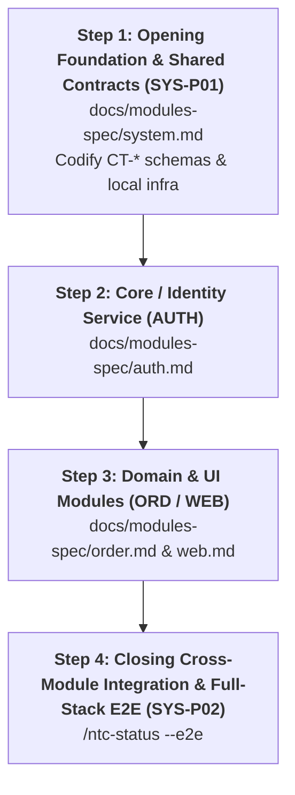

# Step-by-Step Operator Playbook (`STEP-by-STEP.md`)

> ⚠️ **HUMAN ARCHITECT PLAYBOOK ONLY — AI AGENTS MUST NOT READ THIS FILE**  
> This document is generated at the end of **Step 4 (`/ntc-modules --approve`)** strictly for the **Human Architect (User)** to read and run `/ntc-*` slash commands (or copy-paste prompts) so the project advances in the exact order required by the NTC Micro-Harness protocol.  
> **AI Agents:** Do NOT read or ingest `STEP-by-STEP.md`. Your authoritative sources are `PRD.md`, `ARCHITECTURE.md`, `SPEC.md`, `AGENTS.md`, `docs/plans/system-roadmap.md`, `docs/plans/contract-registry.md`, `docs/prototypes/registry.md`, `ai-skill-maps.md`, `docs/modules-spec/<slug>.md`, and `docs/plans/active/<slug>/phase-*.md`.

---

## 1. Quick Slash Command Cheat Sheet (`/ntc-*` Plugin)

| Step | Slash Command | Flags / Options | Purpose |
| :--- | :--- | :--- | :--- |
| **Step 1** | **`/ntc-init`** | `--repo <git-url>` `--idea "..."` `--no-ui` | Connect Git remote `origin` (optional), answer 3–5 clarifying questions, and generate `PRD.md` + `ARCHITECTURE.md`. |
| **Step 2** | **`/ntc-prototype`** | `--screen <SCR-ID>` `--revise "..."` `--approve` | Generate & refine interactive HTML/CSS prototypes (`docs/prototypes/`) from `PRD` + `ARCHITECTURE` until locked (`APPROVED`). |
| **Step 3** | **`/ntc-spec`** | `--skills-from "<url>"` `--approve` | Lock overall `SPEC.md` + `system-roadmap.md` + `contract-registry.md`, then map & install module AI skills into `ai-skill-maps.md`. |
| **Step 4** | **`/ntc-modules`** | `--module <MOD>` `--approve` | Use `SPEC.md` + `ai-skill-maps.md` + `Prototypes` to generate detailed `docs/modules-spec/<slug>.md` for every module & `STEP-by-STEP.md`. |
| **Step 5** | **`/ntc-plan`** | `--module <MOD>` `--verify` | Pre-generate 100% of Phase Dossiers (`docs/plans/active/<slug>/phase-*.md`) with Level-4 Atomic WBS across all modules. |
| **Step 6** | **`/ntc-run`** | `--module <MOD>` `--phase <MOD>-P<NN>` | Execute 1 Atomic Task (`1 Turn = 1 Task`) with 1:1 UI parity, test proof, `🎫 Resume Ticket` update, and Atomic Git Commit. |
| **Delta CR** | **`/ntc-cr`** | `"<change description>"` `--approve-delta` | Trigger the 4-Step Delta Reverse-Unlock Protocol (`CR-<NN>`) when adding/changing features or screens mid-project. |
| **Status / E2E** | **`/ntc-status`** | `--fix` `--e2e` | Validate & auto-sync plans (`validate_plans.py --fix`) or trigger the closing `SYS-P<FINAL>` Full-Stack E2E verification (`--e2e`). |

---

## 2. Implementation Dependency Flow

Execute modules in the dependency order below so that every provider contract (`CT-*`) is codified and `AVAILABLE` before consumer modules execute:



---

## 3. Step 5 (Gate 4): Pre-Generate ALL Phase Dossiers (`/ntc-plan`)

> **Rule Reminder:** Before writing any production code in Step 6 (`/ntc-run`), **all Phase Dossiers (`docs/plans/active/<slug>/phase-<NN>-<slug>.md`) for all modules in the project** must be generated and validated first.

### ⚡ Option 1: Using Plugin Slash Commands (Recommended)
```text
/ntc-plan --module SYS
/ntc-plan --module <MOD>
/ntc-plan --verify
```

### 📋 Option 2: Full Copy-Paste Prompt — Module `<MOD>` (`<module-slug>`)
```text
Thực hiện Step 5 / Gate 4 (/ntc-plan — Pre-Generate Phase Dossiers & WBS) cho Module <MOD> (<module-slug>).
Căn cứ vào:
- @AGENTS.md và @docs/WORKFLOW.md
- @ai-skill-maps.md (BẮT BUỘC đọc và áp dụng các skill: `atomic-harness-gatekeeper`, `<project>-domain-invariants`, `<module-skills>`)
- @docs/modules-spec/<module-slug>.md (Mục 9: Module Phase Sequence & Mục 5.4: UI Screen Mapping nếu có)
- @docs/plans/contract-registry.md và @docs/prototypes/registry.md (nếu module có giao diện UI)

Hãy khởi tạo TOÀN BỘ các file Phase Dossiers của module `<module-slug>` tại `docs/plans/active/<module-slug>/phase-<NN>-<slug>.md` (từ `docs/templates/phase-dossier-template.md`) và phân rã chi tiết từng Major Task thành các Atomic Tasks (Level 4: `.1` Contract/Schema -> `.2` Implementation -> `.3` Unit Test/Verification).
Nếu là module UI, mỗi Atomic Task giao diện BẮT BUỘC điền rõ `UI Prototype Reference: SCR-<MOD>-<NN>` trỏ tới file `.html` đã chốt trong `docs/prototypes/<module-slug>/`.
Chỉ đặt `Lifecycle Status: READY_TO_EXECUTE` cho Phase 01 và `PENDING` cho các Phase kế tiếp.
Sau khi tạo xong, chạy `python scripts/validate_plans.py --fix` và dừng lại báo cáo bảng WBS để tôi duyệt. Chưa viết code sản phẩm.
```

---

## 4. Step 6 (Gate 5): Atomic Implementation per Module (`/ntc-run` / `"tiếp tục"`)

Once **all** Phase Dossiers for **all** modules are generated and approved in Step 5, start Step 6 using either **Slash Commands (`/ntc-run`)**, **Standard Multi-Tab Prompts**, or **Isolated Git Worktree Mode**.

### Step 4.1: Execute Opening Foundation Module `SYS` (`SYS-P01`)
```text
/ntc-run --module SYS
```
*(Or type `"tiếp tục SYS"` for each subsequent Atomic Task until `SYS-P01` finishes).*

### Step 4.2: Execute Domain / UI Module `<MOD>` (`<module-slug>`)

#### ⚡ Using Slash Command
```text
/ntc-run --module <MOD>
```

#### 🌿 Isolated Git Worktree Prompt (Parallel Multi-Agent Mode)
```text
Tôi muốn triển khai Module <MOD> (`<module-slug>`) độc lập trên một Git Worktree riêng biệt.
1. Tạo git worktree tại `../<project>-<module-slug>` trên nhánh `feat/<module-slug>` tách từ `main`:
   `git worktree add ../<project>-<module-slug> -b feat/<module-slug> main`
2. Áp dụng @AGENTS.md và @ai-skill-maps.md (`using-git-worktrees`, `atomic-harness-gatekeeper`, `<module-skills>`).
3. Chạy `/ntc-run --module <MOD>` để thực thi DUY NHẤT Atomic Task đầu tiên (`<MOD>-P01.1.1`), kiểm thử, cập nhật `🎫 Resume Ticket`, và tạo Atomic Git Commit checkpoint.
```

### Step 4.3: Closing `SYS` Cross-Module Integration & Full-Stack E2E Gate (`SYS-P<FINAL>`)
*(Run ONLY after all domain and UI module phases are archived in `docs/plans/completed/<slug>/`)*:
```text
/ntc-status --e2e
```

---

## 5. Cheat Sheet Điều Khiển Vòng Lặp Step 6 & Yêu Cầu Thay Đổi Giữa Chừng

| Tình huống | Lệnh `/ntc-*` hoặc Câu lệnh tự nhiên | Hành động tự động của Agent |
| :--- | :--- | :--- |
| **1. Chạy Atomic Task tiếp theo trong cùng Phase** | **`/ntc-run`** *(hoặc `tiếp tục` / `tiếp tục <MOD>`)* | - Đối soát `git status` / `git diff HEAD` để phục hồi nếu phiên trước bị ngắt (Crash Recovery).<br>- Thực thi **đúng 1 Atomic Task chưa làm (`[ ]`) tuần tự kế tiếp** (kèm port 1:1 UI Prototype nếu là task UI).<br>- Chạy test, tick `[x]`, cập nhật `🎫 Resume Ticket`, chạy `validate_plans.py --fix` và **tự động `git commit` tạo điểm lui an toàn**. |
| **2. Chuyển sang Phase kế tiếp khi Phase hiện tại đã hết task** | **`/ntc-run --phase <MOD>-P02`** *(hoặc `tiếp tục phase <MOD>-P02`)* | - Tự động chuyển hồ sơ `phase-01-*.md` sang `docs/plans/completed/<module-slug>/`.<br>- Chạy `python scripts/validate_plans.py --fix` đồng bộ trạng thái.<br>- Kích hoạt `phase-02-*.md`, **thực thi luôn Atomic Task đầu tiên (`<MOD>-P02.1.1`)** và tạo `git commit` checkpoint! |
| **3. Thêm tính năng mới / sửa luồng / thêm màn hình UI giữa chừng (Change Request)** | **`/ntc-cr "<mô tả thay đổi>"`** *(hoặc `yêu cầu thay đổi: <mô tả>`)* | - Tạm dừng code Step 6, cấp mã `CR-<NN>` vào `docs/plans/system-roadmap.md` (`## 6. Change Request (CR) Log`) và phân tích phạm vi ảnh hưởng (Delta Blast Radius).<br>- Cập nhật trước UI Prototype (`SCR-*`) để bạn duyệt (`--approve-delta`) và cập nhật Contract (`CT-*`).<br>- Bổ sung phần thay đổi (Delta) vào `SPEC.md` + `docs/modules-spec/<slug>.md` và nối thêm Major/Atomic Tasks vào hồ sơ pha đang mở (hoặc tạo hồ sơ Delta Phase mới `phase-<NN+1>-cr-<nn>-*.md` — **không sửa hồ sơ đã `completed/`**).<br>- Chạy `python scripts/validate_plans.py --fix`, commit kế hoạch Delta và sẵn sàng để bạn gõ `/ntc-run`! |
