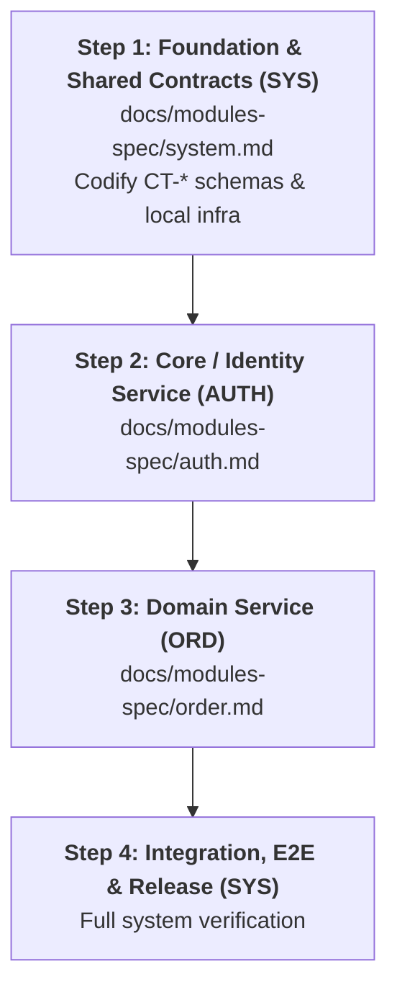

# Step-by-Step Operator Playbook (`STEP-by-STEP.md`)

> ⚠️ **HUMAN ARCHITECT PLAYBOOK ONLY — AI AGENTS MUST NOT READ THIS FILE**  
> This document is generated at the end of **Gate 3 (Step 3.3)** strictly for the **Human Architect (User)** to read and copy-paste prompts from so the project advances in the exact order required by the Harness protocol.  
> **AI Agents:** Do NOT read or ingest `STEP-by-STEP.md`. Your authoritative sources are `SPEC.md`, `AGENTS.md`, `docs/plans/system-roadmap.md`, `docs/plans/contract-registry.md`, `docs/modules-spec/<slug>.md`, `ai-skill-maps.md`, and `docs/plans/active/<slug>/phase-*.md`.

---

## 1. Implementation Dependency Flow

Execute modules in the dependency order below so that every provider contract (`CT-*`) is codified and `AVAILABLE` before consumer modules execute:



---

## 2. Gate 4 Prompts: Pre-Generate ALL Phase Dossiers (All Modules)

> **Rule Reminder:** Before writing any production code in Gate 5, **all Phase Dossiers (`docs/plans/active/<slug>/phase-<NN>-<slug>.md`) for all modules in the project** must be generated and validated first.
> Copy-paste the prompts below sequentially (or per module) to complete Gate 4.

### 2.1 Gate 4 Prompt — Module `SYS` (`system`)
```text
Thực hiện Gate 4 (Pre-Generate Phase Dossiers & WBS) cho Module SYS (system).
Căn cứ vào:
- @AGENTS.md và @docs/WORKFLOW.md
- @ai-skill-maps.md (BẮT BUỘC đọc và áp dụng các skill: `atomic-harness-gatekeeper`, `<project>-domain-invariants`, `<sys-skills>`)
- @docs/modules-spec/system.md (Mục 9: Module Phase Sequence)
- @docs/plans/contract-registry.md

Hãy khởi tạo TOÀN BỘ các file Phase Dossiers của module `system` tại `docs/plans/active/system/phase-<NN>-<slug>.md` (từ `docs/templates/phase-dossier-template.md`) và phân rã chi tiết từng Major Task thành các Atomic Tasks (Level 4: `.1` Contract/Schema -> `.2` Implementation -> `.3` Unit Test/Verification).
Sau khi tạo xong, chạy `python scripts/validate_plans.py --fix` và dừng lại báo cáo bảng WBS để tôi duyệt. Chưa viết code sản phẩm.
```

### 2.2 Gate 4 Prompt — Module `<MOD>` (`<module-slug>`)
```text
Thực hiện Gate 4 (Pre-Generate Phase Dossiers & WBS) cho Module <MOD> (<module-slug>).
Căn cứ vào:
- @AGENTS.md và @docs/WORKFLOW.md
- @ai-skill-maps.md (BẮT BUỘC đọc và áp dụng các skill: `atomic-harness-gatekeeper`, `<project>-domain-invariants`, `<module-skills>`)
- @docs/modules-spec/<module-slug>.md (Mục 9: Module Phase Sequence & Mục 5.4: UI Screen Mapping nếu có)
- @docs/plans/contract-registry.md và @docs/prototypes/registry.md (nếu module có giao diện UI)

Hãy khởi tạo TOÀN BỘ các file Phase Dossiers của module `<module-slug>` tại `docs/plans/active/<module-slug>/phase-<NN>-<slug>.md` (từ `docs/templates/phase-dossier-template.md`) và phân rã chi tiết từng Major Task thành các Atomic Tasks (Level 4: `.1` Contract/Schema -> `.2` Implementation -> `.3` Unit Test/Verification).
Nếu là module UI, mỗi Atomic Task giao diện BẮT BUỘC điền rõ `UI Prototype Reference: SCR-<MOD>-<NN>` trỏ tới file `.html` đã chốt trong `docs/prototypes/<module-slug>/`.
Chỉ đặt `Lifecycle Status: READY_TO_EXECUTE` cho Phase 01 và `PENDING` cho các Phase kế tiếp.
Sau khi tạo xong, chạy `python scripts/validate_plans.py --fix` và dừng lại báo cáo bảng WBS để tôi duyệt. Chưa viết code sản phẩm.
```

*(Repeat for all remaining modules until `python scripts/validate_plans.py` confirms 100% of planned phases across all modules have dossiers in `docs/plans/active/`.)*

---

## 3. Gate 5 Prompts: Atomic Implementation per Module (Standard & Multi-Agent Worktree)

Once **all** Phase Dossiers for **all** modules are generated and approved in Gate 4, start Gate 5 using either **Option A (Standard Workspace / Multi-Tab)** or **Option B (Isolated Git Worktree for Parallel Agents)**.

### Step 1: Execute Module `SYS` (`system` — Foundation & Shared Contracts)

#### 📋 Option A: Standard Workspace Prompt
```text
Bắt đầu Gate 5 (Atomic Implementation) cho Module SYS (`system`), Phase `SYS-P01`.
Căn cứ vào:
- @AGENTS.md (Quy tắc 1 Turn = 1 Atomic Task, Contract-First, No-Stubbing)
- @ai-skill-maps.md (BẮT BUỘC kích hoạt: `atomic-harness-gatekeeper`, `<sys-skills>`)
- @docs/modules-spec/system.md
- @docs/plans/active/system/phase-01-<slug>.md

Hãy kích hoạt Phase `SYS-P01` và thực thi DUY NHẤT Atomic Task đầu tiên (`SYS-P01.1.1`).
Chạy kiểm chứng thực tế (Executable Proof), tick `[x]`, cập nhật `🎫 Resume Ticket` và dừng lại báo cáo.
```

---

### Step 2: Execute Module `<MOD>` (`<module-slug>`)

#### 📋 Option A: Standard Multi-Tab Prompt (Shared Workspace)
```text
Tôi muốn bắt đầu triển khai Gate 5 cho Module <MOD> (`<module-slug>`) độc lập ở tab này, bắt đầu từ Phase `<MOD>-P01`.
Căn cứ vào:
- @AGENTS.md (Chỉ tạo/sửa code trong `<code-root>` và hồ sơ trong `docs/plans/active/<module-slug>/`; 1 Turn = 1 Atomic Task; Bảo toàn 1:1 UI Prototype nếu là task UI)
- @ai-skill-maps.md (BẮT BUỘC đọc và áp dụng các skill: `atomic-harness-gatekeeper`, `<project>-domain-invariants`, `<module-skills>`)
- @docs/plans/contract-registry.md (các hợp đồng phụ thuộc đã AVAILABLE) và @docs/prototypes/registry.md (nếu module có UI: BẮT BUỘC đọc file `.html` prototype của `SCR-<MOD>-<NN>`, giữ nguyên 100% cấu trúc DOM, class/tokens, các trạng thái UI và `data-testid`)
- @docs/modules-spec/<module-slug>.md
- @docs/plans/active/<module-slug>/phase-01-<slug>.md

Hãy kích hoạt Phase `<MOD>-P01` và thực thi DUY NHẤT Atomic Task đầu tiên (`<MOD>-P01.1.1`).
Chạy test chứng minh (Executable Proof), tick `[x]`, cập nhật `🎫 Resume Ticket` và dừng lại báo cáo.
```

#### 🌿 Option B: Isolated Git Worktree Prompt (Parallel Multi-Agent Mode)
```text
Tôi muốn triển khai Module <MOD> (`<module-slug>`) độc lập trên một Git Worktree riêng biệt.

A. Thiết lập Không gian làm việc Cô lập (Worktree):
- Kiểm tra và tạo git worktree tại `../<project>-<module-slug>` trên nhánh mới `feat/<module-slug>` tách từ `main`:
  `git worktree add ../<project>-<module-slug> -b feat/<module-slug> main`
- Mọi thao tác tạo/sửa file chỉ được thực hiện bên trong worktree này, giới hạn trong `<code-root>` và `docs/plans/active/<module-slug>/`.

B. Căn cứ Kỹ thuật & Kỹ năng Bắt buộc:
- @AGENTS.md (1 Turn = 1 Atomic Task, 1:1 UI Prototype Parity, Crash Recovery, Phase Boundary Hard Stop)
- @ai-skill-maps.md (BẮT BUỘC đọc và áp dụng: `using-git-worktrees`, `atomic-harness-gatekeeper`, `<project>-domain-invariants`, `<module-skills>`)
- @docs/plans/contract-registry.md và @docs/prototypes/registry.md (nếu module có UI: BẮT BUỘC đọc file `.html` prototype của `SCR-<MOD>-<NN>` và chuyển đổi 1:1 DOM/styles/`data-testid`)
- @docs/modules-spec/<module-slug>.md
- @docs/plans/active/<module-slug>/phase-01-<slug>.md

C. Thực thi:
- Kích hoạt Phase `<MOD>-P01` và thực thi DUY NHẤT Atomic Task đầu tiên (`<MOD>-P01.1.1`), chạy test chứng minh và cập nhật `🎫 Resume Ticket`.

D. Nghiệm thu & Merge về Main (Khi hoàn thành toàn bộ các Phase của Module <MOD>):
- Chạy full test suite của module, chạy `python scripts/validate_plans.py --fix`, commit gọn gàng, merge `feat/<module-slug>` vào `main` và xóa worktree.
```

---

## 4. Cheat Sheet Điều Khiển Vòng Lặp Thực Thi Gate 5 (Dành cho Người dùng)

Sau khi đã phát lệnh bắt đầu Phase 01 của một Module ở Mục 3, bạn chỉ cần dùng **2 câu lệnh siêu ngắn** dưới đây để điều khiển Agent cho đến khi xong toàn bộ dự án:

| Tình huống | Câu lệnh bạn nhập | Hành động tự động của Agent |
| :--- | :--- | :--- |
| **1. Chạy các Atomic Task tiếp theo trong cùng Phase** | `tiếp tục` *(hoặc `tiếp tục <MOD>`)* | - Kiểm tra phục hồi nếu phiên trước bị tắt đột ngột (Crash Recovery).<br>- Thực thi **đúng 1 Atomic Task chưa làm (`[ ]`) tuần tự kế tiếp**.<br>- Chạy test, tick `[x]`, cập nhật `🎫 Resume Ticket` và dừng lại. |
| **2. Khi hoàn thành Atomic Task cuối cùng của Phase `<MOD>-P01`** | *(Ở cuối turn của task cuối, Agent tự báo hết task Phase P01)*<br>Nếu bạn vẫn gõ `tiếp tục` ➔ **Agent sẽ từ chối và nhắc chuyển phase!** | Bạn nhập:<br>**`tiếp tục phase <MOD>-P02`** | - Tự động chuyển hồ sơ `phase-01-*.md` sang `docs/plans/completed/<module-slug>/`.<br>- Chạy `python scripts/validate_plans.py --fix` đồng bộ trạng thái.<br>- Kích hoạt `phase-02-*.md` và **thực thi luôn Atomic Task đầu tiên (`<MOD>-P02.1.1`)**! |
| **3. Sau đó trong Phase `<MOD>-P02`** | `tiếp tục` | Lặp lại quy trình chạy từng Atomic Task của Phase 02 cho đến hết. |
