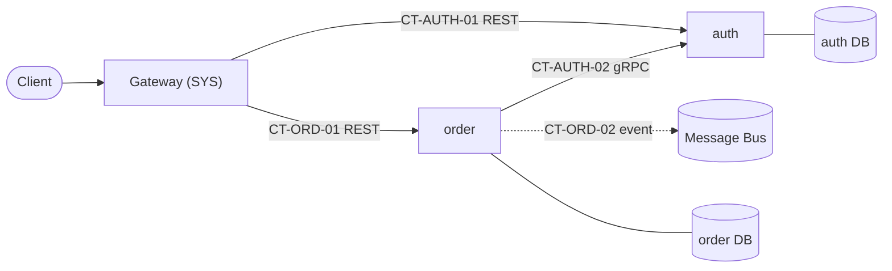
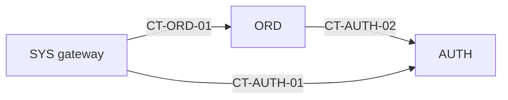

# Project Roadmap: <Project Name>

> **Status:** APPROVED | IN_REVIEW | DRAFT  
> **Authority:** Derived from `SPEC.md` and approved by Human Architect.  
> **Contract Registry:** `docs/plans/contract-registry.md`  
> **Last Synchronized:** YYYY-MM-DD  

<!--
STRUCTURE INVARIANTS (checked by scripts/validate-plans.ps1):
- Keep the section headings "## 2. Module Registry", "## 3. Global Phase Sequence", and "## 5. Active Work Pointer".
- Keep table header names unchanged; wrap codes, slugs, IDs, paths, and statuses in backticks.
- Module status:       PLANNED | BLUEPRINT_REVIEW | READY | IN_PROGRESS | COMPLETED
- Global phase status: PENDING | ACTIVE | COMPLETED
-->

---

## 1. System Architecture Blueprint
*(Service map: every module, its data store, and sync/async communication. Label edges with contract IDs.)*

### Architectural Invariants
1. **Database-per-Service:** each module owns its storage; no module reads or writes another module's storage.
2. **Contract-First:** inter-module communication happens only through contracts registered in `docs/plans/contract-registry.md`.
3. **No Cross-Module Imports:** a module never imports another module's source; shared code lives in a `SYS`-owned package declared as a contract.
4. **Dependency Inversion:** domain layers never depend directly on infrastructure, database drivers, or presentation frameworks.
*(Edit to match `SPEC.md`; these are defaults.)*

---

## 2. Module Registry

| Code | Slug | Responsibility | Code Root | Blueprint | Depends On | Status |
| :--- | :--- | :--- | :--- | :--- | :--- | :--- |
| `SYS` | `system` | Cross-cutting: shared contracts package, local orchestration, CI, gateway, E2E tests | `./` | `docs/plans/modules/system.md` | — | `PLANNED` |
| `AUTH` | `auth` | Identity, credentials, token issuance | `services/auth/` | `docs/plans/modules/auth.md` | `SYS` | `IN_PROGRESS` |
| `ORD` | `order` | Order lifecycle | `services/order/` | `docs/plans/modules/order.md` | `SYS`, `AUTH` | `PLANNED` |

---

## 3. Global Phase Sequence
*(Project-level phases, described at a high level. Detailed work lives in each Module Blueprint.)*

| GP | Title | Objective | Participating Module Phases | Exit Criteria | Status |
| :--- | :--- | :--- | :--- | :--- | :--- |
| `GP-01` | Foundation & Contracts | Repo scaffolding, local infra, first contracts codified | `SYS-P01`, `AUTH-P01` | Infra boots; `CT-AUTH-01` `AVAILABLE` | `ACTIVE` |
| `GP-02` | Core Domain Services | Primary business capabilities per service | `AUTH-P02`, `ORD-P01` | Module test suites green | `PENDING` |
| `GP-03` | Integration & Async Flows | Events, workers, cross-service flows | `ORD-P02`, `SYS-P02` | Contract tests green across providers/consumers | `PENDING` |
| `GP-04` | Hardening & Release | E2E, load, security review | `SYS-P03` | E2E + NFR targets met | `PENDING` |

---

## 4. Module Dependency Graph
*(Directed: consumer → provider. Label with contract IDs. Must agree with the Contract Registry.)*

**Recommended build order:** `SYS` → `AUTH` → `ORD`.

---

## 5. Active Work Pointer
<!-- AGENT INVARIANT: update whenever the current stage or focus changes. The table MUST match docs/plans/active/ exactly. -->
- **Current Stage:** Gate 1 | Gate 2 | Gate 3 | Gate 4 | Gate 5
- **Current Focus:** `AUTH` → `docs/plans/active/auth/phase-01-contracts-and-schema.md`
- **Planning Item In Review (Gate 2/3 only):** e.g. `docs/plans/modules/order.md` — `IN_REVIEW`

| Module | Active Dossier | Lifecycle Status |
| :--- | :--- | :--- |
| `AUTH` | `docs/plans/active/auth/phase-01-contracts-and-schema.md` | `IN_PROGRESS` |
